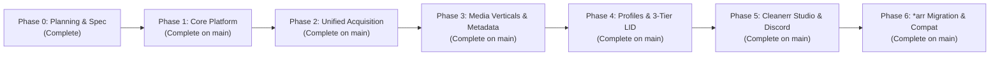

# Managerr: Vision, Scope, and Engineering Roadmap

> **Status:** `v0.2.0` - All core milestones (including Cleanerr Lifecycle Studio & Discord Bot) implemented on `main`  
> **License:** GNU General Public License v3.0 (`GPL-3.0-or-later`)  
> **Stack:** .NET 10 (C# Modular Monolith) + React 19 / TypeScript SPA + ONNX Runtime (Local Language Verification)  
> **Database:** Embedded SQLite (`WAL` + `FTS5` in `/config`): no external PostgreSQL, MariaDB, or Redis required  
> **Task Tracking:** Tracked in the project's issue tracker.

---

## 1. Executive Vision

**Managerr** is a self-hosted media automation and lifecycle platform that replaces the separate `*arr` daemons with a single service:

| Legacy Tool Replaced | Media Vertical / Role | Key Limitations Addressed by Managerr |
| :--- | :--- | :--- |
| **Sonarr** | TV Series & Anime | Rigid TVDB lock-in; awkward anime/scene dual-numbering; rudimentary single-language profile handling |
| **Radarr** | Movies | Duplicate indexer/client configs; Custom Format JSON sprawl needed just to express dual-audio or language upgrades |
| **Lidarr** | Music | Strict MusicBrainz-only gating that blocks unlisted/indie/remix releases; separate daemon overhead |
| **Readarr** | Ebooks, Audiobooks & Comics | Defunct centralized Goodreads proxy (`bookinfo`); poor separation of Ebook vs Audiobook editions in one library |
| **Prowlarr / NZBHydra2** | Indexer Hub & Proxies | Eliminates cross-app HTTP sync latency; indexers, Cardigann v12 definitions, and rate-limiters run **in-process** |
| **Cleanerr** | Visual Node-Based Media Lifecycle & Cleanup DAG Engine | Integrated on `main`: `@xyflow/react` Workflow Studio, Maintainerr-compatible Rule Builder, native Leaving Soon queue with whole-series handling, hardlink protection, and Discord Gateway + `/cleanerr` slash commands + signed magic links |

---

## 2. Core Design Pillars

1. **One Engine, No External Databases:** TV Shows, Anime, Movies, Music, Ebooks, Audiobooks, and Comics/Manga share one unified acquisition, scoring, queue, naming, and storage engine backed by embedded SQLite (`WAL` + `FTS5`) in `/config` (`managerr.db`, `cache.db`, `telemetry.db`); no external Postgres, Redis, or search containers required.
2. **Reuse Proven Upstream Foundations (GPL-3.0):** Directly adapt tested modules from pulled upstream repositories in [`upstream/`](../upstream/), including `Prowlarr` Cardigann/Torznab/Newznab indexers, `Servarr` download client adapters, and release parsers, rather than rewriting 10+ years of tracker/downloader edge cases from scratch.
3. **Composable Profiles and Native Language Upgrades:** Replace brittle Custom Format hacks with a multi-dimensional **Quality + Audio/Text Language + Edition Scoring Engine** that natively supports upgrading existing files when a preferred language (or dual-audio track) appears, with configurable quality-floor guardrails.
4. **Trust-But-Verify Post-Download Language Testing:** Verify downloaded files *before* library import (and optionally scan existing libraries) using a 3-tier pipeline: Stage 1 container/header inspection (`ffprobe`, `EPUB` OPF, `PDF`), Stage 2 interior text & subtitle OCR (`SearchPioneer.Lingua` + `Tesseract` OCR), and Stage 3 stratified center-channel speech verification (`FFmpeg` 16 kHz + `Silero VAD v5` ONNX + `Whisper.net` `ggml-tiny-q5_1` + Pearson waveform correlation + `mkvpropedit` auto-tagging) to catch mislabeled or `und` releases.
5. **Pluggable, Non-Lock-In Metadata Federation (20 Built-In Providers):** Include standard `*arr` defaults (**TheTVDB**, **TMDB**, **MusicBrainz**, **AcoustID**, **Open Library**) while allowing per-library and per-item provider selection, priority waterfalls, field-level merge policies, and 15 additional built-in adapters (**AniList**, **AniDB**, **TVMaze**, **Trakt**, **Discogs**, **Deezer**, **Hardcover**, **Audnexus**, **BookBrainz**, **Google Books**, **DNB**, **MangaDex**, **ComicVine**, **`local_sidecar`**, **`indie_folder_tags`**).
6. **Plex-First Unified Identity, Preset + Custom RBAC Roles & `*arr` Shims:** Zero-IdP **"Sign in with Plex"** SSO + automatic Plex Media Server user & shared-library sync, **4 simple preset roles (`Admin`, `Manager`, `Requester`, `Viewer`) + unlimited Custom Roles**, LAN break-glass Passkeys, scoped API tokens, and virtual `/compat/{sonarr,radarr,lidarr,readarr,prowlarr}` API shims.
7. **Direct `*arr` + Overseerr Migration:** Live API and offline `.db`/`.zip` migration wizard with dry-run diffs, custom-format translation, Overseerr `plexId` user/request sync, hardlink-safe in-place library adoption, and parallel read-only shadow mode prior to cutover.

---

## 3. Architecture Documentation Index

| Document | Scope |
| :--- | :--- |
| [`01-UNIFIED-ARCHITECTURE-AND-CODE-REUSE.md`](./01-UNIFIED-ARCHITECTURE-AND-CODE-REUSE.md) | Modular monolith boundaries, zero-external-DB embedded SQLite `WAL`+`FTS5` design, polymorphic media model, and upstream code reuse map |
| [`02-SECURITY-AND-API-SPEC.md`](./02-SECURITY-AND-API-SPEC.md) | **Plex-first auth**, **Preset + Custom Role Builder RBAC**, break-glass Passkeys, scoped PATs, REST v1 + SignalR, and `*arr` shims |
| [`03-INDEXERS-AND-DOWNLOADERS.md`](./03-INDEXERS-AND-DOWNLOADERS.md) | Embedded Prowlarr/Cardigann v12 indexer engine, proxy/FlareSolverr routing, unified categories, and 12 Usenet/Torrent clients |
| [`04-PROFILES-SCORING-AND-LANGUAGE-UPGRADES.md`](./04-PROFILES-SCORING-AND-LANGUAGE-UPGRADES.md) | Composable profile inheritance, multi-axis scoring, `PlexUser`-aware language upgrade matrix, dual-audio rules, and quality-floor guardrails |
| [`05-LANGUAGE-VERIFICATION-PIPELINE.md`](./05-LANGUAGE-VERIFICATION-PIPELINE.md) | Pre-import & library-audit language testing (container tags, text/subtitle OCR LID, Silero VAD v5 + Whisper ONNX speech LID, quarantine & re-grab) |
| [`06-METADATA-PROVIDER-ARCHITECTURE.md`](./06-METADATA-PROVIDER-ARCHITECTURE.md) | Pluggable metadata provider SDK, 20 built-in providers matrix, cross-provider ID graph, and field merge policies |
| [`08-MIGRATION-ENGINE.md`](./08-MIGRATION-ENGINE.md) | Live API + SQLite backup importer for Sonarr/Radarr/Lidarr/Readarr/Prowlarr/NZBHydra2/Overseerr, shadow mode, and cutover |

---

## 4. Phased Delivery Roadmap

Implementation tasks, acceptance criteria and milestone progress are tracked as milestones and issues:

### Milestone Completion Summary (`v0.2.0`)

| Milestone / Wave | Branch | Status | Highlights |
| :--- | :--- | :--- | :--- |
| **Phase 1: Core Platform, Embedded SQLite, and Plex-First RBAC** | `main` | Complete | `.NET 10` modular host, 3-file SQLite (`WAL` + `FTS5`), Plex PIN OAuth + PMS Gate, Preset & Custom RBAC Roles, Passkeys, OpenAPI v1, SignalR |
| **Phase 2: Unified Acquisition: Indexers and Download Clients** | `main` | Complete | Cardigann v12 YAML engine (`login:`, Go-templates, filters, multi-path search), Torznab/Newznab, 12 full Torrent/Usenet client drivers, parser router, hardlink organizer |
| **Phase 3: Polymorphic Media Graph and Pluggable Metadata** | `main` | Complete | 4-tier polymorphic catalog (`MediaWork` -> `MediaFile`), dual Ebook/Audiobook slots, 20 built-in metadata providers + `ExternalIdLinks` crosswalk |
| **Phase 4: Composable Profiles, Language Upgrades, and Verification** | `main` | Complete | Multi-axis scoring, dual `QualityCutoff` x `LanguageCutoff`, 3-tier verification (`ffprobe`/EPUB/PDF + `Lingua`/`Tesseract` + `Silero VAD v5`/`Whisper.net` ONNX + `mkvpropedit`) |
| **Phase 5: Cleanerr Workflow Studio, Rule Builder & Discord Bot** | `main` | Complete | `@xyflow/react` DAG Studio, Maintainerr-compatible Rule Builder, whole-series Leaving Soon queue, hardlink protection, and Discord Gateway WebSocket + `/cleanerr` slash commands |
| **Phase 6: `*arr` and Overseerr Migration and Compatibility Shims** | `main` | Complete | Offline `.db`/`.zip` & live API importer, Read-Only Shadow Mode, 1-click cutover, and `/compat/{sonarr,radarr,lidarr,readarr,prowlarr}` shims |
| **Stabilization and Nightly TestLab E2E (`#21` to `#36`)** | `main` | Complete | Zero-warning builds, parser corpus harness (3,540+ upstream fixtures), real Stage 2/3 verification integration, and Docker TestLab E2E harness |
| **Feature Gaps and Homelab Hardening (`#37` to `#46`)** | `main` | Complete | Full Cardigann v12 engine parity, 12 real download clients (`deluge`, `rtorrent`, `flood`, `aria2`), 20 live metadata adapters, parser invariants, modularized C# & React codebases |

### Phase Breakdown

* **Phase 0: Architecture and Upstream Audit (Complete)**
  * Finalize domain schemas, API contracts, security threat model, upstream module extraction plan, and populate milestones & issues.
* **Phase 1: Foundation, Embedded SQLite, and Plex-First RBAC (`Milestone: Phase 1`: Complete)**
  * .NET 10 modular host, 3-file embedded SQLite `WAL` + `FTS5` datastore (`managerr.db`, `cache.db`, `telemetry.db`), **Plex.tv PIN OAuth + PMS Shared User/Library Sync**, **Preset Roles (`Admin`, `Manager`, `Requester`, `Viewer`) + Custom Role Builder**, LAN break-glass Passkeys & scoped PATs, OpenAPI v1 + SignalR, React + Vite 8 shell.
* **Phase 2: Acquisition Engine: Indexers and Download Clients (`Milestone: Phase 2`: Complete)**
  * Port/adapt `Prowlarr` Cardigann v12 + Torznab + Newznab engine, a Cardigann definition loader for user-provided YAML (`/config/Definitions/Custom` or `MANAGERR_DEFINITIONS_DIR`), indexer health/rate-limiter, and 12 supported Usenet/Torrent download client connectors (`qBittorrent`, `Deluge`, `Transmission`, `rTorrent`, `Flood`, `Vuze`, `aria2`, `SABnzbd`, `NZBGet`, `Pneumatic`, and Torrent/Usenet Blackholes).
* **Phase 3: Polymorphic Media Graph and Pluggable Metadata (`Milestone: Phase 3`: Complete)**
  * Implement canonical `MediaWork` / `MediaContainer` / `MediaUnit` / `MediaEdition` / `MediaFile` tables; ship 20 built-in metadata adapters (`TheTVDB`, `TMDB`, `MusicBrainz`, `AcoustID`, `Open Library`, `AniList`, `AniDB`, `TVMaze`, `Trakt`, `Discogs`, `Deezer`, `Hardcover`, `Audnexus`, `BookBrainz`, `Google Books`, `DNB`, `MangaDex`, `ComicVine`, `local_sidecar`, `indie_folder_tags`).
* **Phase 4: Composable Profiles, Language Upgrades, and Verification Pipeline (`Milestone: Phase 4`: Complete)**
  * Build multi-axis Profile & `PlexUser`-aware Language Upgrade evaluator; integrate pre-import quarantine staging + Stage 1 (`ffprobe`/EPUB/PDF), Stage 2 (`SearchPioneer.Lingua` + `Tesseract` OCR), and Stage 3 (`Silero VAD v5` + `Whisper.net` `ggml-tiny-q5_1` ONNX + Pearson correlation + `mkvpropedit`) language verification workers.
* **Phase 5: Integrated Cleanerr Subsystem (`Milestone: Phase 5`: Complete)**
  * Cleanerr `@xyflow/react` Workflow Studio UI (`WorkflowStudioView`, `DeletionQueueView`, `MediaExclusionsView`), Maintainerr-compatible Rule Builder, C# topological DAG evaluator, whole-series handling, native Leaving Soon queue without mutating Plex collections, hardlink protection, and outbound Discord Gateway WebSocket + `/cleanerr` slash commands + HMAC magic links.
* **Phase 6: `*arr` and Overseerr Migration and Compatibility Shims (`Milestone: Phase 6`: Complete)**
  * Build offline `.db`/`.zip` + live API importer (including `NZBHydra2` and Overseerr `plexId` users) with dry-run diffing and shadow mode; expose `/compat/{sonarr,radarr,lidarr,readarr,prowlarr}` endpoints.

---

## 5. Explicit Non-Goals

* **No External Database or Cache Containers:** No PostgreSQL, MySQL, Redis, or Elasticsearch dependencies: everything runs self-contained inside `/config` on embedded SQLite `WAL` + `FTS5`.
* **Not a Media Streaming/Transcoding Player:** Playback stays in Plex, Jellyfin, Emby, Navidrome, Audiobookshelf, or Kavita.
* **Not a BitTorrent/Usenet Protocol Peer:** Managerr orchestrates external download clients (`qBittorrent`, `SABnzbd`, `NZBGet`, `Transmission`, `Deluge`, `rTorrent`, `Flood`, `aria2`, `Vuze`, `Pneumatic`) via secure APIs.
* **No Mandatory External IdP or Telemetry:** No Keycloak requirement; full self-hostable operation.
