# Unified System Architecture and Upstream Code Reuse Blueprint

## 1. Architectural Strategy: Modular Monolith on the Sonarr v5 / .NET 10 Baseline

The upstream repositories in [`upstream/`](../upstream/) share the following baseline:
* **Sonarr (`v5.0.0.2870`)** and **Radarr (`develop`)** target **`.NET 10.0` (`net10.0`)**, ASP.NET Core Kestrel, embedded **SQLite** (`FluentMigrator` 8 + `Dapper`), and `Openur.FFMpegCore` / `FFprobe`.
* **Sonarr v5's Frontend** uses **Vite 8 + React + TypeScript 5.9 + TanStack React Query 5 + React Router 7 + Lucide + `@dnd-kit`**.
* **Prowlarr (`develop`)** uses the identical `NzbDrone.Core` host/DI/datastore patterns to run 581+ **Cardigann YAML**, **Torznab**, and **Newznab** indexers across TV, Movies, Music, and Books.
* **Lidarr** and **Readarr** contribute `TagLibSharp` audio tagging (`AudioTagService.cs`) and native `EPUB`/`MOBI`/`AZW3` metadata readers (`EpubTag/`, `AzwTag/`).
* **Cleanerr (`main`)** uses **React + TypeScript + Vite + `@xyflow/react` + `lucide-react`** on the frontend (`WorkflowStudioView.tsx`, `DeletionQueueView.tsx`, `MediaExclusionsView.tsx`) paired with a topological DAG workflow engine, staged grace-period auto-rescue worker, and outbound Discord Gateway WebSocket + signed magic links.

### Single-Process Modular Monolith with No External Databases
Running 6 to 7 separate `*arr` and `cleanerr` containers, plus external Postgres, Redis, or Meilisearch sidecars, wastes system memory, complicates backups, and introduces multi-container failure points. Managerr runs as **one self-contained container** (`managerr`) backed exclusively by **embedded SQLite (`WAL` + `FTS5`) + in-process memory cache** inside `/config`, requiring **no external databases or cache servers**.

```mermaid
flowchart TB
    subgraph UI["Frontend SPA (Vite 8 + React + TanStack Query 5 + @xyflow/react)"]
        Views["Unified Media Views\n(TV / Anime / Movies / Music / Books / Comics)"]
        ProfUI["Composable Profile & Score Simulator"]
        CleanUI["Cleanerr Workflow Studio (@xyflow/react)\nRule Builder, Deletion Queue & Exclusions"]
        MigUI["*arr + Cleanerr Migration & Shadow-Mode Wizard"]
    end

    subgraph API["API & Edge Layer (Managerr.Host)"]
        NativeV1["REST /api/v1 (OpenAPI 3.1) & Streamable MCP (/api/v1/mcp, /mcp)"]
        Compat["Virtual Shims /compat/{sonarr,radarr,lidarr,readarr,prowlarr}"]
        Hub["SignalR + SSE Real-Time Event Hub & Magic Links"]
        Sec["Local / Plex / OIDC / Passkeys + Preset & Custom RBAC Roles (36 Scopes) + Scoped API Keys"]
    end

    subgraph Core["Managerr Core Modules (.NET 10)"]
        Catalog["Catalog & Polymorphic Media Graph"]
        Meta["Metadata Federation Engine\n(TVDB, TMDB, MusicBrainz, Hardcover, AniList, Audnexus, OpenLibrary...)"]
        Acq["Acquisition & Prowlarr-Derived Indexer Engine\n(Cardigann YAML + Torznab + Newznab + FlareSolverr)"]
        Decision["Multi-Axis Profile & Language Upgrade Engine"]
        Dl["Unified Download Client Orchestrator\n(12 Torrent/Usenet Clients) & Release Parser"]
        Verify["3-Tier Language Verification Pipeline\n(ffprobe/OPF/PDF + Lingua/Tesseract OCR + Silero VAD v5/Whisper.net)"]
        Clean["Cleanerr Node-DAG & Rule Builder Lifecycle Engine\n(Leaving Soon Queue + Auto-Rescue + Discord Gateway WS)"]
        Org["Atomic Organizer, Stream Pruner & Tagger"]
        Mig["*arr + Cleanerr + Overseerr Migrator"]
    end

    subgraph Data["Embedded Persistence (/config SQLite WAL + FTS5)"]
        DB[("managerr.db\n(Core State, Users, Roles, Catalog, Cleanerr)")]
        CacheDB[("cache.db + In-Memory Cache\n(Metadata & Rate-Limit State)")]
        LogDB[("telemetry.db\n(Audit, Verification & Cleanerr Logs)")]
    end

    UI --> API
    API --> Core
    Core --> Data
```



---

## 2. Solution Layout (`src/`)

```text
managerr/
├── upstream/                              # Shallow Git submodules of upstream reference repositories
│   ├── Sonarr/                            # v5.0.0.2870 (.NET 10, Vite 8, Video MediaInfo)
│   ├── Radarr/                            # develop (.NET 10, Movie Editions, CustomFormat specs)
│   ├── Lidarr/                            # develop (MusicBrainz, Chromaprint, TagLibSharp AudioTagService)
│   ├── Readarr/                           # develop (Author/Book/Edition model, EpubTag, AzwTag, Calibre)
│   └── Prowlarr/                          # develop (Cardigann engine, Torznab/Newznab, Indexer Proxies)
├── docs/                                  # Architecture & feature specifications
├── scripts/                               # Setup, upstream sync, parser corpus & E2E scripts
└── src/                                   # Implemented .NET 10 + React 19 solution
    ├── Managerr.Host/                     # Entry point, Kestrel, REST /api/v1, /compat/* shims, MCP server, SignalR/SSE, Scheduler
    ├── Managerr.Common/                   # SafeHttpClient (SSRF guard), crypto envelope, IO/hardlink abstractions, options
    ├── Managerr.Datastore/                # Embedded SQLite WAL + FTS5 datastore (managerr.db, cache.db, telemetry.db)
    ├── Managerr.Security/                 # Local PBKDF2-SHA512, Plex PIN OAuth, OIDC+PKCE, Passkeys, RBAC Roles (36 scopes), API keys
    ├── Managerr.Catalog/                  # Polymorphic MediaWork / Container / Unit / Edition / File domain
    ├── Managerr.Metadata/                 # IMetadataProvider SDK + 20 built-in adapters + ExternalId crosswalk
    ├── Managerr.Indexers/                 # Adapted Prowlarr Cardigann v12 + Torznab + Newznab + Proxies
    ├── Managerr.Downloaders/              # 12 Usenet & Torrent download client connectors + Managerr.Downloaders.Parser
    ├── Managerr.Profiles/                 # Composable profiles, multi-axis scorer, language upgrade state machine
    ├── Managerr.Verification/             # Stage 1 (ffprobe/OPF/PDF), Stage 2 (Lingua/Tesseract OCR), Stage 3 (Silero VAD v5 + Whisper.net)
    ├── Managerr.Cleanerr/                 # Node-DAG & Rule Builder evaluator, Leaving Soon queue, Discord Gateway WS & slash commands
    ├── Managerr.Migration/                # SQLite + REST importer for Sonarr/Radarr/Lidarr/Readarr/Prowlarr/NZBHydra2/Cleanerr/Overseerr
    └── Managerr.Frontend/                 # React 19 + TypeScript + Vite 8 + @xyflow/react + TanStack Query UI
```

---

## 3. Polymorphic Media Domain & Embedded SQLite Storage

### 3.1 Zero-External-Database Embedded SQLite Architecture
Managerr requires **no external PostgreSQL, MariaDB, Redis, or Elasticsearch containers**. All persistence lives inside `/config` using a **3-file embedded SQLite `WAL` architecture** (proven in Servarr's `nzbdrone.db` / `logs.db` split, configured for high concurrency):
1. **`/config/managerr.db` (Core Transactional State):** Catalog, `PlexUser`s, preset & custom `Roles`, profiles, indexers, downloaders, Cleanerr workflows/queues/exclusions, and encrypted secrets. Backed up atomically online via `VACUUM INTO '/config/backups/...'` (backups remain compact at ~20 to 80 MB).
2. **`/config/cache.db` + In-Process `IMemoryCache`:** Metadata provider responses, cross-walk caches, and indexer rate-limit windows (excluded from backups; safe to delete/rebuild anytime).
3. **`/config/telemetry.db`:** Language verification job outputs, Cleanerr simulation/run logs, and append-only `AuditEvents` with automatic rolling retention.
* **Concurrency & Search Tuning:** Configured automatically at connection open with `PRAGMA journal_mode=WAL; PRAGMA synchronous=NORMAL; PRAGMA busy_timeout=10000; PRAGMA temp_store=MEMORY; PRAGMA mmap_size=268435456; PRAGMA foreign_keys=ON;`, a serialized async write coordinator per `.db` file (eliminating `SQLITE_BUSY` under parallel RSS/verification workers), and embedded **SQLite `FTS5`** virtual tables for local search across hundreds of thousands of episodes, tracks, and books.

### 3.2 4-Tier Canonical Media Hierarchy

A core pitfall in multi-media managers is either:
* Creating 4 completely separate copy-pasted tables/pipelines (`SeriesService`, `MovieService`, `ArtistService`, `AuthorService`), **or**
* Flattening everything into a generic blob that loses Season/Episode numbering, Album Release variants, or Book Editions.

Managerr uses a **4-Tier Canonical Media Hierarchy** that handles every vertical natively without code duplication in the acquisition, scoring, verification, queue, or cleanup layers:

| Canonical Entity | TV / Anime | Movies | Music | Ebooks & Audiobooks | Comics / Manga |
| :--- | :--- | :--- | :--- | :--- | :--- |
| **`MediaWork`** *(Top-level catalog entry)* | Series (*Severance*, *Frieren*) | Movie (*Dune: Part Two*): optional `Collection` link | Artist (*Daft Punk*) | Literary Work / Book Series + Author link | Comic Series / Manga (*One Piece*) |
| **`MediaContainer`** *(Grouping level)* | Season (`Season 1`, `Specials`) | *(Implicit singleton container)* | Album / Release Group (*Discovery*) | Book Work (*Dune*) | Volume / Story Arc |
| **`MediaUnit`** *(Monitored & grab-targeted unit)* | Episode (`S01E01` / Abs `#01`) | Movie Feature | Track (`Disc 1 - Track 01`) *(or Album-level pack)* | **Format Slot** (`Ebook` unit vs `Audiobook` unit, independently monitored) | Issue / Chapter (`Ch. 1120` or `Vol. 108`) |
| **`MediaEdition`** *(Variant metadata)* | Cut (`Theatrical`, `Extended`, `Uncut`) | Cut (`IMAX`, `Director's Cut`, `Theatrical`) | `AlbumRelease` (`JP CD 14-track`, `2024 24-bit WEB`) | `BookEdition` (`DE Hardcover ISBN`, `EN Unabridged Audible ASIN`) | Scanlation / Official Publisher Edition |
| **`MediaFile`** *(Physical verified asset)* | `.mkv` / `.mp4` + sidecar `.srt`/`.nfo` | `.mkv` / `.mp4` + sidecars | `.flac` / `.mp3` / `.opus` + `.lrc` | `.epub` / `.azw3` / `.pdf` / `.m4b` + `.opf` | `.cbz` / `.cbr` / `.pdf` |

> [!IMPORTANT]
> **Readarr Single-Profile Flaw Resolution:** In legacy Readarr, running both Ebooks and Audiobooks required running **two separate Readarr containers** because a single `Book` could only hold one `BookFile` quality profile. In Managerr, a `Book` (`MediaContainer`) can expose independent `Ebook` and `Audiobook` `MediaUnit` slots (each with its own root folder and profile) under the **same unified author/book catalog entry**.

---

## 4. Exact Upstream Code Reuse Matrix

Because Managerr is licensed under **GPL-3.0-or-later**, we directly lift, unify, and adapt C# subsystems from [`upstream/`](../upstream/):

| Subsystem | Primary Upstream Source Path(s) | Reuse Strategy | Key Modifications in Managerr |
| :--- | :--- | :--- | :--- |
| **Cardigann, Torznab & Newznab Indexers** | [`upstream/Prowlarr/src/NzbDrone.Core/Indexers/`](../upstream/Prowlarr/src/NzbDrone.Core/Indexers/) | **Direct Lift & Adapt (90% reuse)** | Embed in-process (no HTTP roundtrip to Prowlarr); route outbound calls through `SafeHttpClientFactory`; encrypt passkeys/cookies at rest |
| **Download Client Connectors (12 Clients)** | [`upstream/Sonarr/src/NzbDrone.Core/Download/Clients/`](../upstream/Sonarr/src/NzbDrone.Core/Download/Clients/) (`QBittorrent`, `Sabnzbd`, `Nzbget`, `Deluge`, `Transmission`, `rTorrent`, `Aria2`, `Flood`, `Vuze`, `Pneumatic`, `Blackhole`) | **Direct Lift & Unify (90% reuse)** | Generalize category settings so one qBittorrent/SABnzbd client config routes `tv`, `movies`, `music`, `books`, and `audiobooks` categories simultaneously |
| **Video Stream Analysis (`ffprobe`)** | [`upstream/Sonarr/src/NzbDrone.Core/MediaFiles/MediaInfo/`](../upstream/Sonarr/src/NzbDrone.Core/MediaFiles/MediaInfo/) & [`upstream/Radarr/src/NzbDrone.Core/MediaFiles/MediaInfo/`](../upstream/Radarr/src/NzbDrone.Core/MediaFiles/MediaInfo/) (`243_mediainfo_multiple_streams.cs`) | **Direct Lift & Extend (80% reuse)** | Feed into Stage 1 of the Language Verification Pipeline; add `mkvpropedit` header patching for verified `und` tracks |
| **Audio Tagging (`ID3` / `FLAC` / `M4B`)** | [`upstream/Lidarr/src/NzbDrone.Core/MediaFiles/AudioTagService.cs`](../upstream/Lidarr/src/NzbDrone.Core/MediaFiles/AudioTagService.cs) & [`upstream/Readarr/src/NzbDrone.Core/MediaFiles/AudioTag.cs`](../upstream/Readarr/src/NzbDrone.Core/MediaFiles/AudioTag.cs) | **Direct Lift (85% reuse)** | Shared across Music tracks AND M4B/MP3 Audiobooks |
| **Ebook Header & OPF Readers (`EPUB` / `AZW3` / `MOBI`)** | [`upstream/Readarr/src/NzbDrone.Core/MediaFiles/EpubTag/`](../upstream/Readarr/src/NzbDrone.Core/MediaFiles/EpubTag/) & [`AzwTag/`](../upstream/Readarr/src/NzbDrone.Core/MediaFiles/AzwTag/) | **Direct Lift & Harden (80% reuse)** | Add zip-slip/XXE hardening + extract interior chapter text slices for Stage 2 `SearchPioneer.Lingua` Language Verification |
| **Release Title Parsers** | `NzbDrone.Core/Parser/` across `Sonarr` (TV/Anime), `Radarr` (Movies/Editions), `Lidarr` (Albums/Tracks), `Readarr` (Authors/Books) | **Consolidate Behind `Managerr.Downloaders.Parser` (75% reuse)** | Keep tested vertical regex suites separate per media type (avoiding cross-vertical false positives) behind an `IReleaseParserRouter` interface |
| **Plex-First Identity (`Sign in with Plex`) & Vite 8 UI** | Cleanerr `create_plex_pin` / `check_plex_pin` flow + [`upstream/Sonarr/frontend/`](../upstream/Sonarr/frontend/) | **Port & Extend (75% reuse)** | `plex.tv` PIN OAuth, PMS shared-library RBAC, Plex Home user switcher, Local PBKDF2-SHA512 accounts, OIDC 1.0 + PKCE, WebAuthn Passkeys, and scoped API keys |
| **Cleanerr Visual Workflow Studio UI** | Cleanerr React + `@xyflow/react` views (`WorkflowStudioView.tsx`, `DeletionQueueView.tsx`, `MediaExclusionsView.tsx`) | **Integrated in `Managerr.Frontend`** | Built into `Managerr.Frontend` with Maintainerr-compatible Rule Builder, YAML import/export, dry-run simulation, Leaving Soon queue, and bulk exclusions wired to `/api/v1/cleanerr/*` and SignalR |
| **Cleanerr DAG Engine, Rule Builder & Discord Bot** | C# `Managerr.Cleanerr` engine & Discord Gateway worker | **Implemented in `Managerr.Cleanerr`** | Kahn's topological DAG evaluator, Maintainerr `AND`/`OR` rule groups, whole-series handling, native Leaving Soon queue without modifying Plex collections, hardlink protection, `/cleanerr` slash commands, interactive buttons, and HMAC magic links |
| **Profiles, Language Upgrades & Speech LID** | *Greenfield Managerr Differentiator* | **Greenfield Core Engine** | Composable mixins, dual Quality/Language cutoffs, `Silero VAD v5` + `Whisper.net` ONNX speech verification |
