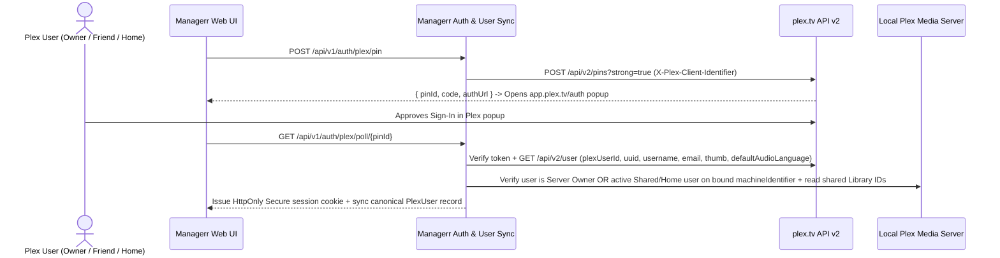
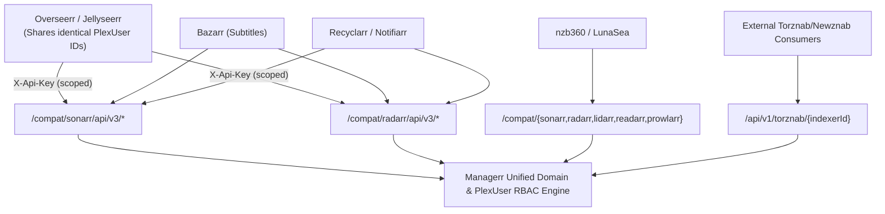

# Security Architecture, Multi-Provider Identity, and API Specification

Legacy `*arr` applications share a well-known security and usability debt: a single static global `X-Api-Key` with full administrative privileges, flat all-or-nothing authentication with no concept of individual household/friend users, unencrypted API tokens in SQLite tables, and inconsistent SSRF protections on webhook/indexer test endpoints. Meanwhile, maintaining a full external enterprise IdP like Keycloak across every homelab workflow adds unnecessary operational friction when **Plex** is often already the central user directory, while some operators prefer local accounts or an existing OIDC provider.

Managerr supports **Local Accounts (`PBKDF2-SHA512`)**, **Plex Users (`Sign in with Plex` + Plex Media Server User Directory)**, **OIDC 1.0 + PKCE**, and **WebAuthn Passkeys**, powering Web UI SSO, library-scoped RBAC, Overseerr-compatible media requests, per-user preferred languages, and Cleanerr watch-state/exclusion attribution, while treating the API as a zero-trust contract.

---

## 1. Plex-First Identity & Security Architecture (Defense in Depth)

### 1.1 Primary Identity Backbone: "Sign in with Plex" & PMS User Directory

Modeled on and extending `plex.py` (`create_plex_pin`, `check_plex_pin`) from Cleanerr and Overseerr's Plex authentication flow:



1. **Zero-Config First-Run Owner Claim:**
   * On initial setup, the administrator clicks **"Sign in with Plex"**. Managerr verifies the PIN token against `https://plex.tv/api/v2/user`, auto-discovers owned Plex Media Servers via `https://plex.tv/api/v2/resources` (offering both direct LAN `http://<ip>:32400` and `*.plex.direct` TLS endpoints), binds the selected `machineIdentifier`, and assigns the Plex Server Owner the `system:owner` role automatically.
2. **Strict PMS Server-Membership Gate:**
   * Having a random `plex.tv` account is never sufficient to log in. On login and periodic background sync, Managerr verifies against your bound Plex Media Server (`machineIdentifier` via PMS `/accounts` and `plex.tv/api/v2/friends` / `api/users`) that the account is either the **Server Owner**, a **Plex Home / Managed User**, or an **actively shared Plex Friend**.
   * Unsharing a user from your Plex server automatically revokes their Managerr sessions and disables their account on the next sync.
3. **Plex Home / Managed Household Profiles:**
   * Full support for **Plex Home / Managed Users** (e.g., household/family profiles without separate `plex.tv` emails) via profile selection + optional 4-digit Plex Home PIN verification (`POST /api/v1/auth/plex/home-switch`).
4. **Automatic PMS Library-Access Inheritance:**
   * Managerr imports the exact list of **Plex Library Sections** shared with each Plex user (`Movies`, `TV Shows`, `Anime`, `Music`, `Audiobooks`). By default, non-admin Plex users can only browse and request media in Managerr libraries mapped to the Plex libraries shared with them. Cleanerr (`cleanerr:*`), indexers, and downloaders remain restricted to the Plex Admin (`system:owner`) by default.
5. **LAN Offline Resilience, Local Accounts, Passkeys & OIDC:**
   * **Offline Session Continuity:** Once authenticated, Managerr issues its own short-lived access tokens (10 min) + rotating refresh tokens in `HttpOnly; Secure; SameSite=Strict` cookies backed by the local `Users` table in `managerr.db`; local LAN access continues operating even if `plex.tv` experiences an internet outage.
   * **Local Passwords (`PBKDF2-SHA512`) & Passkeys (WebAuthn):** Users can register local `PBKDF2-SHA512` credentials and/or **Resident Passkeys (WebAuthn / FIDO2)** (managed in `System -> Security` or the user profile modal, with RP settings in `Settings -> General`) for passwordless or LAN login without touching `plex.tv`.
   * **OIDC 1.0 + PKCE:** Standard OpenID Connect with PKCE (configured via `Settings -> General` or environment variables) supports customizable `username`, `email`, `displayName`, and `groups` claim mappings plus automatic `AdminGroups`, `ManagerGroups`, and `RequesterGroups` role mapping.
   * **Reverse-Proxy Forwarded Header Trust:** Disabled by default (`TrustForwardedHeaders=false`) and configurable under `Settings -> General` with required `TrustedProxyCidrs` when enabled and optional `AllowedHosts` allowlisting (`X-Forwarded-Host`).
6. **Scoped Machine API Keys (`mgr_live_<id>_<secret>`):**
   * For headless scripts, n8n workflows, Homepage widgets, and `/compat/*` integrations; only the `SHA-256` / `BLAKE2b` keyed hash is stored in the database, bound to a specific `PlexUser` owner, **Fine-Grained Scopes**, **Library Restrictions**, optional **Expiry**, and optional **Source CIDR Allowlist**.

---

### 1.2 Unified `PlexUser` Identity Record ("Plex Users for Everything")

Every human actor across Managerr is represented by a single canonical `Users` record anchored by immutable `plex_user_id`:

| Field / Attribute | Source | How Managerr Uses It Across Workflows |
| :--- | :--- | :--- |
| `plex_user_id` & `plex_uuid` | `plex.tv` / PMS `/accounts` | Immutable primary external identity key (survives Plex username or email changes) |
| `username`, `email`, `avatar_url` | `plex.tv` / PMS | Displayed in Web UI, audit logs, request lists, and Cleanerr watch/rescue/exclusion history |
| `shared_plex_section_ids` | PMS Shared Libraries sync | Auto-scopes which Managerr libraries (`tv`, `anime`, `movie`, `music`, `audiobook`) the user can see and request |
| `preferred_audio_lang` & `preferred_sub_lang` | Seeded from Plex profile (`defaultAudioLanguage` / `defaultSubtitleLanguage`), editable in UI | Powers **Per-User Language Upgrades**: when a German-preferring Plex user requests or watches an English release, Managerr seeks a `de` or Dual-Audio upgrade |
| `discord_user_id` *(optional link)* | Linked in User Settings or admin mapping | Resolves Discord button clicks (`clnr_excl`, `clnr_sel_excl`) to a `PlexUser` and checks their integrated RBAC `cleanerr:*` permissions |
| `seerr_user_id` *(auto-matched)* | Matched automatically via `plexId` in Overseerr/Jellyseerr | Unifies Overseerr request attribution (`requested_by`) with native Managerr & Cleanerr user rules |
| `rbac_roles` & `cleanerr_quota_override` | Integrated RBAC Engine | **Defaults to `none` for Cleanerr on all non-admin users** (`system:owner` / Plex Admin only by default); admin can selectively grant `cleanerr:read` / `cleanerr:rescue` / `cleanerr:exclude` (+ optional item quota) per role or per `PlexUser` |

---

### 1.3 Simple Preset Roles + Custom Role Builder (RBAC + Library ABAC)

Managerr ships with **4 simple preset human roles** (plus 2 machine-token presets) by default, while allowing the Admin to **create unlimited custom roles** via the UI Role Builder or `/api/v1/roles`:

#### Built-in Preset Roles
| Preset Role | Key | Default Assignment | Default Capabilities |
| :--- | :--- | :--- | :--- |
| **`Admin`** | `system:owner` | **Plex Server Owner** *(immutable lock-out guard)* | **Full platform & Cleanerr control:** Cleanerr Studio/Queue/Exclusions, indexers, downloaders, profiles, custom roles, secrets, migration |
| **`Manager`** | `media:manager` | Co-Admin / Curator *(manual assign)* | Add/edit/delete media in allowed libraries, manual search/grab, language quarantine review, profile editing *(no Cleanerr or secrets by default)* |
| **`Requester`** | `media:requester` | **Imported Plex Friends & Home Users** *(default)* | Browse & request media within their **shared Plex libraries** + set personal language preferences *(zero access to Cleanerr, indexers, downloaders, queue, or disk paths)* |
| **`Viewer`** | `media:viewer` | Read-Only Household Profile *(manual assign)* | Browse catalog & release calendar within shared Plex libraries *(cannot request, edit, or delete)* |
| *`Compat Token`* | `automation:compat` | Scoped Machine API Keys (`Overseerr`, `Bazarr`, `Recyclarr`) | Restricted to a single virtual `/compat/{app}` surface + permitted libraries |
| *`Metrics Token`* | `metrics:readonly` | Scoped Machine API Keys (`Homepage`, `Prometheus`) | Health, queue counts, storage stats & `/metrics` only |

#### Creating Extra Custom Roles (`Roles` Table & Role Builder UI)
Administrators can **clone any preset** or **create brand-new custom roles** (`POST /api/v1/roles`, stored in `managerr.db`) combining:
1. **Permission Scopes:** Toggle any subset of scopes below (e.g., create an **`Anime Curator`** role with `catalog:write` + `quarantine:review` scoped solely to the `Anime` library, or a **`Trusted VIP`** role with `catalog:auto_approve` + `cleanerr:exclude`).
2. **Library Access Policy:** Choose **`Inherit Shared Libraries from Plex`** *(default)* or pin the custom role to an explicit allowlist of Managerr libraries.
3. **Optional Quotas & Limits:** Attach `movie_request_quota` (per N days), `tv_season_request_quota`, `music_book_request_quota`, `auto_approve_requests` boolean, and optional `cleanerr_exclusion_limit` (if `cleanerr:exclude` is enabled on that custom role).
4. **Multi-Role Composition:** A `PlexUser` can hold one primary role plus any number of additive custom roles (effective capabilities = union of granted scopes across their assigned roles). Built-in `system:owner` cannot be deleted or stripped from the bound Plex Server Owner.

#### Fine-Grained Permission Scopes (36 Scopes, Selectable in Custom Role Builder)
```text
catalog:read          catalog:request       catalog:auto_approve  catalog:write         catalog:delete
profiles:read         profiles:write
indexers:read         indexers:write        indexers:search
downloaders:read      downloaders:write
queue:read            queue:manage          quarantine:review
langverify:read       langverify:execute
cleanerr:read         cleanerr:rescue       cleanerr:exclude      cleanerr:write        cleanerr:execute
users:read            users:manage          roles:manage
migration:read        migration:execute
webhooks:manage       system:admin          audit:read            metrics:read
compat:sonarr         compat:radarr         compat:lidarr         compat:readarr        compat:prowlarr
```

---

### 1.4 Secrets Encryption at Rest & Network/Filesystem Hardening
* **Envelope Secret Encryption (`AES-256-GCM`):** All sensitive fields in embedded SQLite (`managerr.db`) (Plex server and admin tokens, indexer passkeys and cookies, download client passwords, Discord bot tokens, and metadata provider API keys) are encrypted via per-record DEKs wrapped by a HKDF-SHA256 KEK (`MANAGERR_MASTER_KEY` env var or `/run/secrets/managerr_master_key`). API responses never echo raw secrets (`{"isSet": true, "maskedHint": "****9f2a"}`).
* **CSRF & Cookie Hardening:** Double-submit / `Sec-Fetch-Site` + custom header CSRF protection on all cookie-authenticated mutating endpoints.
* **SSRF Egress Guard (`SafeHttpClientFactory`):** Validates resolved IPs at socket-connect time (preventing DNS rebinding), blocking cloud metadata (`169.254.169.254`), loopback, and unapproved RFC1918 targets unless explicitly allowlisted for configured homelab services (`Plex`, `Overseerr`, `qBittorrent`, `SABnzbd`, `n8n`, legacy `*arr` containers).
* **Custom Script Sandboxing & Path Traversal Protection:** Replaces arbitrary shell scripts with **Signed Webhook Events** (`MANAGERR_ALLOW_CUSTOM_SCRIPTS=false` by default); enforces canonical path checks + zip-slip/RAR-bomb limits during subtitle and ebook inspection.
* **Immutable Audit Log & Rate Limiting:** Append-only `AuditEvents` table recording `plex_user_id` / token ID, source IP, action, and redacted diff; partitioned ASP.NET Core token-bucket rate limiters on auth and search endpoints.

---

## 2. Native API v1 Design (`/api/v1`)

### 2.1 Transport & Contract Standards
* **OpenAPI 3.1 First:** Full machine-generated OpenAPI 3.1 schema at `/api/v1/openapi.json` with interactive Scalar UI.
* **Consistent Resource Envelopes & Filtering:** Cursor/offset pagination, RSQL filtering (`?filter=mediaType==movie;languages.audio=in=(de,en);requestedByPlexUserId==48291`), **RFC 9457 Problem Details (`application/problem+json`)**, and `Idempotency-Key` support on mutating `POST` endpoints.

### 2.2 Core REST Endpoint Domains

| Domain Prefix | Key Endpoints | Description |
| :--- | :--- | :--- |
| `/api/v1/auth/*` | `POST /plex/pin`, `GET /plex/poll/{pinId}`, `POST /plex/home-switch`, `POST /breakglass/login`, `POST /passkeys/login/complete`, `POST /tokens` | **Sign in with Plex** PIN flow, Plex Home user switcher, break-glass local/Passkey login, session & scoped PAT management |
| `/api/v1/users/*` | `GET /users`, `POST /users/sync-plex`, `PATCH /users/{id}`, `POST /users/me/discord-link` | Sync Plex Friends & Home Users + shared PMS library mappings, assign preset/custom roles, preferred languages & Discord ID link |
| `/api/v1/roles/*` | `GET /roles`, `POST /roles`, `POST /roles/{id}/clone`, `PUT /roles/{id}`, `DELETE /roles/{id}`, `GET /roles/scopes` | Built-in preset roles (`Admin`, `Manager`, `Requester`, `Viewer`) + **Custom Role Builder CRUD** (fine-grained scopes, library policies & quotas) |
| `/api/v1/libraries` | `GET/POST /libraries`, `PATCH /libraries/{id}`, `GET /libraries/{id}/stats` | Logical libraries binding a Media Type (`tv`, `anime`, `movie`, `music`, `ebook`, `audiobook`, `comic`), Plex library section mapping, root folders, naming template, metadata waterfall, and default profile |
| `/api/v1/catalog/*` | `GET /works`, `POST /works`, `POST /requests`, `GET /works/{id}/tree`, `PATCH /works/bulk` | Unified polymorphic media CRUD, Plex-user-attributed media requests, monitoring toggles, external ID overrides |
| `/api/v1/metadata/*` | `GET /metadata/search?q=...`, `GET/PUT /metadata/providers/{key}/settings`, `GET/POST/DELETE /metadata/webhooks` | Federated live search across configured metadata providers with cross-walked IDs, provider key config, and custom HTTP webhooks |
| `/api/v1/profiles/*` | `GET/POST /profiles`, `POST /profiles/simulate`, `GET/POST/DELETE /profiles/language-policies`, `GET/POST/PUT/DELETE /profiles/mixins` | Composable quality + language + custom-scoring profiles; `/simulate` dry-runs any release title or media file with a full score breakdown |
| `/api/v1/indexers/*` | `GET/POST /indexers`, `GET /indexers/definitions`, `POST /indexers/search`, `POST /indexers/{id}/test`, `GET/POST/PUT/DELETE /indexers/proxies` | Native Prowlarr-class indexer management, interactive release search, Cardigann definition browser, proxy bindings, health & query telemetry |
| `/api/v1/downloaders/*` | `GET/POST /downloaders`, `POST /downloaders/{id}/test`, `GET /downloaders/queue`, `POST /downloaders/manual-import` | Usenet, Torrent, and blackhole client configurations, category mappings, remote path mappings, unified queue state machine, manual import |
| `/api/v1/quarantine/*` & `/api/v1/verification/*` | `GET /quarantine`, `GET /quarantine/{id}/snippets/{index}`, `POST /quarantine/{id}/approve`, `GET/PUT /verification/settings` | Language verification thresholds, per-stream `ffprobe`/OCR/Whisper confidence scores, browser audio snippet preview & quarantine resolution |
| `/api/v1/cleanerr/*` | `GET/POST /workflows`, `POST /workflows/simulate`, `GET /workflows/{node-catalog,templates}`, `GET/POST /queue/{id}/{rescue,exclude,delete-now}`, `POST /exclusions/bulk`, `POST /webhooks/discord-interactions`, `GET /webhooks/magic/{exclude,postpone,rescue,exclude-all}` | Full `Cleanerr` visual DAG workflow studio API, dry-run per-node simulation, grace-period deletion queue, `PlexUser`-attributed exclusions & quotas, Ed25519 Discord interactions & HMAC magic links |
| `/api/v1/migration/*` | `POST /migration/sources`, `POST /migration/plan`, `POST /migration/execute`, `GET /migration/{jobId}` | Import live APIs or `.db`/`.zip` backups (`*arr`, `NZBHydra2`, `cleanerr.db`, `Overseerr` Plex users), dry-run diffs, shadow mode & cutover |
| `/api/v1/system/*` | `GET /system/health`, `GET /system/tasks`, `PATCH /system/tasks/{taskKey}`, `GET /system/audit`, `POST /system/backups`, `GET/PUT /system/backups/settings` | Health checks, background scheduler control, audit logs, encrypted backups, OpenTelemetry / Prometheus `/metrics` |

### 2.3 Real-Time Event Stream & Signed Webhooks
1. **SignalR / WebSocket Hub (`/api/v1/realtime`):** Pushes live typed events (`queue.updated`, `verification.progress`, `import.completed`, `upgrade.language.grabbed`, `cleanerr.staged`, `cleanerr.rescued`, `migration.step`) filtered by the authenticated `PlexUser`'s RBAC + shared library permissions.
2. **Signed Outbound Webhooks:** Every outbound webhook includes `X-Managerr-Signature-256: sha256=<hmac>`, `X-Managerr-Delivery-Id`, and `X-Managerr-Timestamp` (replay protection).

---

## 3. Virtual `*arr` Compatibility API Shims (`/compat/*`)

To ensure Managerr is a drop-in replacement without breaking the third-party ecosystem (**Overseerr / Jellyseerr, Recyclarr, Notifiarr, Bazarr, LunaSea, nzb360, Homepage, n8n**), Managerr exposes virtual compatibility routers backed directly by its unified core:



### Compatibility Surface Matrix

| Virtual Mount Path | Emulated Upstream Contract | Primary Ecosystem Consumers | Translation Behavior |
| :--- | :--- | :--- | :--- |
| `/compat/sonarr/api/v3/*` | Sonarr v3/v4/v5 REST | Overseerr, Bazarr, Recyclarr, nzb360 | Maps `MediaWork (tv/anime)` <-> `SeriesResource`, `MediaUnit` <-> `EpisodeResource`, unified Profiles <-> `QualityProfileResource` + `CustomFormatResource` |
| `/compat/radarr/api/v3/*` | Radarr v3/v5 REST | Overseerr, Bazarr, Recyclarr, nzb360 | Maps `MediaWork (movie)` <-> `MovieResource`, unified Profiles <-> Radarr Quality/CF schema |
| `/compat/lidarr/api/v1/*` | Lidarr v1 REST | Lidarr mobile apps, Lidify, scripts | Maps `MediaWork (music)` <-> `ArtistResource` / `AlbumResource` / `TrackResource` |
| `/compat/readarr/api/v1/*` | Readarr v1 REST | Calibre-Web-Automated, request bots | Maps `MediaWork (ebook/audiobook)` <-> `AuthorResource` / `BookResource` / `EditionResource` (can be bound to separate virtual keys for Ebook vs Audiobook) |
| `/compat/prowlarr/api/v1/*` & `/torznab/{id}` | Prowlarr v1 + Newznab/Torznab XML/JSON | Cross-Seed, Autobrr, external tools | Exposes Managerr's internal indexers as standard Torznab/Newznab feeds if external tools need search access |

> [!IMPORTANT]
> **Overseerr and Plex User Correlation:** Even when requests arrive via Overseerr through `/compat/sonarr` or `/compat/radarr`, Overseerr's user tags / webhook metadata (`plexId` / `requestedBy_username`) map **1:1 to Managerr's synced `PlexUser` table**, preserving exact `PlexUser` ownership for language preferences and Cleanerr retention rules.
