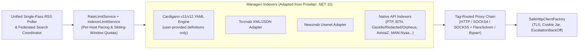

# Unified Indexer Hub & Download Client Orchestration

## 1. Eliminating the Prowlarr Sync Tax

In a traditional `*arr` stack, **Prowlarr** runs as a separate process that exposes local Torznab/Newznab proxy endpoints (`http://prowlarr:9696/{id}/api`) synced over HTTP into Sonarr, Radarr, Lidarr, and Readarr. That architecture causes:
* **4x Redundant RSS Polling:** Sonarr, Radarr, Lidarr, and Readarr each poll Prowlarr on separate timers, burning tracker API quotas (`QueryLimit`) unless carefully staggered.
* **Lost Tracker Metadata:** Specialized Cardigann fields (`downloadvolumefactor` freeleech flags, `uploadvolumefactor`, tracker-native tags, language flags, minimum seed time / Hit-and-Run rules) get flattened or lost across the generic Torznab XML boundary.

Managerr embeds the **`.NET 10` Prowlarr Indexer Engine directly in-process** while still optionally exposing `/api/v1/torznab/{indexerId}` for external tools like `cross-seed` or `autobrr`.



---

## 2. Indexer Subsystem Specification

### 2.1 Upstream Code Lift (`upstream/Prowlarr`)
Managerr directly adapts the `.NET 10` indexer core from [`upstream/Prowlarr/src/NzbDrone.Core/Indexers/`](../upstream/Prowlarr/src/NzbDrone.Core/Indexers/):

| Component | Upstream Reference Path | Capabilities Preserved & Enhanced |
| :--- | :--- | :--- |
| **Cardigann YAML Engine (Schema v12)** | [`Definitions/Cardigann/CardigannBase.cs`](../upstream/Prowlarr/src/NzbDrone.Core/Indexers/Definitions/Cardigann/CardigannBase.cs), [`CardigannParser.cs`](../upstream/Prowlarr/src/NzbDrone.Core/Indexers/Definitions/Cardigann/CardigannParser.cs), [`CardigannRequestGenerator.cs`](../upstream/Prowlarr/src/NzbDrone.Core/Indexers/Definitions/Cardigann/CardigannRequestGenerator.cs) | Full AngleSharp HTML DOM selectors, JSON `:filter` selectors, Go template expansion, login flows (`form`, `post`, `cookie`, `http`, `oneurl`), and all 23 v12 filters (including `base64decode`/`base64encode`) |
| **No bundled definitions** | None | Managerr ships no tracker or indexer definitions and names no providers. Cardigann YAML is loaded only from `/config/Definitions/Custom` (and an optional `Managerr:CardigannDefinitionsDirectory` / `MANAGERR_DEFINITIONS_DIR`). A Prowlarr migration skips Cardigann indexers whose definition is missing and lists them in the report. |
| **Usenet Newznab & Spotweb** | [`Definitions/Newznab/`](../upstream/Prowlarr/src/NzbDrone.Core/Indexers/Definitions/Newznab/) | Auto-discovers `t=caps`, paged `tvsearch`/`movie`/`music`/`book` queries with `tvdbid`, `tmdbid`, `imdbid`, `rid`, `artist`, `album` |
| **Generic Torznab** | [`Definitions/Torznab/`](../upstream/Prowlarr/src/NzbDrone.Core/Indexers/Definitions/Torznab/) | Connects external Jackett, Bitmagnet, Zilean, or other Torznab feeds |
| **Anti-Bot & Network Proxies** | [`IndexerProxies/FlareSolverr/`](../upstream/Prowlarr/src/NzbDrone.Core/IndexerProxies/FlareSolverr/), `Http/`, `Socks4/`, `Socks5/` | Tag-based chaining of up to 1 network proxy (`HTTP`/`SOCKS5` VPN container) + 1 Cloudflare challenge solver (`FlareSolverr` / `Byparr`), with automatic `cf_clearance` + `User-Agent` session caching |
| **Quotas, Pacing & Backoff** | [`IndexerLimitService.cs`](../upstream/Prowlarr/src/NzbDrone.Core/Indexers/IndexerLimitService.cs), [`EscalationBackOff.cs`](../upstream/Prowlarr/src/NzbDrone.Core/ThingiProvider/Status/EscalationBackOff.cs) | Per-host `requestDelay` pacing, sliding-window hourly/daily `QueryLimit` & `GrabLimit` reservation (always reserving N% quota for interactive user searches), and 9-level escalation backoff (`60s` -> `24h`) |

### 2.2 Unified Single-Pass RSS Poller (Comparison to Legacy `*arr` Stack)
Instead of 4 apps polling the same tracker 4 times every 15 minutes:
1. Managerr executes **one unified RSS fetch per enabled indexer** across all active root categories (`2000` Movies, `3000` Audio/Audiobooks, `5000` TV/Anime, `7000` Books/Comics).
2. Each incoming `ReleaseInfo` item is classified by its normalized `NewznabStandardCategory` (`IndexerCapabilitiesCategories.cs`, supporting custom tracker `100000+` category mappings) and dispatched in-memory to the matching catalog matcher (`TV/Anime`, `Movie`, `Music`, `Book/Audiobook`, `Comic`).
3. **Result:** Up to **75% fewer tracker HTTP requests**, zero duplicate Cloudflare challenges, and instant cross-media freeleech/ratio awareness.

### 2.3 Tracker-Aware Acquisition Rules
Because Cardigann & native definitions run in-process, Managerr's Decision Engine and Cleanerr Seeding Engine receive detailed tracker telemetry:
* `DownloadVolumeFactor` / `UploadVolumeFactor` (e.g., `0.0` Freeleech, `0.5` Half-Leech, `2.0` Double Upload): profiles can prefer Freeleech or block non-freeleech grabs on strict economy trackers when ratio drops below a configured floor.
* Per-Indexer `MinimumSeedTime`, `SeedRatioTarget`, and `HitAndRunGraceHours` passed directly to the Download Client & Cleanerr Seeding Lifecycle Manager at grab time.

---

## 3. Download Client Orchestration

### 3.1 Supported Download Clients (12 Drivers)
Adapted and unified from [`upstream/Sonarr/src/NzbDrone.Core/Download/Clients/`](../upstream/Sonarr/src/NzbDrone.Core/Download/Clients/):

| Protocol | Supported Clients | Notes |
| :--- | :--- | :--- |
| **BitTorrent (8 Clients)** | **qBittorrent**, **Deluge**, **Transmission**, **rTorrent / ruTorrent**, **Flood**, **Vuze**, **aria2**, **Torrent Blackhole** (`torrent_blackhole`) | Full magnet + `.torrent` file push, queue polling, pause/resume/remove (`deleteData`), per-vertical category/tag routing, per-grab ratio/time seed limits |
| **Usenet (4 Clients)** | **SABnzbd**, **NZBGet**, **Pneumatic**, **Usenet Blackhole** (`usenet_blackhole`) | Priority mapping (`Force`/`High`/`Normal`/`Low`), queue polling, per-vertical category routing, failed-unpack / password detection |
| **Remote Path Mappings** | **UI + REST API** | Configurable under **Settings -> Download Clients -> Remote Path Mappings** or `/api/v1/downloaders/remote-paths` |

### 3.2 Multi-Vertical Category Matrix on a Single Client Configuration
In legacy `*arr` setups, you had to configure the exact same qBittorrent host/username/password 4 separate times across Sonarr, Radarr, Lidarr, and Readarr.

In Managerr, you configure **qBittorrent once** with a clean **Per-Media-Type Category Routing Table**:

```yaml
downloadClient:
  name: "Primary qBittorrent"
  implementation: "QBittorrent"
  host: "qbittorrent.lan"
  port: 8080
  useSsl: false
  categoryMappings:
    tv:        { category: "managerr-tv",        priority: "recent_high" }
    anime:     { category: "managerr-anime",     priority: "recent_high" }
    movie:     { category: "managerr-movies",    priority: "normal" }
    music:     { category: "managerr-music",     priority: "normal" }
    ebook:     { category: "managerr-ebooks",    priority: "normal" }
    audiobook: { category: "managerr-audiobooks",priority: "normal" }
    comic:     { category: "managerr-comics",    priority: "normal" }
  remotePathMappings:
    - remotePath: "/data/torrents/"
      localPath: "/mnt/storage/torrents/"
```

### 3.3 Hardlink-First Atomic Import Pipeline
* Validates at startup and health-check time whether `downloadStagingPath` and `libraryRootFolder` share the same filesystem device ID (`st_dev`), surfacing an explicit **TRaSH-Guides Hardlink Health Check** warning if Docker bind mounts break atomic hardlinking (`/downloads` + `/tv` vs unified `/data/{torrents,media}`).
* Imports torrents via **atomic hardlinks** (keeping seeding files untouched in the torrent client until Cleanerr's seeding rules expire them) and Usenet completions via **atomic rename/move**, only after passing the Pre-Import Malware & Language Verification gates.
