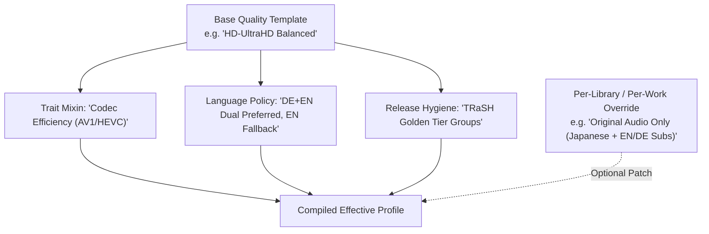
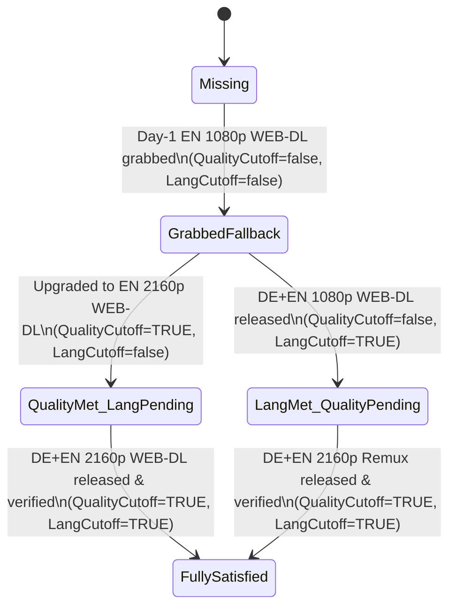

# Profiles, Multi-Axis Scoring, and Language Upgrade Engine

## 1. Why Legacy Sonarr / Radarr Profiles Fall Short

In Sonarr v4/v5 and Radarr v5, profiles suffer from four structural pain points:
1. **Profile Explosion (No Inheritance):** Want `1080p Good` for English shows, `1080p Good (German + English Dual)` for movies, and `1080p Anime (Japanese + Subs)`? You must duplicate entire profiles and manually maintain dozens of Custom Format score tables across multiple apps (leading to external tools like Recyclarr just to keep JSON blobs in sync).
2. **Quality Dominance Over Language:** In Sonarr/Radarr, **Quality Tier always trumps Custom Format score** unless you merge all qualities into a single giant quality group, which destroys fine-grained quality ordering and cutoffs.
3. **Broken Language Upgrade Semantics:** Language in Sonarr v4+ was demoted into Custom Formats. Expressing *"Grab English 1080p immediately on release day so I can watch tonight, then automatically upgrade to German+English Dual-Audio 1080p (or 2160p) weeks later when the dubbed release drops, without ever downgrading a 2160p Remux to a 480p cam just because it is German"* is notoriously fragile and error-prone.
4. **Cross-Media Disconnect:** Video profiles (`WEBDL-1080p`, `HDR10`, `TrueHD Atmos`) don't generalize cleanly to Music (`FLAC 24bit/96kHz` vs `MP3-320`) or Books/Audiobooks (`EPUB Retail` vs `M4B Unabridged 128kbps` with narrator/language preferences) without a unified multi-axis scoring model.

---

## 2. Composable Profile Architecture (Inheritance & Mixins)

Managerr replaces monolithic profiles with **Composable Policy Profiles** supporting 3-level inheritance:



* **Zero Duplication:** Updating a shared `Language Policy` or `Release Group Tier` mixin immediately updates every profile inheriting it.
* **Built-in Preset Packs & TRaSH-Guides Native Importer:** Ships with curated built-in presets for Video (1080p/4K/HDR/Anime), Music (Lossless/Audiophile/Compact), Ebooks (Retail EPUB/PDF), and Audiobooks (Chaptered M4B), plus native one-click import of TRaSH-Guides / Recyclarr Custom Format definitions without needing an external sync container.
* **Interactive Profile Simulator (`/api/v1/profiles/simulate` & UI Drawer):** Paste any release name (or pick an existing library item) to see an itemized scorecard explaining why Release B beats Release A, which cutoff is satisfied, and whether a grab is a `QualityUpgrade`, `LanguageUpgrade`, `TraitUpgrade`, or `BlockedByFloor`.

---

## 3. Unified Multi-Axis Scoring Formula

Every candidate release R evaluated against an Effective Profile P for a target media unit M produces a structured **Score Vector** rather than an opaque single integer:

$$S_{\text{total}}(R, P, M) = w_Q \cdot S_{\text{quality}}(R) + w_L \cdot S_{\text{lang}}(R, M) + w_T \cdot S_{\text{traits}}(R) + w_B \cdot S_{\text{efficiency}}(R)$$

subject to **Hard Gates** (must all pass or candidate is rejected immediately):
* $Q(R) \in \text{AllowedQualities}(P)$ and $Q(R) >= Q_{\text{floor}}(P, M_{\text{current}})$
* $L(R) \in \text{AllowedLanguages}(P, M)$
* $S_{\text{traits}}(R) >= S_{\text{minTraitScore}}(P)$ and no `RequiredReject` rule matched
* Bitrate / file-size per runtime minute within $[B_{\min}(Q), B_{\max}(Q)]$

### The Four Scoring Axes

| Axis | Video (TV / Anime / Movie) | Music | Books & Audiobooks |
| :--- | :--- | :--- | :--- |
| **1. Quality ($S_{\text{quality}}$)** | Source (`Remux`, `Bluray`, `WEB-DL`, `WEBRip`, `HDTV`) x Resolution (`2160p`, `1080p`, `720p`) | Format (`FLAC 24-bit`, `FLAC 16-bit`, `ALAC`, `AAC-256`, `Opus-192`, `MP3-320`, `MP3-V0`) | Ebook (`EPUB3 Retail`, `EPUB`, `AZW3`, `MOBI`, `PDF Scan`) / Audio (`M4B Chaptered`, `MP3 Merged`) |
| **2. Language ($S_{\text{lang}}$)** | Audio stream languages (`de`, `en`, `orig`), Dual/Multi-Audio combo bonuses, Subtitle fallback (`de` forced/full subs) | Vocal/Edition language (`jp` vs `en` version), Country edition (`JP Bonus Track`) | Text language (`de`, `en`, `fr`) or Spoken narration language |
| **3. Traits / Custom Rules ($S_{\text{traits}}$)** | Dynamic Range (`DV+HDR10+`, `HDR10`), Audio Codec (`TrueHD Atmos`, `DTS-X`, `DD+`), Video Codec (`AV1`, `x265`), Release Group Tier, Edition (`IMAX`, `Director's Cut`), Streaming Service (`AMZN`, `NF`, `ATVP`) | Media source (`CD`, `WEB`, `Vinyl`), Mastering (`2024 Remaster`, `MFSL`), Scene/Group tier, Cue+Log presence | Retail vs OCR flag, Unabridged vs Abridged, Preferred Narrator match, Illustrated edition |
| **4. Size/Bitrate Curve ($S_{\text{efficiency}}$)** | Smooth bell-curve preference (e.g., reward sweet-spot `8 to 18 Mbps` 1080p; penalize bloated re-encodes or starved micro-rips) | Bitrate consistency & completeness | Reasonable size sanity per page count / duration |

> [!TIP]
> **`orig` (Original Language) Dynamic Token:** Any language rule can reference the special token `original` (resolved automatically per work from metadata, e.g., `ja` for *Attack on Titan*, `ko` for *Parasite*, `de` for *Dark*, `en` for *Severance*). You never have to create separate profiles per country of origin.

---

## 4. Language Policy and Language-Driven Upgrades

### 4.1 Language Policy Schema
Each Language Policy defines **ordered Language Satisfaction Tiers** with explicit scores, subtitle bridges, and **upgrade triggers**:

```yaml
languagePolicy:
  id: "de-en-dual-with-fast-en-fallback"
  name: "German + Original Dual-Audio (Fast English/Original Day-1 Fallback)"

  # Ordered tiers from highest satisfaction (Tier 1) to lowest acceptable fallback (Tier 4)
  tiers:
    - tier: 1
      id: "dual-de-orig"
      label: "German + Original Dual Audio"
      match:
        audioContainsAll: ["de", "original"]
      score: 1000
      satisfiesLanguageCutoff: true

    - tier: 2
      id: "de-audio-only"
      label: "German Audio"
      match:
        audioContainsAny: ["de"]
      score: 750
      satisfiesLanguageCutoff: false   # Keep looking for Dual Audio if available.

    - tier: 3
      id: "orig-with-de-subs"
      label: "Original Audio + German Subtitles"
      match:
        audioContainsAny: ["original", "en"]
        subtitlesContainsAny: ["de"]
      score: 400
      satisfiesLanguageCutoff: false

    - tier: 4
      id: "day1-en-or-orig"
      label: "Original or English Audio (Day-1 Grab)"
      match:
        audioContainsAny: ["original", "en"]
      score: 200
      satisfiesLanguageCutoff: false

  # Language Upgrade Behavior
  upgradeRules:
    enableLanguageUpgrades: true
    languageCutoffTier: 1   # Upgrade until Tier 1 ("dual-de-orig") is reached and verified on disk.

    # Crucial Guardrail: Can a better language tier step down in video/audio quality?
    qualityTradeoffPolicy:
      mode: "bounded_stepdown"          # "never_downgrade_quality" | "bounded_stepdown" | "weighted_score"
      maxQualityTierDrop: 1             # e.g. Allow 2160p WEB-DL (EN) -> 1080p Bluray (DE+EN),
      minimumAbsoluteQuality: "WEBDL-1080p" # Never drop below 1080p WEB-DL even for Tier 1 language.
      preservePreviousFileAsAlternate: false # Optional: keep both 4K-EN and 1080p-DE editions.
```

### 4.2 Dual-Cutoff State Machine (Quality Cutoff x Language Cutoff)

Unlike Sonarr/Radarr (which stop monitoring upgrades as soon as *Quality Cutoff* is met, or keep churning forever if Custom Format cutoffs are misconfigured), Managerr tracks **two explicit, independent cutoff flags** per `MediaUnit`:

1. `QualityCutoffMet` ($Q_{\text{current}} >= Q_{\text{cutoff}}$)
2. `LanguageCutoffMet` ($L_{\text{verified}}(\text{file}) <= \text{Tier}_{\text{cutoff}}$, verified by actual file inspection, not just release title.)



### 4.3 Concrete Upgrade Scenarios Solved Cleanly

| Scenario | Existing File on Disk | New Candidate Release | Legacy `*arr` Behavior | Managerr Decision |
| :--- | :--- | :--- | :--- | :--- |
| **Delayed Dub Upgrade** | `Severance S02E01 2160p WEB-DL [EN]` *(Quality Cutoff Met)* | `Severance S02E01 2160p WEB-DL [DE+EN]` | Often ignored if Quality Cutoff was met unless CF cutoff hacks are tuned perfectly | **GRAB (`LanguageUpgrade`):** Same quality, jumps from Language Tier 4 -> Tier 1 |
| **Cam/SD Dub Trap Prevention** | `Dune Part Two 2160p WEB-DL [EN]` | `Dune Part Two 720p HDTV [DE]` | High language CF score can accidentally overwrite 4K with garbage quality if qualities are merged | **REJECT (`BlockedByQualityFloor`):** Violates `minimumAbsoluteQuality: WEBDL-1080p` |
| **Multi-Edition Coexistence (Optional)** | `Movie 2160p Remux [EN TrueHD]` | `Movie 1080p WEB-DL [DE]` | Overwrites 4K Remux OR refuses German version | **MULTI-EDITION / MUX HOOK:** Can either store `[2160p EN]` + `[1080p DE]` side-by-side for Plex/Jellyfin version picker, OR wait for `2160p DE+EN` |
| **False-Positive Release Title ("MULTI")** | `Movie 1080p WEB-DL [EN]` | `Movie.2026.MULTI.1080p.WEB-DL` (actually only EN + FR, no DE) | Imports over your good file, losing history, leaving wrong language on disk | **CAUGHT PRE-IMPORT:** Grabbed into staging -> Language Verification Pipeline sees `en, fr` (no `de`) -> **Quarantined/Aborted**, original file untouched, release hash blocklisted. |
| **Ebook Translation Upgrade** | `The Winds of Winter [EN].epub` | `Die Winde des Winters [DE].epub` | Readarr cannot link translated edition upgrade cleanly to same work | **GRAB (`LanguageUpgrade`):** Linked under unified `MediaWork`, upgrades or stores alongside English edition per policy |

### 4.4 `PlexUser`-Driven Language Preferences & Automatic Upgrade Promotion
Because Managerr uses **Plex Users** across login, requests, Overseerr correlation, and watch history (automatically seeding `preferred_audio_lang` and `preferred_sub_lang` from each user's Plex account profile):
* **Requester-Aware Language Target:** When a `PlexUser` requests an item (either natively in Managerr or via Overseerr), Managerr checks their preferred language. If an item was initially grabbed in `en` for an English-speaking viewer and a German-preferring `PlexUser` later requests or subscribes to it, Managerr can automatically attach the **`DE + Original Dual-Audio`** mixin to that `MediaWork` and trigger a **Language Upgrade** search, without maintaining per-user duplicate libraries or profiles.

---

## 5. Audio Track & Subtitle Remux/Cleanup Policy (Optional Post-Verify Step)

When importing a bloated `MULTI` release containing 12 audio tracks (`en, de, fr, es, it, pl, ru, tr, hi, th, pt, cs`), profiles can optionally enable **Lossless Stream Pruning** (via `mkvmerge` / `ffmpeg -c copy` during atomic import):
* Keep only tracks matching `retainAudioLanguages: ["de", "original", "en"]` and `retainSubtitleLanguages: ["de", "en"]`.
* Automatically set MKV `default` track flag to the user's #1 preferred language (`de`) and `forced` flag on forced narratives, ensuring Plex/Jellyfin plays the right language immediately without transcoding or manual stream switching, while saving 15 to 30% disk space on `MULTI` Remuxes.
