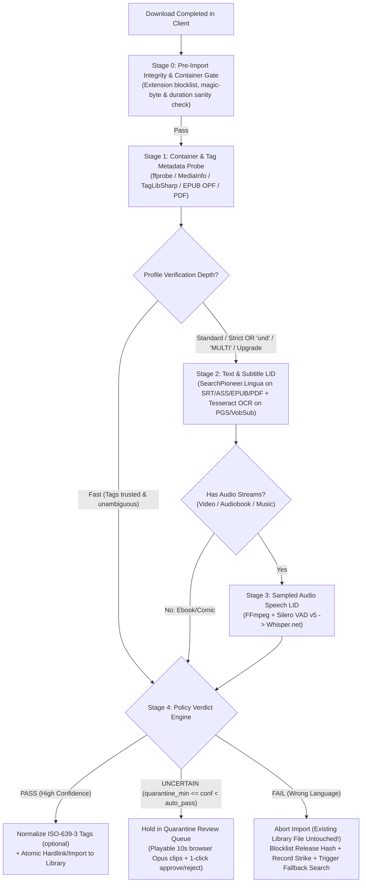

# Post-Download & Library File Language Verification Pipeline

## 1. Problem Statement

Release titles on Usenet and BitTorrent routinely mislabel or omit critical language details:
* Releases tagged `MULTI` or `DUAL` frequently lack the specific target language (e.g., containing English + Spanish when German was expected).
* Scene and P2P encodes regularly leave MKV/MP4 audio stream metadata untagged (`und` / `undetermined`) or mislabeled (e.g., a French or Russian voice-over dub muxed with stream language left at `eng`).
* Dubbed releases sometimes contain English segments for extended scenes, or fake stereo tracks duplicating English on both `eng` and `ger` streams.
* Ebooks (`EPUB`, `MOBI`, `PDF`) and Audiobooks (`M4B`, `MP3`) frequently carry inaccurate `<dc:language>` metadata from poor Calibre conversions.

**Core Architectural Rule in Managerr:**
> **No downloaded file overwrites an existing library item or marks a `LanguageCutoff` as satisfied until its actual on-disk language composition passes the Verification Pipeline in staging.**

---

## 2. End-to-End Verification Pipeline Architecture

Verification runs in an isolated **Pre-Import Staging Worker** (before atomic hardlink/move into the library root folder) and can also be scheduled as a **Background Library Audit** over pre-existing media files migrated from legacy `*arr` instances.



---

## 3. Detailed Stage Specifications

### Stage 0 - Integrity & Container Sanity Pre-Gate
* Verifies file is non-zero, container headers match extension (magic-byte check: Matroska `1A 45 DF A3`, MP4 `ftyp`, FLAC `fLaC`, ZIP/EPUB `PK\x03\x04`, PDF `%PDF`), and video/audio duration matches expected metadata runtime within configurable tolerance (e.g., `+/- 25%`, catching 90-second sample spam or malformed files).

### Stage 1 - Container & Embedded Metadata Inspection (`< 200 ms`)
Extracts declared language tags across every media type and normalizes all codes (`de`, `deu`, `ger`, `de-DE`, `"Deutsch"`, `"German"`) into canonical **BCP-47 / ISO 639-3** codes:

| Media Vertical | Extractor Engine | Inspected Signals |
| :--- | :--- | :--- |
| **Video (`MKV`, `MP4`, `AVI`, `TS`)** | `ffprobe` JSON + `MediaInfo` | Per-stream `tags.language`, `tags.title` regex hints (e.g., `"German TrueHD"`, `"Castellano"`, `"Latino"`, `"VFF"`, `"VOSTFR"`), `disposition.default`, `disposition.forced`, `disposition.dub`, `disposition.original` |
| **Audiobooks & Music (`M4B`, `FLAC`, `MP3`, `Opus`)** | `TagLibSharp` + `ffprobe` | ID3v2 `TLAN`, MP4 `©lan`/`----:com.apple.iTunes:LANGUAGE`, Vorbis `LANGUAGE`, chapter title language cues, AcoustID/Chromaprint fingerprint lookup |
| **Ebooks (`EPUB`, `MOBI`, `AZW3`, `FB2`)** | Native XML/Header Parser | EPUB `content.opf` `<dc:language>`, MOBI EXTH record `524`, FB2 `<lang>` |
| **Documents & Comics (`PDF`, `CBZ`, `CBR`)** | `PDF` Structure Inspector / Archive Reader | PDF Catalog `/Lang` & text layer, `ComicInfo.xml` `<LanguageISO>` |

**When Stage 1 Alone Suffices (Configurable):**
* Only if the profile's `verificationMode` is set to `TrustExplicitTags` **AND** all required streams carry explicit ISO codes (not `und`) **AND** the grab is not replacing an existing verified library file.
* Otherwise (default `VerifyContentOnUpgradesAndAmbiguous` or `AlwaysVerifyContent`), execution proceeds to Stage 2 & Stage 3.

---

### Stage 2 - Text, Ebook & Subtitle Language Identification (`< 500 ms` text / `< 3 s` OCR)

1. **Text-Based Subtitles (`SRT`, `ASS/SSA`, `WebVTT`, `TX3G`) & Ebooks (`EPUB`, `MOBI`, `PDF` text layer):**
   * Extracts 5 stratified text slices across the middle `20%-85%` of the file (skipping front-matter copyright pages, publisher boilerplate, URL watermarks like *"Subtitles by OpenSubtitles"*, and end credits).
   * Strips HTML/ASS formatting tags and runs **`SearchPioneer.Lingua`** in-process statistical n-gram language identification across 75+ languages (including closely related languages such as `de` vs `nl`, `es` vs `pt`, and `no` vs `da` vs `sv`).
   * **Subtitle Completeness Check:** Counts dialogue cues and temporal coverage across the video runtime:
     * Distinguishes **Forced Subtitles** (e.g., 15-80 cues covering foreign-speech signs/parts) from **Full Subtitles** (e.g., 600-1,800 cues spanning `> 60%` of dialogue windows), preventing a release with 12 forced sign-translation lines from falsely satisfying a "Full German Subtitles" requirement.
2. **Bitmap Subtitles (`HDMV PGS`, `DVD VobSub`) & Scanned Comics/PDFs:**
   * Extracts 8-12 subtitle bitmap frames from the middle of the film (or 3 interior comic pages) and runs lightweight local OCR (**`Tesseract`**) followed by `SearchPioneer.Lingua` text LID.

---

### Stage 3 - Sampled Audio Speech Language Identification (`~1.5 - 4.0 s` per stream on CPU)

Testing a 60 GB 4K Remux does **not** require decoding the whole movie. Managerr uses **Smart Seek + Voice Activity Detection (VAD) + Whisper.net Speech LID**:

#### Step 3.1: Multi-Timestamp Stratified Seek (Byte-Range / Keyframe Seek)
* Using `ffmpeg -ss <timestamp> -i <file> -map 0:a:<streamIndex> -t 45 -ac 1 -ar 16000 -f s16le -`, Managerr seeks directly via container index to **5 interior checkpoints**:
  $$t \in \{0.18, 0.34, 0.50, 0.66, 0.82\} \times \text{Duration}$$
  *(Deliberately avoiding `0-15%` studio logos/opening theme songs and `85-100%` end-credit music.)*
* **Center-Channel Isolation for Surround Tracks (`5.1` / `7.1`):** When probing `5.1` or `7.1` audio (`eac3`, `truehd`, `dts`), FFmpeg isolates the **Front Center (`FC`) channel** (`-af "pan=mono|c0=FC"`), where dialogue is mixed cleanly without loud background music/explosion stems on `FL`/`FR`.

#### Step 3.2: Voice Activity Filtering (`Silero VAD v5` ONNX)
* Runs **`Silero VAD v5`** (SHA-256 verified ONNX model) over the extracted 16 kHz PCM frames to discard explosions, silence, instrumental scores, and laughter.
* Collects **3 to 5 clean speech windows of 8-12 seconds each**. If fewer than 15 seconds of human speech exist across all 5 checkpoints:
  * Checks if the work is tagged `Dialogue-Free / Silent / Instrumental` (e.g., *Flow (2024)*, classical music); otherwise widens search checkpoints before marking `InsufficientSpeech`.

#### Step 3.3: Neural Spoken Language Identification (`Whisper.net`)
* Feeds each clean speech window into **`Whisper.net`** using a local quantized GGML model (`ggml-tiny-q5_1`, supporting 99 languages offline on x86_64/ARM64 CPU).
* **Majority + Log-Probability Aggregation:**
  * Computes confidence-weighted vote across the $N$ windows:
    $$\hat{\ell} = \arg\max_{\ell} \frac{1}{N} \sum_{i=1}^{N} P(\ell \mid \text{window}_i)$$
  * **Partial-Dub / Uncut-Insert Detection:** In countries like Germany, "Extended Cut" releases often have 90% German dubbing and 10% English original audio with forced subtitles for never-dubbed extended scenes. Because Managerr samples 5 separate checkpoints:
    * If $\ge 3/5$ windows are `de` ($p > 0.85$) and $1\text{-}2/5$ windows are `original` (`en`), Managerr classifies the track as **`de` (Hybrid Extended Cut Dub)** rather than falsely failing the entire release.
  * **Duplicate Fake-Dub Detection:** Computes **Pearson waveform correlation** across audio streams in the same container (configurable threshold `verification.fake_dub_correlation_threshold`, default `0.97`), catching fake `MULTI` torrents where Stream 0 (`eng`) and Stream 1 (`deu`) contain the same English audio waveform.

---

## 4. Verdict Matrix, Configurable Thresholds & Quarantine UX

All confidence thresholds are configurable via `Settings` / `PUT /api/v1/verification/settings`:
* `verification.auto_pass_confidence` (default `0.80`, range `0.50-0.99`)
* `verification.quarantine_min_confidence` (default `0.45`, range `0.10` to `auto_pass - 0.01`)
* `verification.auto_patch_header_confidence` (default `0.85`, range `0.50-0.99`)
* `verification.fake_dub_correlation_threshold` (default `0.97`, range `0.80-0.999`)

| Detected Reality vs Profile Requirement | Default Confidence | Verdict | Automated Action |
| :--- | :--- | :--- | :--- |
| Declared tags match detected speech/text languages; meets target tier | $\ge 0.80$ | `VerifiedPass` | Import atomically; mark `LanguageVerified = true` on `MediaFile`; satisfy `LanguageCutoff` if target tier reached |
| Stream tagged `und` (undetermined), but `Whisper.net`/`Lingua` detects required `de` | $\ge 0.85$ | `VerifiedPass + AutoTag` | Optionally rewrite MKV header tag in-place (`mkvpropedit --edit track:a1 --set language=deu`, no remuxing in `< 50 ms`) so Plex/Jellyfin displays **"German"** properly, then import |
| Required language completely absent (e.g. `MULTI` release is `en` + `fr`, missing `de`) | $\ge 0.80$ | `VerifiedFail` | **Abort import** (keep existing library file safe); add release hash/GUID to Blocklist (`Reason: LanguageMismatch [Expected: de, Actual: en,fr]`); increment indexer/group reliability telemetry; **immediately trigger next-best candidate search** |
| Low speech / heavy music / borderline confidence | `0.45 - 0.79` | `QuarantineReview` | Move/hold in Quarantine state; expose **3 playable 10-second Opus audio snippets** (`GET /api/v1/quarantine/{id}/snippets/{index}`) in the Web UI so a reviewer can click `Approve as DE` or `Reject & Blocklist` |
| Music track (singing LID is unreliable vs spoken speech) | N/A | `MusicPolicy` | Uses Chromaprint/AcoustID audio fingerprint + release edition catalog matching + lyrics/ID3 check instead of spoken-speech `Whisper.net` LID |

---

## 5. Verification Data Schema (`MediaFileVerificationReport`)

Every verified file stores a permanent structured JSON audit trail inspectable in the UI and `/api/v1/verification`:

```json
{
  "mediaFileId": "0192e4b0-7c4a-7000-8a12-9f01b84e1120",
  "verifiedAt": "2026-10-31T18:10:04Z",
  "durationMs": 2140,
  "verdict": "VerifiedPass",
  "headerAutoPatched": true,
  "streams": [
    {
      "streamIndex": 1,
      "streamType": "audio",
      "codec": "eac3",
      "channels": 6,
      "declaredLanguage": "und",
      "detectedLanguage": "de",
      "confidence": 0.984,
      "method": "silero-vad-v5+whisper.net-tiny-q5_1",
      "windows": [
        { "offsetSec": 1120, "speechSec": 9.5, "lang": "de", "prob": 0.991 },
        { "offsetSec": 2240, "speechSec": 10.0, "lang": "de", "prob": 0.988 },
        { "offsetSec": 3360, "speechSec": 8.2, "lang": "de", "prob": 0.974 }
      ],
      "appliedTagPatch": "deu"
    },
    {
      "streamIndex": 2,
      "streamType": "audio",
      "codec": "truehd",
      "channels": 8,
      "declaredLanguage": "eng",
      "detectedLanguage": "en",
      "confidence": 0.993,
      "method": "silero-vad-v5+whisper.net-tiny-q5_1"
    },
    {
      "streamIndex": 3,
      "streamType": "subtitle",
      "codec": "subrip",
      "declaredLanguage": "deu",
      "detectedLanguage": "de",
      "confidence": 0.999,
      "cueCount": 54,
      "coverageClassification": "forced",
      "method": "searchpioneer.lingua"
    }
  ]
}
```
