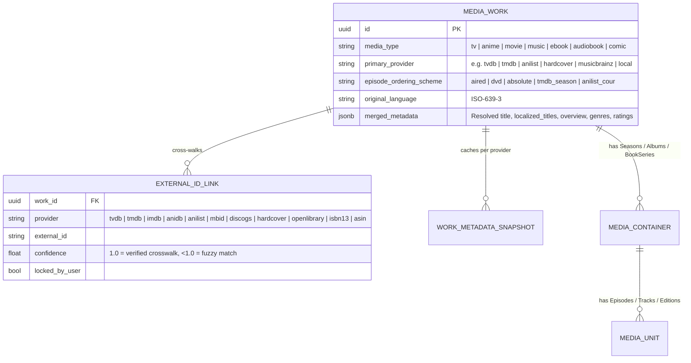

# Pluggable Multi-Source Metadata Federation Architecture

## 1. Breaking Free from Single-Provider Lock-In

Every legacy `*arr` application hard-wired its domain identity to a single upstream metadata source (often funneled through a centralized Servarr proxy):
* **Sonarr -> SkyHook (TheTVDB only):** If TVDB moderators lock a controversial season split (e.g., *Money Heist*, *Attack on Titan*, *Monogatari*, YouTube/nebula web series), you cannot switch that series to TMDB, AniList, or TVMaze ordering.
* **Radarr -> TMDB only:** Stand-up specials, concert films, fan edits, or TV-movies classified as miniseries on TMDB cannot be added even when listed on TVDB or IMDb/OMDb.
* **Lidarr -> MusicBrainz only:** Indie Bandcamp EPs, DJ mixes, game soundtracks, and new SoundCloud/Deezer releases absent from MusicBrainz are completely unmanageable.
* **Readarr -> BookInfo (Goodreads scraper):** When the centralized Goodreads proxy broke, the entire Readarr project had to be retired upstream, stranding thousands of libraries.

**Managerr Principle:**
> Ship all familiar `*arr` default providers enabled by default for a simplified setup, while treating **every metadata provider as a hot-swappable plugin** at the **Global**, **Library**, and **Individual Work** levels, plus a **Local/NFO Escape Hatch** so you are never blocked from managing your own media.

---

## 2. Default + Optional Metadata Provider Matrix

Managerr includes first-party adapters for the standard `*arr` defaults alongside modern alternatives across every vertical:

| Media Vertical | Built-in `*arr` Default(s) | Built-in Alternative & Enrichment Providers | Special Crosswalk / Mapping Sources |
| :--- | :--- | :--- | :--- |
| **TV Series** | **TheTVDB v4** *(Sonarr default)* | **TMDB (TV)**, **TVMaze**, **Trakt**, **OMDb / IMDb**, **Fanart.tv** | **TheXEM** (scene <-> TVDB numbering), **Wikidata** ID bridge |
| **Anime** | **TheTVDB** + Absolute Mode *(Sonarr default)* | **AniList** (GraphQL), **AniDB**, **MyAnimeList (MAL)**, **Kitsu**, **TMDB** | **Fribb `anime-lists` / PlexAniBridge** (`anidb` <-> `anilist` <-> `tvdb` <-> `tmdb` <-> `imdb`), **Animetosho** |
| **Movies** | **TMDB** *(Radarr default)* | **TheTVDB (Movies)**, **OMDb / IMDb**, **Trakt**, **MDBList** (ratings/lists), **Fanart.tv** | **TMDB <-> IMDb <-> TVDB** native crosswalk |
| **Music** | **MusicBrainz** + **AcoustID** *(Lidarr default)* | **Discogs**, **Deezer API** (credential-free catalog/art), **Last.fm**, **SpotifyMetadata**, **Bandcamp Resolver** | **MusicBrainz URL Relationships** (`mbid` <-> `discogs` <-> `wikidata` <-> `spotify`) |
| **Ebooks** | **Open Library** + **BookInfo-Proxy Compat** *(Readarr migration compat)* | **Hardcover** (GraphQL: rich series & editions), **Google Books**, **BookBrainz**, **DNB (Deutsche Nationalbibliothek SRU)** | **ISBN-13 / ISBN-10 / OCLC / ASIN / Goodreads ID** crosswalk |
| **Audiobooks** | **Open Library** + **Audnexus** | **Hardcover**, **Audible Catalog Regions** (`de`, `com`, `co.uk`, `fr`, `jp`), **Google Books** | **ASIN <-> ISBN <-> Hardcover** edition linking |
| **Comics & Manga** | **ComicVine** / **AniList** | **MangaDex** (multi-language chapters/volumes), **Metron**, **Grand Comics Database (GCD)**, **Open Library** | **MangaUpdates / AniList / MAL** ID crosswalk |
| **Any Vertical (Fallback)** | **Local Sidecar (`NFO` / `OPF` / `ComicInfo.xml` / Embedded ID3-FLAC)** | **Custom HTTP JSON / GraphQL Plugin Manifest** | Synthetic `local:<uuid>` ID (upgradeable to external ID later) |

---

## 3. Canonical Internal Identity vs. External Provider IDs

In Sonarr, `TvdbId` is the show's identity; in Radarr, `TmdbId` is the movie's identity. Changing providers breaks the database.

Managerr decouples internal identity from external providers using a **UUIDv7 Canonical Graph** plus a many-to-many **`ExternalIdLinks`** crosswalk table:



### Crosswalk Graph Function for Indexer Searching
Even if a user chooses **TMDB** or **AniList** as the primary metadata & episode-ordering provider for a TV show, Torznab/Newznab indexers often index releases by `tvdbid`, `imdbid`, or `rid`.
* Because `EXTERNAL_ID_LINK` stores **all** known IDs (`tmdb=95396`, `tvdb=371980`, `imdb=tt11280740`), Managerr's acquisition engine automatically queries indexers using `tvdbid=371980` AND `imdbid=tt11280740` AND localized/alias titles simultaneously, giving users complete freedom of metadata display/ordering **without losing any indexer hits**.

---

## 4. Provider Priority Waterfalls & Field-Level Merge Policies

Each Library defines a **Metadata Profile** that controls both **Fallback Order** (if Provider A is down or lacks an item, try Provider B) and **Field-Level Authority**:

```yaml
metadataProfile:
  id: "tv-anime-hybrid"
  mediaType: "anime"

  # 1. Structural Authority (who defines Seasons/Episodes/Editions?)
  structureAuthority:
    defaultProvider: "anilist"          # Can be overridden per-show in UI (e.g. switch to tvdb or tmdb)
    fallbackProviders: ["thetvdb", "tmdb", "tvmaze"]
    allowUnlistedLocalItems: true

  # 2. Field-Level Enrichment Merge Order
  fieldMergeOrder:
    titlesAndAliases: ["anilist", "thetvdb", "tmdb", "anidb"]   # Collects ALL localized titles (DE, EN, JA-Romaji) for release matching.
    localizedOverview:
      preferredLanguages: ["de", "en"]
      providers: ["tmdb", "thetvdb", "anilist"]
    artwork:
      posters: ["fanart_tv", "tmdb", "thetvdb", "anilist"]
      backdrops: ["tmdb", "fanart_tv"]
      clearLogo: ["fanart_tv", "tmdb"]
    ratings: ["imdb", "anilist", "trakt", "tmdb"]
```

### Key Capabilities Enabled by Field-Level Merging
1. **Multilingual Title Alias Harvesting (Multilingual Search Relevance):**
   * When searching German, French, or Japanese trackers, releases may use the localized title (*"Haus des Geldes"*), international title (*"Money Heist"*), or original title (*"La Casa de Papel"*).
   * Managerr harvests **all language aliases across all linked providers** (`TMDB translations` + `TVDB aliases` + `AniDB synonyms` + `Hardcover/OpenLibrary edition titles`) so automated searches find both original and translated releases directly.
2. **Per-Show / Per-Book Provider Switcher:**
   * On any item's detail page, click **Change Structural Provider / Ordering** (e.g., `TheTVDB (Aired)` -> `TMDB` or `TheTVDB (DVD Order)` or `AniList`) with a live side-by-side preview of how existing files on disk will re-map before committing.
3. **Resilient Caching & Outage Immunity:**
   * Provider responses are cached locally with Stale-While-Revalidate (`ETag` / `Last-Modified`) and circuit breakers. If an upstream API goes offline (or rate-limits), library browsing, importing, and RSS matching continue uninterrupted from local snapshots and fallback providers.
4. **Direct API Keys OR Self-Hosted/Community Proxies:**
   * Users can supply their own free API keys (TMDB, TVDB, Hardcover, Discogs, Fanart.tv, MAL), use zero-key open APIs (Open Library, MusicBrainz, Audnexus, TVMaze, AniList, Deezer), or point any adapter at a self-hosted mirror (e.g., local MusicBrainz VM or custom caching proxy).

---

## 5. Extensible Metadata Plugin SDK

New metadata sources can be added without modifying Managerr core via two mechanisms:

1. **Declarative JSON/YAML HTTP Adapter (`metadata-definitions/*.yml`):**
   * Similar to how Cardigann YAML democratized torrent indexers, a declarative metadata manifest maps `search`, `getWorkById`, `getChildren`, and JSONPath/GraphQL selectors for REST/GraphQL catalogs.
2. **.NET `IMetadataProviderPlugin` Assembly / WASM Sandbox:**
   * Strongly typed C# contract (`SearchAsync`, `GetWorkGraphAsync`, `ResolveExternalIdsAsync`, `GetArtworkAsync`) loaded from `/plugins/metadata/` with isolated `AssemblyLoadContext` and outbound HTTP domain allowlists.
