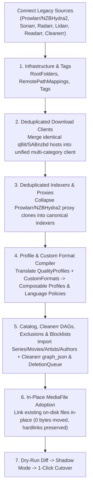

# `*arr` & Overseerr Migration + Shadow-Sync Specification

Replacing an established homelab stack (`Sonarr` + `Radarr` + `Lidarr` + `Readarr` + `Prowlarr` / `NZBHydra2` + `Cleanerr` + `Overseerr/Seerr`) involves preserving existing user configurations: users have years of curated root folders, hardlinked torrents, TRaSH Custom Formats, Cleanerr ReactFlow workflows & exclusions, blocklists, and monitored states.

Managerr includes an idempotent **Migration & Shadow-Sync Engine (`Managerr.Migration`)** engineered for **no re-downloads and no broken hardlinks**.

---

## 1. Supported Ingestion Modes

Every legacy source can be ingested via either (or both) of two transports:

1. **Offline Backup `.zip` / Raw Database Reader (Fast & Consistent):**
   * Directly reads `sonarr.db`, `radarr.db`, `lidarr.db`, `readarr.db`, `prowlarr.db` + `config.xml`, `nzbhydra.yml` / `nzbhydra.mv.db` (if migrating from **NZBHydra2**), and **`cleanerr.db`**.
   * Inspects `VersionInfo` (FluentMigrator schema version) to handle Sonarr v3, v4, and **v5 (`QualityProfileQualityRanks`, `Connections`)**, Radarr v4/v5 (`243_mediainfo_multiple_streams`), Lidarr v2, Readarr v0.4, Prowlarr v1, and Cleanerr v1 SQLAlchemy schemas cleanly.
2. **Live REST API Connector (Zero File Copying Needed):**
   * Connects to running instances via URL + `X-Api-Key` / Bearer token (`/api/v3`, `/api/v5`, `/api/v1`) to pull live state, and supports **Continuous Delta Sync** while testing Managerr in parallel.

---

## 2. Deterministic 7-Phase Migration Pipeline

---

## 3. Exact Source-to-Managerr Schema Mapping & Deduplication Rules

### 3.1 Indexer and Proxy Deduplication (`prowlarr.db` / `nzbhydra.yml` + `*arr.db`)
A typical user has indexers in `prowlarr.db` or `NZBHydra2`, replicated as synthetic Torznab/Newznab proxy rows across `sonarr.db`, `radarr.db`, `lidarr.db`, and `readarr.db`.
* **How Managerr Deduplicates Deterministically:**
  1. Imports canonical `Indexers` (`Cardigann`, `Newznab`, `Torznab`, native trackers) + `IndexerProxies` (`FlareSolverr`, `SOCKS5`) + `IndexerStatus` cookies directly from `prowlarr.db` and/or `nzbhydra.yml`.
  2. Reads `ApplicationIndexerMapping` in `prowlarr.db` (and matches `nzbhydra2` base URLs) to recognize and **skip** every synthetic `(Prowlarr)` / `(NZBHydra2)` aggregate proxy entry in `sonarr.db` / `radarr.db` / `lidarr.db` / `readarr.db`, while preserving any standalone indexers configured only inside an individual `*arr` app.

### 3.2 Download Client Consolidation
* Matches `DownloadClients` across all source databases by normalized `(Implementation, Host, Port, Username)`, so the same client configured in several *arr apps becomes one Managerr download client. Hosts are taken over exactly as configured; only a loopback host in a live *arr is replaced by that *arr's own host.
* Merges four identical `QBittorrent` / `SABnzbd` configs (`tv-sonarr`, `radarr`, `lidarr`, `readarr` categories) into **one unified Managerr Download Client** preserving each legacy category name in `categoryMappings`, so **every active seeding torrent in qBittorrent continues tracking without changing categories or breaking paths**.

### 3.3 Quality Profile & Custom Format Compiler
Reads `QualityDefinitions`, `QualityProfiles`, `QualityProfileQualityRanks` (Sonarr v5), `CustomFormats`, `ReleaseProfiles`, `DelayProfiles`, and `MetadataProfiles` (Lidarr/Readarr):

1. **Structural Fidelity:** Compiles allowed qualities, quality group ordering, and `Cutoff` into Managerr's `Quality` axis so initial release scoring matches legacy behavior 1:1 on Day 1.
2. **Automatic Language Rule Uplift Assistant:**
   * Detects Custom Formats using `LanguageSpecification` (e.g., TRaSH `"German"`, `"Language: Not Original"`, `"Dual Audio"`, `"MULTi"`) and offers a side-by-side wizard prompt:
     * *Option A (Strict 1:1 Legacy Compat):* Keep as raw trait scores.
     * *Option B (Recommended Uplift):* Promote detected language CFs into a native **Managerr Language Policy** with `enableLanguageUpgrades: true` and quality-floor protection.

### 3.4 Complete Media Catalog & In-Place File Adoption Table Map

| Source DB | Imported Source Tables | Target Managerr Entities | Special Migration Handling |
| :--- | :--- | :--- | :--- |
| **`sonarr.db`** | `Series`, `SeriesTranslations`, `Episodes`, `EpisodeFiles`, `SubtitleFiles`, `SceneMappings`, `History`, `Blocklist`, `ImportLists`, `ImportListExclusions` | `MediaWork (tv / anime)` -> `MediaContainer (Season)` -> `MediaUnit (Episode)` -> `MediaFile` | Preserves `SeriesType` (`Standard`, `Daily`, `Anime`), populates `ExternalIdLinks` (`tvdb`, `tvmaze`, `imdb`, `tmdb`), retains existing `MediaInfo` JSON |
| **`radarr.db`** | `Movies`, `MovieMetadata`, `MovieTranslations`, `AlternativeTitles`, `Collections`, `MovieFiles`, `SubtitleFiles`, `History`, `Blocklist`, `ImportLists`, `ImportExclusions` | `MediaWork (movie)` + `Collection` -> `MediaUnit` -> `MediaFile` | Links `tmdb` + `imdb` IDs, preserves `MinimumAvailability` (`Announced`, `InCinemas`, `Released`), imports movie editions |
| **`lidarr.db`** | `Artists`, `ArtistMetadata`, `Albums`, `AlbumReleases`, `Tracks`, `TrackFiles`, `MetadataProfiles`, `LyricFiles`, `History`, `Blocklist` | `MediaWork (music)` -> `MediaContainer (Album)` -> `MediaEdition (AlbumRelease)` -> `MediaUnit (Track)` -> `MediaFile` | Preserves `ForeignArtistId` / `ForeignAlbumId` (`MusicBrainz` MBIDs) and selected release edition bindings |
| **`readarr.db`** | `Authors`, `AuthorMetadata`, `Books`, `Editions`, `Series`, `SeriesBookLink`, `BookFiles`, `MetadataProfiles`, `History`, `Blocklist` | `MediaWork` -> `MediaContainer (Book)` -> `MediaEdition` -> `MediaUnit (ebook / audiobook)` -> `MediaFile` | **Merges dual Readarr instances.** If user ran `readarr-ebooks` + `readarr-audiobooks`, matches books by `ForeignBookId` / `ISBN` / `(Author, Title)` into unified works with dual `ebook` + `audiobook` slots, and auto-crosswalks defunct Goodreads IDs to **Open Library + Hardcover + Audnexus**. |
| **`cleanerr.db` (Cleanerr)** | `workflows` (`graph_json`, `cron_schedule`, `dry_run`), `exclusion_rules`, `deletion_queue` (`staged_at`, `delete_at`, `action_config_json`), `service_instances` (`plex`, `seerr`), `plex_libraries`, `app_settings` (`discord_bot_token`, `discord_webhook_url`, `discord_channel_id`) | `Managerr.Cleanerr` Workflows, ExclusionRules, Staged DeletionQueue & Discord/Plex Connectors | Imports existing `@xyflow/react` workflow graphs verbatim (e.g. *Monday Movies 1-Year Cleanup* & *Monday TV Seasons 1-Year Cleanup*), binds `media_item_id` references via `tmdb_id`/`tvdb_id`/`plex_rating_key` to canonical `MediaWork` IDs, maps `seerr_user` / `viewed_by` rules directly to canonical `PlexUser` IDs, and preserves remaining grace days (`delete_at`). |
| **Plex + Overseerr (`db.sqlite3` / API)** | PMS `/accounts` + `plex.tv` Friends/Home Users, Overseerr `user` (`plexId`, `permissions`, `movieQuotaLimit`, `tvQuotaLimit`), `media_request` (`requestedById`, `mediaId`) | Canonical `Users` (`PlexUser` Directory), Library RBAC & Request Ownership | Seeds Managerr's **Plex-First User Directory** in one click, matching Overseerr `plexId` directly to `plex_user_id` so every user's shared library access, preferred languages, request quotas, and historical `requested_by_plex_user_id` ownership carry over with zero Keycloak/IdP setup. |

> [!CAUTION]
> **Strict Zero-Touch File Guarantee During Migration:**
> Adopting `EpisodeFiles`, `MovieFiles`, `TrackFiles`, and `BookFiles` **never moves, renames, remuxes, or modifies files on disk**. Managerr verifies file existence (`stat`), records inode/size/mtime, and marks migrated files as `LanguageVerificationStatus = ImportedUnverified` (allowing optional low-priority background language auditing later if desired).

---

## 4. Safe Cutover Workflow: Dry-Run -> Shadow Mode -> Cutover

To build operator confidence before turning off existing `*arr` containers, Managerr provides a 3-stage rollout:

1. **Stage 1: Interactive Dry-Run Report:**
   * Produces a full pre-flight summary: *"Found 412 TV Series (18,490 EpisodeFiles), 1,280 Movies, 195 Artists, 340 Books, 28 deduplicated Indexers (collapsed from 112), 2 consolidated Download Clients, 0 missing root folder mounts."* Highlights any unmapped container Docker paths (`/tv` vs `/mnt/media/tv`) with an inline **Path Remapper**.
2. **Stage 2: Read-Only Shadow Mode (Optional 24h to 7d Burn-In):**
   * Managerr runs its unified RSS poller and Decision Engine in **Shadow Mode**: it evaluates live RSS releases against migrated profiles and logs *"Managerr would have grabbed X (`LanguageUpgrade`)"* vs *"Legacy Sonarr grabbed Y"* in a comparison dashboard, **without** pushing grabs to download clients or touching disk.
3. **Stage 3: Atomic Cutover and Compatibility Redirect:**
   * With one click (when connected via Live API), Managerr:
     1. Performs a final incremental delta sync of any items/grabs added during Shadow Mode.
     2. Optionally disables `EnableRss` / `EnableAutomaticSearch` on the legacy `*arr` apps via their APIs (keeping legacy containers intact as a cold rollback backup).
     3. Generates scoped `/compat/{sonarr,radarr,lidarr,readarr,prowlarr}` API keys ready to paste into Jellyseerr, Bazarr, and mobile apps (or swap container hostnames in Docker Compose).
