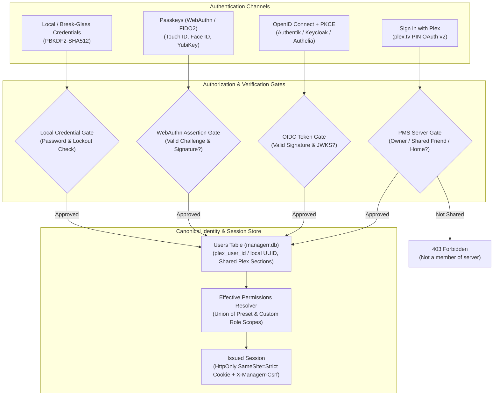

# Authentication, RBAC & Security Architecture

Managerr implements a security model with multiple authentication providers, fine-grained Role-Based Access Control (RBAC), passkeys, envelope encryption at rest, SSRF guards, and audit logs.

---

## 1. Authentication Providers & Identity Architecture

Managerr supports four authentication mechanisms:
1. **Sign in with Plex** (Primary identity provider)
2. **OpenID Connect (OIDC 1.0 + PKCE)** (SSO and identity providers)
3. **WebAuthn / FIDO2 Passkeys** (Biometric and hardware keys)
4. **Local Accounts & Break-Glass Administrator** (Offline LAN fallback)



All authentication providers can be configured in the Web UI under **Settings -> General -> Authentication & Security** (`GET/PUT /api/v1/settings/auth`) or via environment variables.

---

## 2. Sign in with Plex

Managerr uses Plex as its primary identity provider via `plex.tv` PIN OAuth v2 paired with a local Plex Media Server (PMS) membership gate.

### Configuration Options
* **`enabled`**: Enables or disables Plex PIN OAuth login (`true` by default).
* **`boundServerUrl`**: Optional explicit PMS URL bound to this Managerr instance (e.g., `http://plex:32400` or `https://plex.example.com`) for membership verification and library section synchronization.

### Authentication Flow:
1. **PIN Creation:** The web UI requests a new PIN (`POST /api/v1/auth/plex/pin`). Managerr contacts `https://plex.tv/api/v2/pins?strong=true` with its client identifier and returns the PIN code and authorization URL.
2. **User Authorization:** The user authorizes the application in a popup window on `app.plex.tv/auth`.
3. **Token Resolution:** The web UI polls `GET /api/v1/auth/plex/poll/{pinId}`. Upon authorization, Managerr fetches the user profile (`plexUserId`, `uuid`, `username`, `email`, `thumb`, `defaultAudioLanguage`).
4. **PMS Server-Membership Gate:**
   - **Server Membership Check:** An account on `plex.tv` alone does not grant access to Managerr.
   - Managerr verifies against the bound Plex Media Server (`machineIdentifier` / `boundServerUrl`) via PMS `/accounts` and `plex.tv/api/v2/friends` that the user is:
     - The **Server Owner**, OR
     - An active **Plex Home User**, OR
     - An actively shared **Plex Friend**.
   - If an unauthorized user attempts to sign in, the login is rejected. If a friend is unshared from the Plex server, their Managerr session is revoked on the next background sync.
5. **Plex Home User Switching:**
   - Supports household profiles and managed users sharing the same Plex server.
   - Profiles can switch accounts via `POST /api/v1/auth/plex/home-switch` with an optional 4-digit Plex Home PIN.
6. **Library Access Inheritance:**
   - Managerr syncs the exact list of shared library section IDs for each user (`shared_plex_section_ids`).
   - By default, non-admin users can only view and request content in libraries they are allowed to access in Plex.
7. **Offline Session Continuity:**
   - Managerr issues session tokens in an `HttpOnly; Secure; SameSite=Strict` cookie (`managerr_session`).
   - LAN access (`192.168.0.0/16`, `10.0.0.0/8`) continues uninterrupted during internet or `plex.tv` outages.

---

## 3. Generic OpenID Connect (OIDC 1.0 + PKCE) SSO

Managerr provides native OIDC integration implemented in `OidcAuthenticationService` and editable directly in the Authentication Settings UI:

- **Compatible Providers:** Authentik, Keycloak, Authelia, Okta, GitHub/GitLab OIDC, PingFederate, and Google Workspace.
- **Security Standard:** Enforces PKCE (Proof Key for Code Exchange with SHA-256) and validates RS256/ES256 signatures via remote JWKS endpoints.
- **UI & Environment Claim Mappings:**
  - `usernameClaim`: Default `preferred_username`
  - `emailClaim`: Default `email`
  - `displayNameClaim`: Default `name`
  - `groupsClaim`: Default `groups`
- **Provisioning & Email Trust Controls:**
  - `autoProvision`: Creates a Managerr user automatically on first OIDC login when enabled.
  - `trustVerifiedEmail`: Links or provisions accounts using verified email claims from the identity provider.
  - `allowUnclaimedOwnerBootstrap`: If the Managerr instance has not yet been claimed, logging in with an account belonging to `adminGroups` claims instance ownership.
- **Group-to-Role Mapping:** Automatically assigns built-in or custom roles based on token group memberships (configurable in the UI or via environment variables):
  ```ini
  Managerr__Auth__Oidc__Enabled=true
  Managerr__Auth__Oidc__Issuer=https://auth.example.com/application/o/managerr/
  Managerr__Auth__Oidc__ClientId=managerr
  Managerr__Auth__Oidc__ClientSecret_FILE=/run/secrets/oidc_secret
  Managerr__Auth__Oidc__AdminGroups__0=managerr-admins
  Managerr__Auth__Oidc__ManagerGroups__0=managerr-managers
  Managerr__Auth__Oidc__RequesterGroups__0=managerr-users
  ```
- **Connectivity Test:** Use the UI **Test OIDC** button (`POST /api/v1/settings/auth/oidc/test`) to validate discovery metadata and JWKS reachability before enabling SSO.

---

## 4. WebAuthn / FIDO2 Passkeys

Managerr supports passwordless authentication implemented via `PasskeyAuthenticationService` (`Fido2NetLib`):

- **Supported Authenticators:**
  - Platform authenticators: Touch ID, Face ID, Windows Hello, Android Biometrics.
  - Hardware security keys: YubiKey (5 Series, Security Key), Google Titan, Nitrokey.
  - Credential managers: 1Password, Bitwarden, Apple Keychain.
- **Resident Keys (Discoverable Credentials):** Users can log in without typing a username or password.
- **Management UI:** Users can register, nickname, review device AAGUIDs, and revoke passkeys from **System -> Security** or their user profile.
- **UI & Environment Configuration (`enabled`, `rpId`, `rpName`, `requireUserVerification`):**
  ```ini
  Managerr__Auth__Passkeys__Enabled=true
  Managerr__Auth__Passkeys__RpId=managerr.example.com
  Managerr__Auth__Passkeys__RpName=Managerr
  Managerr__Auth__Passkeys__RequireUserVerification=false
  ```

---

## 5. Reverse Proxy Header Trust

When Managerr sits behind Nginx, Caddy, Traefik, or a Tailscale proxy, configure reverse-proxy header trust in **Settings -> Security & Auth** or via environment variables:

- **`trustForwardedHeaders`**: Enables parsing of `X-Forwarded-For`, `X-Forwarded-Proto`, and `X-Forwarded-Host` so rate limits, audit logs, CIDR restrictions, and OIDC/WebAuthn origin validation see the real client IP and HTTPS scheme. Requires a non-empty `trustedProxyCidrs` allowlist to take effect on network requests.
- **`trustedProxyCidrs`**: List of proxy IPs or CIDR ranges allowed to supply forwarded headers (e.g., `127.0.0.1/32`, `172.16.0.0/12`, or `100.64.0.0/10` for Tailscale).
- **`allowedHosts`**: Optional allowlist of hostnames or `*.domain` wildcard patterns accepted from `X-Forwarded-Host` when forwarded headers are enabled (`Managerr:Auth:AllowedHosts` / `system.security.allowed_hosts`).

---

## 6. Local Users & Break-Glass Administrator

For offline environments or emergency recovery, Managerr maintains local credential support:

- **Initial Owner Claim:** If no owner exists, the first user visiting `http://<host>:8989` can complete the local setup wizard (`POST /api/v1/auth/local/claim-owner`) with a username and password.
- **Password Security:** Passwords are never stored in plaintext. They are salted with 16 cryptographically secure bytes and hashed using PBKDF2-SHA512 with 210,000 iterations (`pbkdf2-sha512:210000:<salt>:<hash>`).
- **Break-Glass Emergency Account:** Any administrator can attach a break-glass password or resident passkey to their account (`POST /api/v1/auth/breakglass/setup`). In an emergency, using **Break-Glass Login** bypasses Plex and OIDC cloud checks completely.
- **Brute-Force & Lockout Protections:** The auth endpoints (`/api/v1/auth/*`) are protected by an ASP.NET Core fixed-window rate limiter (`auth_endpoints`, 60 requests per minute per client partition) that throttles repeated attempts.

---

## 7. Users Management & Role-Based Access Control (RBAC)

Managerr implements an RBAC model that combines built-in preset roles with an interactive Custom Role Builder and User Management UI.

### User Editing Modal (`PATCH /api/v1/users/{id}`)
Under **Settings -> Users** (`/settings/users`), administrators can inspect synced Plex and local users, trigger Plex user sync (`POST /api/v1/users/sync-plex`), create local accounts (`POST /api/v1/users/local`), and open the **Edit User** modal to adjust:
* **Account Enabled (`isEnabled`)**: Suspend or restore user login and API token access.
* **Role Assignments**: Assign one or more preset or custom roles (`PUT/PATCH /api/v1/users/{id}/roles`).
* **Request Quotas & Library Access (`requestQuotaLimit`, `sharedLibraryIds`)**: Override per-user request limits or explicitly scope shared libraries.

### Built-in Preset Roles

| Preset Role | System Key | Default Assignment | Scope & Description |
| :--- | :--- | :--- | :--- |
| **`Admin`** | `system:owner` | Plex Server Owner / Instance Creator | **Full Platform Authority.** Cannot be deleted or removed. Access to all libraries, indexers, download clients, Cleanerr, system settings, user management, and encrypted secrets. |
| **`Manager`** | `media:manager` | Co-Admin / Household Curator | **Media & Curation Authority.** Add, edit, and delete media, manage profiles, trigger interactive searches, rescue/exclude Cleanerr items, and review language quarantine. Cannot access system secrets, download client passwords, or edit RBAC roles. |
| **`Requester`** | `media:requester` | Default for Plex Friends & Home Users | **Request Authority.** Browse catalog and submit media requests within shared Plex libraries. No access to download clients, indexers, disk paths, or settings. |
| **`Viewer`** | `media:viewer` | Guests / Read-Only Household Profiles | **Read-Only Access.** Browse media catalog and release calendar. Cannot submit requests or modify state. |
| *`Compat Token`* | `automation:compat` | Ecosystem API Keys (Overseerr, Bazarr) | Scoped access to `/compat/*` shims, catalog read/write, and profiles. |
| *`Metrics Token`* | `metrics:readonly` | Dashboards (Homepage, Prometheus) | Read-only access to `/metrics`, health status, and queue counts. |

### Custom Role Builder (`/api/v1/roles`)
Administrators can clone existing presets or create custom roles under **Settings -> Roles** (`/settings/roles`):
- **Scope Selection:** Toggle any combination of the **36 permission scopes**.
- **Library Access Mode & `allowedLibraryIds` Picker:**
  - `inherit_from_plex`: Dynamically matches the user's shared Plex libraries.
  - `explicit_libraries`: Constrains the role to specific Managerr libraries chosen via the `allowedLibraryIds` picker.
  - `all_libraries`: Grants visibility across all libraries.
- **Request Quotas & Rolling Window:**
  - `AutoApproveRequests` (boolean): Requests skip the pending queue.
  - `MovieRequestQuota`: Max movie requests per rolling window (or null for unlimited).
  - `TvSeasonRequestQuota`: Max TV season requests per rolling window.
  - `MusicBookRequestQuota` (`musicBookRequestQuota`): Max music album and book requests per rolling window.
  - `CleanerrExclusionLimit`: Optional cap on active Cleanerr exclusion rules created by users with this role.
  - **Rolling Quota Window (`system.quotas.rolling_window_days`):** Configurable rolling window in days (default: `30` days), adjustable in General Settings.
- **Multi-Role Union:** A user can be assigned multiple roles; effective permissions are the cumulative union of all granted scopes.

---

## 8. Complete Permission Scopes Reference (36 Scopes)

Actions in Managerr are governed by 36 string constants defined in `src/Managerr.Security/Rbac/PermissionScopes.cs`:

| Category | Scope Identifier | Human-Readable Label | Description |
| :--- | :--- | :--- | :--- |
| **Catalog** | `catalog:read` | Browse Catalog | View movies, series, music, and books within permitted libraries. |
| | `catalog:request` | Request Media | Submit media requests within permitted libraries. |
| | `catalog:auto_approve` | Auto-Approve Requests | Automatically approve media requests without manager review. |
| | `catalog:write` | Add & Edit Media | Add items directly, toggle monitoring, and edit metadata. |
| | `catalog:delete` | Delete Media | Remove catalog entries and media files from disk. |
| **Profiles** | `profiles:read` | View Profiles | View quality and language policies. |
| | `profiles:write` | Edit Profiles | Create and modify composable quality & language policies. |
| **Acquisition** | `indexers:read` | View Indexers | View configured indexers and health status. |
| | `indexers:write` | Manage Indexers | Configure Cardigann/Torznab/Newznab indexers and proxies. |
| | `indexers:search` | Interactive Search | Trigger manual release searches and grabs. |
| | `downloaders:read` | View Downloaders | View download client configurations. |
| | `downloaders:write` | Manage Downloaders | Configure Torrent and Usenet download clients. |
| **Queue & Verification** | `queue:read` | View Queue | Inspect active downloads and import status. |
| | `queue:manage` | Manage Queue | Remove, retry, or manually import queued downloads. |
| | `quarantine:review` | Review Quarantine | Listen to speech snippets and approve/blocklist quarantined grabs. |
| | `langverify:read` | View Language Verification | Inspect stream language verification reports. |
| | `langverify:execute` | Run Language Scans | Trigger on-demand file language verification jobs. |
| **Cleanerr** | `cleanerr:read` | View Cleanerr | View Cleanerr workflows, Leaving Soon queue, and exclusions. |
| | `cleanerr:rescue` | Rescue Queued Media | Rescue or postpone items staged in Cleanerr's Leaving Soon queue. |
| | `cleanerr:exclude` | Create Cleanerr Exclusions | Protect media items, tags, labels, or users from Cleanerr deletion. |
| | `cleanerr:write` | Manage Cleanerr Studio & Discord | Create, edit, import/export Cleanerr workflows, Discord settings, and delete exclusion rules. |
| | `cleanerr:execute` | Execute Cleanerr Cleanup | Run live Cleanerr workflows, process the deletion queue, and delete staged media immediately. |
| **Administration** | `users:read` | View Users | View synced Plex users and role assignments. |
| | `users:manage` | Manage Users | Sync Plex users, assign roles, and edit user quotas. |
| | `roles:manage` | Manage Custom Roles | Create, clone, edit, and delete custom RBAC roles. |
| | `migration:read` | View Migration | Inspect *arr and Overseerr dry-run migration plans. |
| | `migration:execute` | Execute Migration | Run migrations, Shadow Mode, and cutover. |
| | `webhooks:manage` | Manage Webhooks | Configure outbound signed webhooks and Discord bot integration. |
| | `system:admin` | System Administration | System settings, backups, secrets, and break-glass credentials. |
| | `audit:read` | Read Audit Logs | Inspect security and system audit events. |
| **Telemetry** | `metrics:read` | Read Metrics | Read health, queue counts, and Prometheus `/metrics`. |
| **Compatibility Shims**| `compat:sonarr` | Sonarr v3 Shim | Access `/compat/sonarr/api/v3/*`. |
| | `compat:radarr` | Radarr v3 Shim | Access `/compat/radarr/api/v3/*`. |
| | `compat:lidarr` | Lidarr v1 Shim | Access `/compat/lidarr/api/v1/*`. |
| | `compat:readarr` | Readarr v1 Shim | Access `/compat/readarr/api/v1/*`. |
| | `compat:prowlarr` | Prowlarr v1 / Torznab Shim | Access `/compat/prowlarr/api/v1/*` and `/torznab/*`. |

---

## 9. API Keys: Scoped Keys vs. Instance Master Key

Managerr provides two tiers of API tokens for authentication:

### Tier 1: Scoped Machine API Keys (`mgr_live_*`)
Managed under **System -> Security -> API Keys**:
- **Format:** `mgr_live_<pubId>_<secret>` (e.g. `mgr_live_a1b2c3d4_9f8e7d6c5b4a...`).
- **Key Storage:** Only the HMAC-SHA256 hash is saved in the database; the raw token is shown only once at creation time.
- **Bound Owner:** Every key is owned by a specific `PlexUser`; a key cannot hold permissions exceeding its owner's permissions.
- **Scopes:** Keys can be restricted to specific scopes (e.g. only `metrics:read` for Homepage, `cleanerr:read` for monitoring, or `compat:sonarr` for Overseerr).
- **Library Scoping (`libraryIds`):** Keys can be restricted to specific Managerr library IDs.
- **CIDR Restriction:** Supports source IP allowlists (e.g. `192.168.1.50/32`, `10.0.0.0/24`). Requests outside the CIDR are rejected.
- **Expiration (`expiresAt`):** Optional expiration timestamp configurable in the UI with automatic rejection once expired.

### Tier 2: Instance Master API Key (Sonarr/Radarr Compatible)
Located under **Settings -> General -> Security -> API Key**:
- **Format:** 32-character lowercase hexadecimal string (`/^[0-9a-f]{32}$/`).
- **Compatibility:** Drop-in replacement for legacy Sonarr and Radarr API keys. Works directly in Seerr, Overseerr, Bazarr, and Prowlarr.
- **Privilege:** Automatically binds to the active Server Owner and carries all 36 valid permissions (`PermissionScopes.AllValidScopes`).
- **Key Rotation:** Includes a **Reset API Key** action in the UI (`POST /api/v1/settings/general/api-key/reset`). Resetting invalidates the previous key immediately.

---

## 10. Authentication Channels & Ingress Routing

Requests to Managerr are authenticated via `ManagerrAuthenticationHandler` through five distinct channels:

| Priority | Authentication Channel | Header / Parameter Format | Supported Surfaces |
| :---: | :--- | :--- | :--- |
| **1** | `X-Api-Key` Header | `X-Api-Key: <key>` | Global (all REST endpoints and compatibility shims) |
| **2** | Query Parameter | `?apikey=<key>` | Restricted to `/compat/*`, `/feed/*`, `/api/v1/calendar/*`, `/api/v1/torznab/*`, `/api/v1/mcp/*`, and `/mcp/*` |
| **3** | Authorization Bearer | `Authorization: Bearer mgr_live_*`<br>`Authorization: Bearer mgr_sess_*`<br>`Authorization: Bearer <32-hex-key>` | Standard REST API clients and scripts |
| **4** | HttpOnly Session Cookie | Cookie: `managerr_session=<token>` | Managerr Web UI Single Page Application |
| **5** | WebSocket Query Token | `GET /api/v1/realtime?access_token=<token>` | SignalR real-time event streaming socket |

---

## 11. CSRF Protection (`X-Managerr-Csrf`)

To protect browser sessions against Cross-Site Request Forgery (CSRF):
- When a user logs in via the Web UI, Managerr issues a CSRF token in the session payload.
- All cookie-authenticated state-changing HTTP requests (`POST`, `PUT`, `PATCH`, `DELETE`) must include the `X-Managerr-Csrf` header matching the active session.
- API key requests (`X-Api-Key` or `Authorization: Bearer`) and read-only requests (`GET`, `HEAD`, `OPTIONS`) do not require the CSRF header.

---

## 12. Secrets Encryption at Rest (`AES-256-GCM`)

All sensitive credentials stored in `managerr.db` (including download client passwords, indexer passkeys/cookies, metadata provider API keys, Discord bot tokens, Seerr API keys, and OIDC client secrets) are protected using cryptographic envelope encryption implemented in `EnvelopeSecretProtector`:

### Envelope Mechanism:
1. **Key Encryption Key (KEK):** A 256-bit root key derived using HKDF-SHA256 from the instance master secret:
   - Evaluates `MANAGERR_MASTER_KEY` environment variable,
   - Then `/run/secrets/managerr_master_key` (Docker Secret),
   - Then `/config/master.key` (generated automatically on first boot).
2. **Data Encryption Key (DEK):** For every secret written to disk, a fresh random 256-bit DEK is generated.
3. **Payload Protection:**
   - The DEK is encrypted with the KEK using `AES-256-GCM` with a unique 96-bit nonce and associated data `dek:<keyId>`.
   - The secret plaintext is encrypted with the DEK using `AES-256-GCM` with a unique 96-bit nonce and associated data `val:<keyId>`.
4. **Envelope Wire Format:**
   ```text
   enc:v1:{keyId}:{wrappedDekBase64Url}:{encryptedPayloadBase64Url}
   ```
5. **Memory Safety & Masking:** DEKs are zeroed from memory immediately after encryption/decryption using `CryptographicOperations.ZeroMemory`. API responses never return plaintext secrets; instead, they return masked hints:
   ```json
   {
     "isSet": true,
     "maskedHint": "****9f2a"
   }
   ```

---

## 13. SSRF Egress Guard (`SafeHttpClientFactory`)

Managerr prevents Server-Side Request Forgery (SSRF) attacks on outbound connections through `SafeHttpClientFactory`:

### Defense Rules:
- **Socket-Level Verification:** Rather than validating hostnames before DNS resolution, IP addresses are checked in custom socket connect callbacks when the connection is established to prevent DNS rebinding (TOCTOU).
- **Unconditional Blocks:** Egress to cloud provider metadata addresses (`169.254.169.254`, `169.254.0.0/16`), unspecified addresses (`0.0.0.0`), broadcast, and multicast addresses is blocked on all outbound requests.
- **Public vs. Homelab Client Separation:**
  - `CreatePublicClient`: Used for external tracker and metadata API calls. Blocks loopback (`127.0.0.0/8`) and all RFC1918 private subnets (`10.0.0.0/8`, `172.16.0.0/12`, `192.168.0.0/16`).
  - `CreateHomelabClient`: Used for download clients, Plex, Seerr, and internal webhooks. Allows private subnets explicitly specified in `SafeHttpEgress:AllowedPrivateCidrs` and internal container hostnames in `SafeHttpEgress:AllowedInternalHosts`.

---

## 14. Idempotency & Error Handling (RFC 9457)

### Idempotency Keys (`Idempotency-Key`)
To prevent duplicate operations during network retries:
- Clients can send an `Idempotency-Key: <unique-uuid>` header on mutating `POST` requests.
- `IdempotencyMiddleware` calculates a SHA-256 hash of `actorKey + method + path + key`.
- If a duplicate request is received within the expiration window, Managerr returns the cached HTTP status code and response body without re-executing the action.

### RFC 9457 Problem Details
API errors return standardized RFC 9457 `application/problem+json` payloads:
```json
{
  "type": "https://managerr.dev/problems/err_rbac_forbidden",
  "title": "Access denied",
  "status": 403,
  "detail": "Missing required scope 'indexers:write' to modify indexer configuration.",
  "code": "ERR_RBAC_FORBIDDEN",
  "traceId": "00-4b8c9d2f...-01"
}
```

---

## 15. Security Audit Logging

Administrative, security, Cleanerr workflow/queue execution, and authentication events are written to an append-only `audit_events` table inside `/config/telemetry.db`:

- **Recorded Metadata:**
  - `timestamp`: UTC ISO 8601 timestamp.
  - `actor_type`: `user`, `api_key`, or `system`.
  - `actor_id`: User ID or API key prefix.
  - `ip_address`: Remote IP address of the client.
  - `action`: Specific operation (e.g. `auth.login`, `role.created`, `apikey.revoked`, `settings.updated`, `cleanerr.workflow.live_enabled`, `cleanerr.queue.deleted_now`).
  - `resource_type` and `resource_id`: The target entity modified.
  - `diff_json`: Sanitized before/after change delta (with secret fields redacted).
- Audit logs can be reviewed by administrators in the UI under **System -> Events** (`/system/events`) or via `GET /api/v1/system/audit`.
