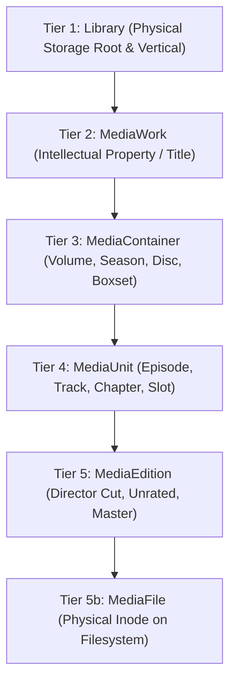
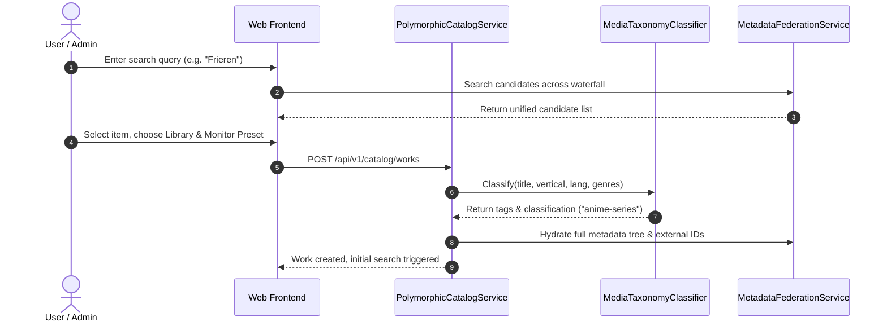
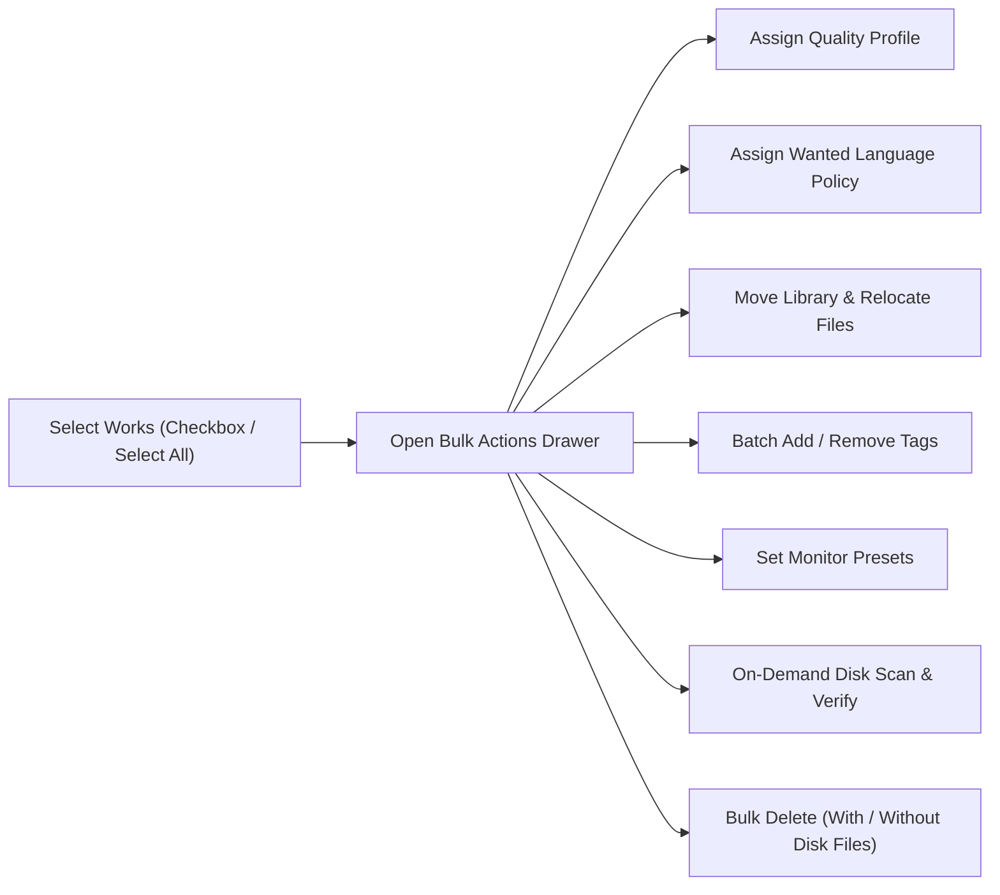
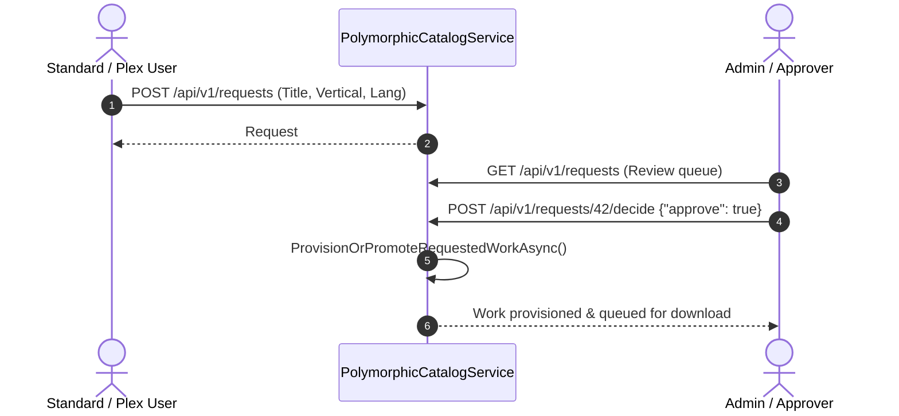

# Catalog, Libraries & Media Management

Managerr uses a single polymorphic catalog engine to handle movies, TV series, anime, music, books, and comics. Every form of media (feature films, serialized television, anime seasons, musical discographies, literary volumes, and comic issues) is modeled through a unified 5-tier relational hierarchy.

This model supports cross-vertical discovery, centralized storage tracking, unified language profiles, and multi-slot tracking for linked formats like eBooks and Audiobooks.

---

## The 5-Tier Polymorphic Data Model

Managerr generalizes media across all formats into five polymorphic layers:



### Hierarchy Breakdown

| Tier | Entity | Role & Semantics | Concrete Vertical Examples |
| :--- | :--- | :--- | :--- |
| **1** | **`Library`** | Top-level administrative and physical filesystem container. Defines default quality profiles, language policies, metadata provider waterfalls, and storage mount points. | *Movies Library* (`/media/movies`), *Anime TV* (`/media/anime`), *Unified Books* (`/media/books`). |
| **2** | **`MediaWork`** | The root intellectual property (IP). Stores global metadata: canonical title, sort title, localized aliases, primary metadata provider, episode ordering scheme, tags, locked fields, and external IDs (`tmdb`, `imdb`, `tvdb`, `anilist`, `musicbrainz`, `goodreads`). | *Dune (2021)*, *Frieren: Beyond Journey's End*, *Pink Floyd - The Dark Side of the Moon*, *Frank Herbert - Dune*. |
| **3** | **`MediaContainer`** | Structural grouping unit within a work. Represents seasons, volumes, book containers, or disc sets. Tracks container-level release dates, external IDs, and monitoring toggles. | *Season 1*, *Specials (Season 0)*, *Disc 1*, *Volume 1*, *Standard Book Container*. |
| **4** | **`MediaUnit`** | The monitored item: stores absolute numbers, air dates, language cutoff status, and watch counters. | *Episode 01*, *Track 04*, *eBook Slot*, *Audiobook Slot*, *Movie Feature Unit*. |
| **5** | **`MediaEdition`** | Concrete release cut, master, or editorial edition attached to a unit. Manages edition preferences and variant tracking. | *Theatrical Cut*, *Director's Cut*, *Extended IMAX Edition*, *2011 Remaster*, *Unabridged Edition*. |
| **5b** | **`MediaFile`** | The actual physical file residing on the filesystem. Contains media telemetry (resolution, video codec, HDR/DV format, audio codec), detected audio/subtitle tracks, hardlink status, and deep language verification results. | `Dune.2021.2160p.UHD.Remux.mkv` (58.4 GB, Inode #849201, Verified DE+EN EAC3). |

### Dual Ebook + Audiobook Unified Slots

Managerr manages written and spoken literature under a single `MediaWork` without requiring separate server instances:

* When adding a book, the engine instantiates a single `MediaWork` representing the literary title.
* Inside its primary container, two dedicated `MediaUnit` slots are generated:
  1. `ebook_slot` (Unit Kind: `ebook_slot`, Unit #1): Monitors and matches EPUB, MOBI, AZW3, and PDF files.
  2. `audiobook_slot` (Unit Kind: `audiobook_slot`, Unit #2): Monitors and matches M4B, MP3, and FLAC audio releases.
* Users can monitor both slots concurrently (the default Dual-Slot preset), monitor only one format (`ebookOnly` or `audiobookOnly`), or unmonitor either slot at will.
* Media files attached to each slot are tagged with `SlotKind: "ebook_slot"` or `SlotKind: "audiobook_slot"`, ensuring indexer searches, language policies, and quality scoring are routed to the proper format handler without cross-contamination.

---

## Library Management & Storage Telemetry

Libraries connect abstract media verticals to host filesystem storage. Managerr provides real-time storage telemetry, safety guards against invalid root folders, and a server-side filesystem explorer.

### Creating & Editing Libraries (`POST /api/v1/libraries`, `PATCH /api/v1/libraries/{id}`)
Under **Settings -> Media Management** (`/settings/media`), administrators can create new libraries or edit existing library settings:
* **`name` & `rootFolderPath`**: Library display name and filesystem root directory (selected via `PathBrowserModal`).
* **`mediaType`**: Target media vertical (`movies`, `tv`, `anime`, `music`, `ebooks`, `audiobooks`, `comics`).
* **`defaultProfileId`**: Assigns the default Composable Quality Profile for newly added or requested items in that library.
* **`metadataWaterfall`**: Customizes the ordered list of metadata providers evaluated for the library (e.g., `anilist -> tvdb -> anidb -> tmdb -> local_sidecar`).
* **Fallback Default Profile (`catalog.default_profile_slug`)**: When a work or request is created without an explicit profile on the work or library, Managerr resolves the configured fallback profile slug (`catalog.default_profile_slug`, configurable via Verification/Catalog settings).

### Disk Space Telemetry

Each configured library maintains dynamic disk space telemetry exposed through `LibrarySummary`:

* **`FreeSpaceBytes` & `TotalSpaceBytes`**: Polled via host OS `DriveInfo` queries on the library's `RootFolderPath`. Telemetry reflects real storage usage, accounting for underlying ZFS datasets, Btrfs subvolumes, NFS shares, or standard ext4/XFS mounts.
* **`RootAccessible`**: A boolean health indicator. If an external NFS/SMB mount drops or file permissions are lost, `RootAccessible` flips to `false`, immediately pausing automated import routines and triggering a warning banner in the Web UI.

### Forbidden System-Root Checks

To prevent misconfigured bind mounts and unintended deletion of system files, Managerr enforces root-folder validation (`IsForbiddenSystemRoot` in `PolymorphicCatalogService.cs`).

The following path prefixes and their exact matches are strictly forbidden as library roots:

```text
/etc    /proc   /sys    /dev    /root   /boot
/usr    /bin    /sbin   /lib    /lib64  /app
/config /var    /run
```

Attempting to register a library pointing to any of these directories immediately rejects with an `ArgumentException` and Problem Details error code `https://managerr.dev/problems/err_forbidden`.

### Server-Side Path Browser (`PathBrowserModal`)

When setting up or editing libraries, administrators can navigate the host filesystem using the server-side browser powered by `GET /api/v1/filesystem` (accepts `path` and `includeFiles` query parameters):

* **Quick Roots**: Automatically exposes common media roots (e.g., `/data`, `/media`, `/storage`, `/mnt`) and existing library roots for fast navigation.
* **Inline Directory Creation**: Administrators can create nested folders directly through the browser modal (`POST /api/v1/filesystem/directories` with `{ "path": "/data/media/..." }`), with permission checks ensuring the daemon can read and write to the directory.
* **Security Scoping**: Directory traversal is restricted from entering protected system roots, preventing unauthorized filesystem reconnaissance through the UI.

---

## Adding Media & Ingestion Workflows

Media can be added interactively via the **Add New Media** view (`/library/add`), imported via lists, or requested by users.



### Monitor Presets

When adding a work or adjusting its monitoring policy, Managerr provides contextual presets based on the media vertical:

| Vertical | Preset Key | Description |
| :--- | :--- | :--- |
| **TV / Anime / Cartoons** | `all` | Monitors all past, present, and future episodes across all seasons. |
| | `future` | Monitors only un-aired episodes whose release date is in the future. |
| | `missing` | Monitors only episodes that have already aired but do not have a physical file on disk. |
| | `existing` | Monitors only episodes that currently have a file on disk. |
| | `recent` | Monitors episodes released within the last 90 days plus all future episodes. |
| | `pilot` | Monitors exclusively the pilot episode (Season 1, Episode 1). |
| | `firstSeason` | Monitors all episodes belonging to Season 1; unmonitors subsequent seasons. |
| | `lastSeason` | Monitors all episodes of the most recent season; unmonitors older seasons. |
| | `monitorSpecials` | Toggles monitoring on for Season 0 / Specials. |
| | `unmonitorSpecials`| Leaves regular seasons intact while unmonitoring Season 0 / Specials. |
| | `none` | Adds the work in a completely unmonitored state (no automated downloads). |
| **Books / Literature** | `all` | Dual-slot monitoring: monitors both the `ebook_slot` and `audiobook_slot`. |
| | `ebookOnly` | Monitors the eBook slot while leaving the audiobook slot unmonitored. |
| | `audiobookOnly` | Monitors the Audiobook slot while leaving the eBook slot unmonitored. |
| | `none` | Keeps both slots unmonitored. |
| **Movies / Music** | `all` | Monitors the entire movie feature or complete musical album / release group. |
| | `none` | Adds the work unmonitored for indexing or metadata tracking only. |

### Minimum Availability

For feature films, the `MinimumAvailability` setting controls the threshold at which a movie becomes eligible for automated indexer searching and RSS grabbing:

* **`announced`**: Grabs releases the moment an indexer indexes a pre-release or early leak, regardless of theatrical status.
* **`inCinemas`**: Releases are eligible once the movie has premiered in theaters or digital festivals.
* **`released`** *(Default)*: Enforces that the official physical (Blu-ray/DVD) or digital (VOD/Streaming) release date has arrived before triggering automatic download grabs.

---

## Automatic Taxonomy Classification Engine

Managerr features an automated classification engine (`MediaTaxonomyClassifier` in `MetadataModelsAndSdk.cs`) that categorizes works based on metadata signals, genres, origin languages, and external IDs.

### Classification Categories

* **`anime-series`**: Serialized animation originating from Japan or using anime database IDs (`anilist`, `anidb`, `mal`, `kitsu`).
* **`anime-movie`**: Feature-length anime films, OVA movies, or theatrical anime releases.
* **`cartoon-series`**: Western serialized animation (e.g., *Avatar: The Last Airbender*, *Rick and Morty*, *Arcane*, *X-Men '97*).
* **`cartoon-movie`**: Western animated feature films (e.g., *Spider-Man: Across the Spider-Verse*).
* **`live-action-series`**: Standard live-action episodic television.
* **`live-action-movie`**: Standard live-action feature films.
* **`donghua`**: Specialized sub-tag automatically applied to anime-style animations where the original language is Chinese (`zh`, `cn`, `zho`, `chi`, `chinese`).
* **`aeni`**: Specialized sub-tag automatically applied to animation where the original language is Korean (`ko`, `kr`, `kor`, `korean`).

### Classification Heuristics

The classifier operates through deterministic heuristic ranking:
1. **Western Animation Guard**: Checks titles against an internal dictionary of known Western cartoons (`Avatar`, `Rick and Morty`, `Arcane`, `The Simpsons`, `Blue Eye Samurai`, `Vox Machina`) to prevent misclassification as anime despite stylized visuals or Asian production studios.
2. **Provider & External ID Signals**: Any work indexed via AniList or AniDB, or possessing verified external IDs for `mal`, `kitsu`, or `xem`, is classified as anime.
3. **Language & Genre Corroboration**: If genre tags contain "Animation" / "Cartoon" and the origin language is East Asian (`ja`, `zh`, `ko`), the work is classified as anime (or sub-tagged as `donghua` / `aeni`).
4. **Overview Semantic Signals**: Analyzes synopsis text for keywords like "manga", "light novel", "shonen", or "high school" when combined with East Asian origin indicators.
5. **Tag Merging**: User-defined custom tags are preserved; the classifier merges managed taxonomy tags without overwriting user tags.

---

## Catalog Filtering, Sorting & State Persistence

The primary Media Library view (`/library`) provides a filterable grid for managing catalog works.

### Labeled Catalog Filter Groups & Date Added Sorting

The catalog interface organizes filters into five labeled bubble groups and supports sorting by title, release year, missing count, rating, or **Date Added** (`sort=added` / `dateAdded` / `addedAt`):

1. **Type**: Filters by root vertical (`Movies`, `TV`, `Anime`, `Music`, `Ebooks`, `Audiobooks`, `Comics`).
2. **Library**: Isolates items belonging to one or more specific physical libraries.
3. **Status**: Evaluates work lifecycle state (`Continuing`, `Ended`, `Upcoming`, `Missing`, `Complete`).
4. **Classification**: Filters by taxonomy (`Anime Series`, `Anime Movie`, `Cartoon`, `Live Action Series`, `Live Action Movie`).
5. **Health**: Surfaces collection hygiene issues:
   * `duplicates`: Works with more physical files than defined media units.
   * `wrong-kind`: Works residing in a library whose media type contradicts the work kind.
   * `non-canonical-quality`: Files containing non-standard quality strings.
   * `missing` / `issues`: Works with unfulfilled monitored units.
   * `healthy` / `ok`: Works with all monitored units satisfied.
   * `unmonitored`: Works where monitoring has been disabled.

### Full State Persistence on `Back` Navigation

When navigating back from a work detail view, the web UI preserves scroll position and active filters:

* **URL Query Parameters**: Active filters are synchronized to the browser address bar using concise query keys:
  * `libs`: Comma-separated library IDs (`?libs=1,3`).
  * `types`: Media vertical tokens (`?types=tv,anime`).
  * `mon`: Monitor status (`?mon=monitored`).
  * `avail`: Availability bubbles (`?avail=missing`).
  * `class`: Taxonomy classification key (`?class=anime-series`).
  * `q`: Text search query (`?q=frieren`).
  * `sort` & `dir`: Active sort field and direction (`?sort=added&dir=desc`, also accepts `dateAdded` or `addedAt`).
* **`sessionStorage` & Scroll Memory**: Filter states are mirrored to `managerr.catalogFilterState`. The window vertical scroll position is tracked and saved to `managerr.catalogScrollY`.
* When returning from a Work Detail view via the Back button, the router checks `location.state.fromCatalog`. If present, it restores the search query, bubble selections, and scroll offset.

### Monitored `X / Y` Progress Bars

Every card in the catalog grid displays an `X / Y` monitored unit progress indicator (`resolveWorkDownloadProgress`):

```text
Progress = (Downloaded Monitored Units / Target Monitored Units) * 100
```

* **Target Units**: Only counts units that are explicitly monitored and have already aired (or are dated today or earlier). Future episodes and unmonitored specials do not distort the completion bar.
* **Color States**:
  * **Green (Complete)**: All monitored units have been downloaded and meet quality and language cutoffs.
  * **Amber (Partial)**: Some monitored units are downloaded, but missing units remain.
  * **Red (Missing)**: Work is monitored, but zero monitored units are downloaded.
  * **Gray (Unmonitored)**: Work is not monitored.

---

## Multi-Select Bulk Operations

For large-scale catalog reorganization, the Media Library includes a multi-select mode with an interactive bulk editing drawer.



### Supported Bulk Actions

* **Quality Profile**: Reassign the target quality profile across selected works or reset to library defaults.
* **Wanted Language Policy**: Assign or clear Composable Language Policies (e.g., enforcing German audio + English forced subtitles across an anime library).
* **Move Library & Files**: Moves selected works to a different library. If **Move files on disk** (`MoveFilesOnLibraryChange`) is checked, the daemon relocates files to the new root folder using atomic filesystem renames across mounts.
* **Tags Management**: Batch apply tags using three operational modes:
  * `add`: Appends tags without altering existing tags.
  * `remove`: Strips specified tags from selected works.
  * `replace`: Overwrites all existing tags with the new tag list.
* **Minimum Availability & Monitoring**: Mass-update availability policies or apply monitor presets (`all`, `missing`, `future`, `firstSeason`, `none`).
* **Strictly On-Demand Disk Scan & Language Verification**: Trigger deep disk scans and FFprobe/Whisper audio language verification across all selected items (`/api/v1/catalog/works/bulk-scan-and-verify`). Unlike scheduled background tasks, this operation runs strictly on demand.
* **Safe Deletion**: Deletes works from the database, with an optional toggle to remove media files from physical disk storage.

---

## Media Management, Naming & File Organization

The media organization engine (`MediaManagementAndDiskScanService.cs`) handles file renaming, Plex/Jellyfin ID tagging, hardlinking, and unmapped file adoption.

### Token Catalog

Naming templates support standard Servarr and Managerr tokens across Video, Music, Books, and Comics:

| Token | Meaning | Example Output |
| :--- | :--- | :--- |
| `{Series TitleYear}` | Series clean title with release year | `Avatar Seven Havens (2026)` |
| `{Series Title}` | Series title without year | `Avatar Seven Havens` |
| `{Movie TitleYear}` | Movie clean title with release year | `Dune Part Two (2024)` |
| `{Movie Title}` | Movie title without year | `Dune Part Two` |
| `{Release Year}` | 4-digit release year | `2026` |
| `{Season:00}` | 2-digit padded season number | `01` |
| `{Episode:00}` | 2-digit padded episode number | `13` |
| `{Absolute:000}` | 3-digit padded absolute anime episode | `013` |
| `{Episode Title}` | Localized episode title | `The Convergence` |
| `{Album Title}` | Album or release group title (Music) | `The Dark Side of the Moon` |
| `{Track:00}` | 2-digit padded track number (Music) | `04` |
| `{Track Title}` | Track title (Music) | `Time` |
| `{Book Title}` | Book or audiobook title (Books) | `Dune` |
| `{Comic Title}` | Comic or manga series title (Comics) | `Berserk` |
| `{Issue:000}` / `{Issue:00}` | 3-digit or 2-digit padded comic issue/chapter number | `001` / `01` |
| `{Quality Full}` | Quality source, resolution, codec, HDR | `WEB-DL 1080p AVC` |
| `{Quality Title}` | Simplified quality source + resolution | `WEB-DL-1080p` |
| `{MediaInfo VideoCodec}`| Detected video stream codec | `AVC`, `HEVC`, `AV1` |
| `{MediaInfo AudioCodec}`| Detected audio stream codec | `EAC3`, `TrueHD`, `FLAC` |
| `{MediaInfo AudioLanguages}`| Bracketed detected audio languages | `[DE+EN]` |
| `{MediaInfo VideoDynamicRangeType}`| Dynamic range tag | `HDR10`, `DV` |
| `{Custom Formats}` | Matched custom format names | `German DL`, `Proper` |
| `{Edition Tags}` | Special edition label | `IMAX`, `Director's Cut` |
| `{Release Group}` | Scene / P2P release group | `WAREZCX` |
| `{imdb-{imdbId}}` | Plex/Jellyfin IMDb match tag | `{imdb-tt1234567}` |
| `{tmdb-{tmdbId}}` | Plex/Jellyfin TMDb match tag | `{tmdb-98765}` |
| `{tvdb-{tvdbId}}` | Plex/Jellyfin TVDB match tag | `{tvdb-412345}` |

### Default Templates by Vertical

* **TV Series**: `{Series TitleYear}/Season {Season:00}/{Series TitleYear} - S{Season:00}E{Episode:00} [{Quality Full}]`
* **Movies**: `{Movie TitleYear}/{Movie TitleYear} [{Edition Tags}] [{Quality Full}]`
* **Anime**: `{Series Title}/{Series Title} - {Absolute:000} [{Quality Full}]`
* **Music**: `{Artist Name}/{Album Title} ({Release Year})/{Track:00} - {Track Title} [{Quality Full}]`
* **Books / Ebooks & Audiobooks**: `{Author Name}/{Book Title}/{Author Name} - {Book Title} [{Quality Full}]`
* **Comics / Manga**: `{Comic Title}/Vol {Season:00}/{Comic Title} - #{Issue:000} [{Quality Full}]`

### Dry-Run Preview & Rename Execution

Before altering files on disk, Managerr allows safe testing:
1. **Preview** (`GET /api/v1/libraries/{id}/rename-preview` or `GET /api/v1/catalog/works/{id}/rename-preview`): Compares existing filesystem paths with the paths generated by active naming templates. Returns a diff list showing proposed renames and unchanged files.
2. **Execute** (`POST /api/v1/libraries/{id}/rename-execute`): Atomically renames files and updates database references. If files are hardlinked, links are safely updated without breaking underlying inodes.

### Unmapped Files Workflow

When media files are placed directly into a library folder without being downloaded through Managerr (e.g., manual torrents, legacy library imports), the Disk Scan task flags them as **Unmapped Files**:
* View unmapped files via `GET /api/v1/libraries/unmapped-files`.
* Administrators can map files to specific `MediaWork` and `MediaUnit` entries using `POST /api/v1/libraries/unmapped-files/map`.
* Upon mapping, the file is ingested, verified via FFprobe/Language verification, and renamed according to the library's naming policy.

---

## Calendar & iCal Feed

The Calendar view (`/calendar`) provides an interactive schedule of upcoming releases across monitored libraries.

### Web Calendar Interface

* Displays release events grouped by month, week, or day.
* Color-coded by vertical: Movies (Cyan), TV (Blue), Anime (Purple), Books (Amber), Music (Green).
* Clicking any calendar card opens a quick-preview popover showing episode overview, air date, release status, and an **Auto Search** button to grab releases.

### Authenticated iCal Feed (`.ics`)

Managerr exposes standard iCalendar feeds compatible with Apple Calendar, Google Calendar, Microsoft Outlook, and Nextcloud:

* **Endpoints**:
  * `/feed/v1/calendar/managerr.ics`
  * `/api/v1/calendar/managerr.ics`
* **Authentication**: Supports standard session authentication or Bearer token authentication in the HTTP header.
* **Query Parameters**:
  * `pastDays` *(Default: 7)*: Number of historical days to include in the feed.
  * `futureDays` *(Default: 60)*: Number of upcoming days to schedule.
  * `vertical`: Restricts events to a specific vertical (e.g., `?vertical=tv` or `?vertical=movies`).
  * `unmonitored` *(Default: false)*: Set to `true` to include releases for unmonitored catalog items.
  * `tags`: Comma-separated list of tags to filter calendar events (e.g., `?tags=anime,favorite`).

Each `.ics` event includes detailed summaries:
```text
BEGIN:VEVENT
UID:managerr-unit-4921@managerr.local
SUMMARY:Frieren: Beyond Journey's End - S01E28 - The Journey to the North
DESCRIPTION:Season 1 Episode 28\nStatus: Monitored\nAir Date: 2024-03-22
DTSTART;VALUE=DATE:20240322
STATUS:CONFIRMED
END:VEVENT
```

---

## User Media Requests & Approval Workflow

Managerr includes a native media request system with approval workflows:



### Request Lifecycle

1. **Submission (`POST /api/v1/requests`)**:
   * Users with `catalog:request` scope can search upstream metadata and submit requests.
   * Requesters can specify desired audio languages (`RequestedAudioLang`) and subtitle languages (`RequestedSubLang`).
   * Multi-library scoping and rolling quotas (`system.quotas.rolling_window_days`) ensure users can only submit requests within their permitted libraries and role quotas.
2. **Review & Moderation**:
   * Administrators review pending requests via the **Requests** tab (`/library/requests`).
   * The queue displays requester username, request timestamp, requested language preferences, and links to upstream metadata (TMDb, TVDB).
3. **Approval Decision (`POST /api/v1/requests/{id}/decide`)**:
   * **Decline**: Sets status to `declined`, recording the decision in the audit log.
   * **Approve**: Invokes `ProvisionOrPromoteRequestedWorkAsync`:
     1. Creates a new `MediaWork` in the requested library (or links to an existing work if already cataloged).
     2. Sets requested language policies and quality profiles.
     3. Marks the work and its units as monitored.
     4. Triggers an indexer search to acquire the requested release.

---

## Related Documentation

* [01. Getting Started & Self-Hosting](01-Getting-Started-and-Self-Hosting): Initial setup, container deployment, and storage volume mappings.
* [02. Authentication, RBAC & Security](02-Authentication-RBAC-and-Security): User permissions, request scopes, and Plex OAuth configuration.
* [04. Metadata Federation & Crosswalk](04-Metadata-Federation-and-Crosswalk): Metadata provider waterfalls, field locking, and external ID crosswalks.
* [07. Quality Profiles, Scoring & Language Policies](07-Quality-Profiles-Scoring-and-Language-Policies): Composable profiles, format scoring, and audio language policies.
* [08. Language Verification & Quarantine](08-Language-Verification-and-Quarantine): FFprobe stream verification, Whisper AI speech-to-text, and file quarantine.
* [11. REST API v1 Reference](11-REST-API-v1-Reference): OpenAPI specification for catalog, library, and media management endpoints.
