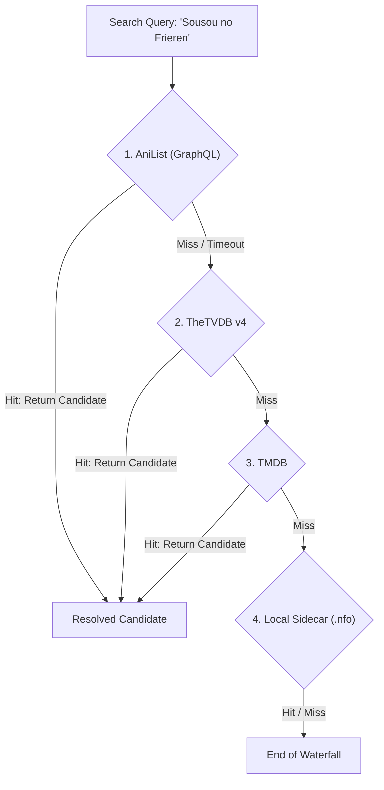
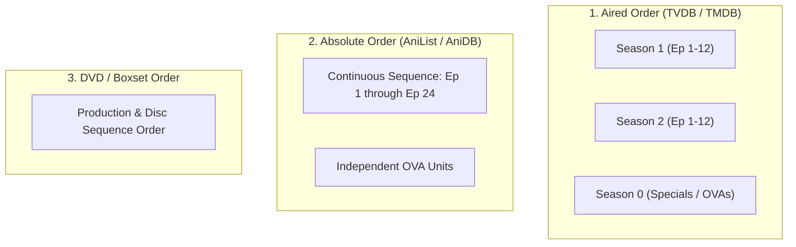
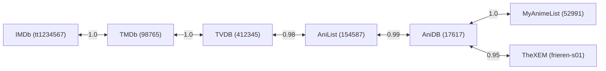

# Metadata Federation & External ID Crosswalk

Indexers publish releases using various title romanizations, absolute episode numbers, and external database IDs. Managerr federates metadata across multiple providers to resolve these differences.

Managerr provides:
1. A pluggable waterfall of 20 built-in metadata providers spanning all media verticals, with UI-editable API keys and custom base URLs.
2. An extensible Custom HTTP Metadata Webhook engine manageable via the UI and REST API.
3. An External ID Crosswalk Graph that traverses relationships between disparate databases (IMDb, TMDb, TVDB, AniList, AniDB, MyAnimeList, Kitsu, TheXEM, MusicBrainz, Discogs, and OpenLibrary).
4. Deterministic Latin / Romaji Title Normalization, localized `Translations` extraction, and SQLite FTS5 Full-Text Search.

---

## Complete Table of Built-In Metadata Providers

Managerr includes 20 pre-configured metadata providers (`BuiltInMetadataProviders.cs` and `MetadataFederationService.cs`). Providers that do not require authentication default to `ready`. Providers requiring API keys remain in `not_configured` until keys are supplied.

| # | Provider Key | Display Name | Supported Verticals | Auth Requirements | Default State | Base URL / Protocol | Description & Capabilities |
| :--- | :--- | :--- | :--- | :--- | :--- | :--- | :--- |
| **1** | **`tvdb`** | TheTVDB v4 / SkyHook | TV, Anime, Movies | None (SkyHook v2) or Optional TVDB v4 Key | `ready` | `https://api4.thetvdb.com/v4` | Default series, season, and episode metadata via zero-key SkyHook proxy or direct TVDB v4 subscriber key. |
| **2** | **`tmdb`** | The Movie Database (TMDB) | Movies, TV, Anime | None (SkyHook v2) or Optional TMDB API Key | `ready` | `https://api.themoviedb.org/3` | Default movie metadata, multi-language descriptions, posters, cast, crew, localized `Translations`, and IMDb cross-references. |
| **3** | **`musicbrainz`** | MusicBrainz + CoverArtArchive | Music | None (Free / Open API) | `ready` | `https://musicbrainz.org/ws/2` | Artist discographies, release groups, media tracklists, and CoverArtArchive cover art. |
| **4** | **`acoustid`** | Chromaprint / AcoustID | Music | **API Key Required** | `not_configured` | `https://api.acoustid.org/v2` | Acoustic audio fingerprinting for automated identification of untagged audio tracks and files. |
| **5** | **`openlibrary`** | Open Library | Ebooks, Audiobooks, Comics | None (Free / Internet Archive) | `ready` | `https://openlibrary.org` | Open literary catalog providing global author, work, edition, and ISBN cross-referencing. |
| **6** | **`anilist`** | AniList GraphQL | Anime, Comics | None (Public GraphQL API) | `ready` | `https://graphql.anilist.co` | Rich anime and manga metadata, Japanese Romaji/Native titles, airing schedules, and studio tags. |
| **7** | **`anidb`** | AniDB + TheXEM | Anime | **Client ID / Key Required** | `not_configured` | `http://api.anidb.net:9001/httpapi` | Authoritative anime catalog with absolute episode numbering and scene group mappings. |
| **8** | **`tvmaze`** | TVMaze | TV, Anime | None (Free / Rate-Limited) | `ready` | `https://api.tvmaze.com` | Fast television schedule lookup, air dates, cast, and embedded episode metadata. |
| **9** | **`trakt`** | Trakt.tv | TV, Movies, Anime | **Client ID Required** | `not_configured` | `https://api.trakt.tv` | Community ratings, trending lists, release dates, and cross-platform watch history synchronization. |
| **10** | **`discogs`** | Discogs Database | Music | **Personal Access Token** | `not_configured` | `https://api.discogs.com` | Physical release catalog (vinyl, cassette, CD masters), catalog numbers, and label information. |
| **11** | **`deezer`** | Deezer Catalog API | Music | None (Free Public API) | `ready` | `https://api.deezer.com` | High-quality album art, ISRC resolution, track previews, and international music releases. |
| **12** | **`indie_folder_tags`** | Indie / Unlisted Folder Tags | Music | None (Local Filesystem) | `ready` | `local://indie-tags` | Extracts ID3/Vorbis tags directly from local folder structures for Bandcamp and unlisted releases. |
| **13** | **`hardcover`** | Hardcover Book Catalog | Ebooks, Audiobooks | **Bearer Token Required** | `not_configured` | `https://api.hardcover.app/v1/graphql` | Modern book metadata, series reading orders, user ratings, and Goodreads/StoryGraph crosswalks. |
| **14** | **`audnexus`** | Audnexus (Audible / Apple) | Audiobooks | None (Free Community API) | `ready` | `https://api.audnex.us` | Audiobook metadata: chapter markers, ASINs, narrator credits, series positions, and unabridged tags. |
| **15** | **`bookbrainz`** | BookBrainz (MetaBrainz) | Ebooks, Audiobooks | None (Free / Open API) | `ready` | `https://api.bookbrainz.org/1` | Open community bibliography linking literary works, translations, editions, and authors. |
| **16** | **`googlebooks`** | Google Books API | Ebooks | None (Standard Public API) | `ready` | `https://www.googleapis.com/books/v1` | Broad global ISBN-10 and ISBN-13 book catalog with synopsis and publishing metadata. |
| **17** | **`dnb`** | Deutsche Nationalbibliothek | Ebooks, Audiobooks | None (SRU Protocol) | `ready` | `https://services.dnb.de/sru/dnb` | Authoritative German national bibliography, used for German literature and Hörbuch releases. |
| **18** | **`mangadex`** | MangaDex API | Comics | None (Public REST API) | `ready` | `https://api.mangadex.org` | Multi-language manga, manhwa, and manhua chapter tracking, volume mappings, and localized aliases. |
| **19** | **`comicvine`** | ComicVine (GameSpot) | Comics | **API Key Required** | `not_configured` | `https://comicvine.gamespot.com/api` | Western comic catalog: series volumes, single issues, storylines, and character credits. |
| **20** | **`local_sidecar`** | Local Sidecar (`.nfo`/`.opf`)| All Verticals | None (Offline Filesystem) | `ready` | `local://sidecar` | Offline fallback: parses existing Kodi/Jellyfin XML `.nfo` files and Calibre `metadata.opf` files. |

### Provider API Keys & Custom Base URLs UI
Navigate to **Settings -> Metadata** (`/settings/metadata`) to configure any of the 20 providers:
* **Encrypted API Keys (`GET /api/v1/metadata/providers/settings`, `PUT /api/v1/metadata/providers/{providerKey}/settings`):** Supply or clear API keys, personal access tokens, or client IDs. Keys are encrypted at rest via `EnvelopeSecretProtector` (`metadata.<key>.api_key`).
* **Custom Base URLs:** Override the upstream endpoint URL for self-hosted mirrors, SkyHook proxies, or local metadata caches.

---

## Custom HTTP Metadata Providers

In addition to built-in providers, Managerr allows administrators to register external HTTP microservices or webhooks via `ICustomHttpMetadataProviderService` directly from **Settings -> Metadata** (`/settings/metadata`). This enables integration with private media trackers, proprietary internal databases, or custom scrapers.

```mermaid
flowchart LR
    A["Managerr Metadata Engine"] -->|HTTP GET /search?q={term}| B["Custom Metadata Webhook"]
    A -->|HTTP GET /lookup?id={id}| B
    B -->|Return Candidate JSON| A
    A -->|Hydrate Works & Units| C["Core Datastore"]
```

### Configuration Schema (`UpsertCustomMetadataWebhookRequest`)

Custom metadata webhooks are managed in the **Settings -> Metadata** UI or via REST API (`GET /api/v1/metadata/webhooks`, `POST /api/v1/metadata/webhooks`, `DELETE /api/v1/metadata/webhooks/{id}`):

```json
{
  "providerKey": "my_anime_indexer",
  "displayName": "Private Anime Tracker API",
  "supportedVerticals": ["anime", "tv"],
  "searchUrlTemplate": "https://metadata.example.com/api/search?q={query}&vertical={vertical}",
  "lookupUrlTemplate": "https://metadata.example.com/api/item/{id}",
  "apiKey": "sec_custom_bearer_token_xyz"
}
```

* **URL Templates**: Support dynamic replacement tokens: `{query}`, `{id}`, `{vertical}`, and `{language}`.
* **Authentication**: If `apiKey` is provided, Managerr automatically attaches an `Authorization: Bearer <apiKey>` header to all outgoing webhook requests.
* **Response Contract**: The custom endpoint returns standard JSON matching Managerr's candidate schema (`title`, `year`, `overview`, `externalIds`, `containers`, `units`).

---

## Offline Sidecars & Indie Media

Managerr can operate entirely offline or ingest unlisted releases without public catalog entries:

### Local Sidecar (`local_sidecar`)
* **Kodi / Jellyfin / Emby `.nfo`**: Detects `<movie>`, `<tvshow>`, and `<episodedetails>` XML documents alongside media files. Reads localized titles, plot summaries, user ratings, and embedded external IDs (`<uniqueid type="tmdb">`).
* **Calibre `metadata.opf`**: Reads Open Packaging Format XML in eBook and Audiobook directories. Extracts Dublin Core elements (`<dc:title>`, `<dc:creator>`, `<dc:identifier opf:scheme="ISBN">`).
* When refreshing metadata, if `local_sidecar` is placed first in the library waterfall, offline edits made in NFO/OPF files take precedence over cloud providers.

### Indie Folder-Tag Mode (`indie_folder_tags`)
* Designed for Bandcamp purchases, SoundCloud rips, or self-published audiobooks that do not exist on MusicBrainz or Discogs.
* The disk scanner reads ID3v2, Vorbis Comments, and FLAC tags directly from audio files to construct artist, album, and track hierarchies automatically, setting `PrimaryProvider: "indie_folder_tags"`.

---

## Provider Waterfalls & Cascading Fallback

Metadata resolution is governed by waterfalls: ordered priority lists of providers evaluated sequentially.

### Per-Library Default Waterfall

Each library configures an ordered list of providers for its vertical (`MetadataWaterfall` on `LibrarySummary`):



* **Default Video Waterfall**: `tmdb` -> `tvdb` -> `tvmaze` -> `trakt` -> `local_sidecar`
* **Default Anime Waterfall**: `anilist` -> `tvdb` -> `anidb` -> `tmdb` -> `local_sidecar`
* **Default Music Waterfall**: `musicbrainz` -> `deezer` -> `discogs` -> `indie_folder_tags`
* **Default Books Waterfall**: `openlibrary` -> `hardcover` -> `dnb` -> `googlebooks` -> `audnexus` -> `local_sidecar`

### Per-Work Overrides

Individual works can override the library waterfall:
* **Primary Provider**: Assign a specific provider (e.g., pinning an anime series directly to `anilist` instead of `tvdb`).
* **Direct ID Queries**: Querying a specific prefix (e.g., `tvdb:412345`, `tmdb:98765`, `imdb:tt1234567`, `isbn:9780441172719`) bypasses search waterfalls and performs an instant O(1) direct lookup.

---

## Field Locking (`LockedFields`)

When updating or re-syncing metadata from upstream APIs, users can retain custom titles, manual year corrections, or custom posters. Managerr supports field-level locking via `LockedFields` (`PolymorphicCatalogService.cs` and `MetadataFederationService.cs`).

Supported lock tokens include:

| Token | Protected Attribute | Effect During Upstream Refresh |
| :--- | :--- | :--- |
| `title` | Canonical Work Title | Prevents remote updates from overwriting custom or translated titles. |
| `sortTitle` | Alphabetical Sort Title | Preserves custom sorting (e.g., sorting without leading "The" or custom ordering). |
| `altTitles` | Localized Title Aliases | Retains user-added search aliases and release match strings. |
| `year` | Release Year | Preserves manual vintage corrections. |
| `status` | Lifecycle Status | Prevents upstream APIs from overriding "Continuing" vs "Ended" status. |
| `overview` | Work Plot / Synopsis | Retains custom or non-spoiler descriptions. |
| `posterUrl` | Artwork / Cover Image | Retains user-uploaded poster artwork and prevents automated poster swaps. |
| `tags` | User Tags | Protects user-assigned tags from being overwritten by taxonomy classifiers. |
| `externalIds` | Crosswalk IDs | Prevents automated linkers from altering manually linked database IDs. |

During synchronization, `ApplyFieldMergeWithLocks` evaluates each incoming attribute against `LockedFields`. Any locked property is preserved verbatim, while unlocked attributes receive fresh upstream data.

---

## Episode Ordering Schemes

Episodic media is frequently broadcast, sold, and grouped differently across platforms. Managerr supports three distinct episode ordering schemes (`EpisodeOrderingScheme`):



1. **`aired`** *(Default for Western TV)*: Follows original broadcast schedules. Separates regular seasons from specials (Season 0).
2. **`absolute`** *(Essential for Anime)*: Uses continuous numbering (e.g., Episode 001 through Episode 1050 for *One Piece*). Matches how anime release groups (SubsPlease, Erai-raws, HorribleSubs) label torrent titles.
3. **`dvd`**: Follows physical DVD/Blu-ray release ordering, restoring creator-intended storylines when broadcast networks aired episodes out of order (e.g., *Firefly*).

### Collapsed Anime Season Alignment

A persistent challenge in media management occurs when TMDb collapses multi-season anime into a single season (e.g., listing all 50 episodes under Season 1), while TVDB and AniList partition the show into multiple seasons (e.g., Season 1: 24 episodes, Season 2: 26 episodes).

Managerr handles this through structural alignment in `UniversalBuiltInMetadataProvider`:
* When querying an anime work, the provider detects whether the remote source provides collapsed seasons versus multi-season structures.
* The External ID Crosswalk maps absolute episode numbers across season boundaries using TheXEM scene maps.
* Release search evaluates both `S02E04` and `Episode 28`, ensuring indexers returning either format match the same underlying `MediaUnit`.

---

## The External ID Crosswalk Graph

The core of Managerr's federation is the **External ID Crosswalk Service** (`ExternalIdCrosswalkService.cs`), an in-memory and database-backed graph traversal engine.



### Graph Architecture

* **Database Table**: `external_id_links` stores directed, weighted edges between provider keys:
  * `source_provider` & `source_id`
  * `target_provider` & `target_id`
  * `media_vertical`
  * `confidence` (Floating point between 0.0 and 1.0)
* **Bidirectional Traversal**: Links are automatically established in both directions (`A -> B` and `B -> A`).
* **Breadth-First Search (BFS)**: When resolving IDs (`ResolveConnectedIdsAsync`), the engine seeds a traversal queue with known IDs. It explores connected nodes up to 32 hops, accumulating all reachable provider keys while maintaining highest-confidence paths.

### Supported ID Ecosystems

* **Movies & TV**: `imdb`, `tmdb`, `tvdb`, `tvmaze`, `trakt`, `wikidata`
* **Anime**: `anilist`, `anidb`, `mal` (MyAnimeList), `kitsu`, `xem` (TheXEM)
* **Music**: `musicbrainz`, `discogs`, `deezer`, `spotify`, `acoustid`
* **Literature**: `openlibrary`, `goodreads`, `hardcover`, `bookbrainz`, `asin` (Amazon/Audible), `isbn`

---

## Latin & Romaji Title Normalization and Localized Translations

Indexers, scene release groups, and fansubbers use inconsistent title variations and localized release titles. A single work may appear as:
* *Sousou no Frieren* (Hepburn Romaji)
* *葬送のフリーレン* (Native Japanese Kanji)
* *Frieren: Beyond Journey's End* (English Official)
* *Frieren - Nach dem Ende der Reise* (German Localized Release)

### Localized `Translations` Extraction
Metadata providers extract localized `Translations` (such as German, French, Spanish, and Japanese title variants) alongside canonical English and Romaji names. These localized variants are stored in `alt_titles` and indexed into both FTS5 catalog search and `GrabHistory` release correlation, allowing German and international releases to match their corresponding works automatically during download import.

### The Normalization Engine (`LatinTitleNormalizer.cs`)

Managerr processes incoming metadata through deterministic normalization routines:

```mermaid
flowchart TD
    Raw["Raw Upstream Metadata"] --> Script{"Script Detection"}
    Script -->|Non-Latin (CJK / Cyrillic)| Translit["Transliterate / Romaji Mapping"]
    Script -->|Latin Script| Clean["Strip Full-Width & Normalize Punctuation"]
    Translit --> Best["Select Best English / Latin Title"]
    Clean --> Best
    Best --> Dedup["Deduplicate & Order AltTitles + Translations"]
    Dedup --> Output["Canonical Work Title + Clean AltTitles"]
```

1. **Script Detection**: Analyzes Unicode code points to detect CJK ideographs, Hiragana, Katakana, Hangul, and Cyrillic text (`ContainsNonLatinScript`).
2. **Punctuation & Full-Width Normalization**: Replaces full-width Unicode characters (`！`, `：`, `〜`) with standard ASCII equivalents (exclamation mark, colon, tilde), strips redundant whitespace, and normalizes smart quotes.
3. **Romanization Selection**: If the primary upstream title is non-Latin, the normalizer checks `attributes`, localized title maps, and transliterated fields to find the cleanest English or Latin-script representation (`SelectBestEnglishOrLatinTitle`).
4. **AltTitles & Translations Ordering**: Collates alternative titles and localized `Translations`, strips duplicates, and sorts them by relevance. Highly ranked aliases are indexed directly into the search catalog.

---

## High-Performance SQLite FTS5 Search

Catalog search (`IFtsSearchService` in `FtsSearchService.cs`) uses SQLite's virtual **FTS5** (Full-Text Search 5) engine with BM25 relevance ranking instead of table scans.

### FTS5 Schema Architecture

```sql
CREATE VIRTUAL TABLE catalog_search_fts USING fts5(
    title,
    alt_titles,
    external_ids,
    content='catalog_search_items',
    content_rowid='id',
    tokenize='unicode61 remove_diacritics 2'
);
```

### Search Query Processing

When a user or API searches for a term:
1. **Token Sanitization**: The input query is split into whitespace-delimited tokens. Punctuation is stripped, and each token is converted to a prefix-matching wildcard:
   ```text
   "dun part" -> "\"dun\"* AND \"part\"*"
   ```
2. **Relevance Scoring via BM25**: SQLite computes Okapi BM25 ranking scores across matching rows, prioritizing hits in `title` over hits in `alt_titles` or `external_ids`:
   ```sql
   SELECT c.id, c.media_type, c.title, c.alt_titles, c.year, c.external_ids
   FROM catalog_search_fts f
   JOIN catalog_search_items c ON c.id = f.rowid
   WHERE catalog_search_fts MATCH @FtsExpr
   ORDER BY bm25(catalog_search_fts)
   LIMIT 25;
   ```
3. **Autocomplete**: The prefix-matching wildcard query provides fast autocomplete responses in the web UI command palette and search bars.

---

## Related Documentation

* [03. Catalog, Libraries & Media Management](03-Catalog-Libraries-and-Media-Management): Polymorphic data model, library structures, and taxonomy classifications.
* [05. Indexers & Release Search](05-Indexers-and-Release-Search): Torznab/Newznab searching, query building, and ID-based matching.
* [07. Quality Profiles, Scoring & Language Policies](07-Quality-Profiles-Scoring-and-Language-Policies): Scoring releases using metadata tags and media characteristics.
* [09. Ecosystem, *arr Compatibility & Migration](09-Ecosystem-Arr-Compat-and-Migration): Migrating legacy Arr databases and preserving external ID links.
* [11. REST API v1 Reference](11-REST-API-v1-Reference): REST endpoints for metadata queries, waterfalls, provider settings, and custom webhooks.
