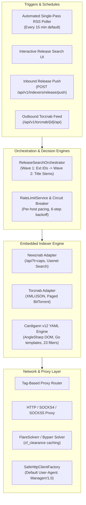
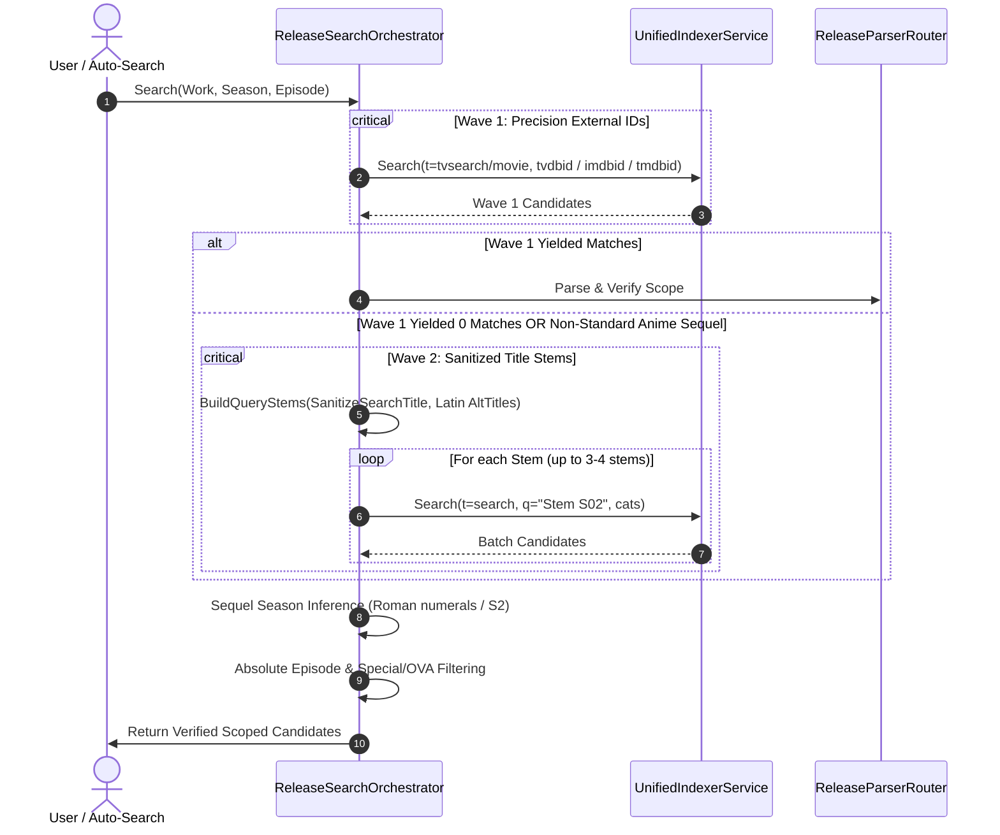

# Indexers and Release Search

Managerr embeds an in-process indexer hub directly into the application core. Running Newznab, Torznab, and the Cardigann v12 YAML engine in-process avoids the process overhead, multi-instance sync latency, and 4x duplicate RSS polling of standalone indexer proxies such as Prowlarr or Jackett.

---

## 1. Architectural Overview and the Unified Polling Hub

In a traditional `*arr` deployment, Sonarr, Radarr, Lidarr, and Readarr each maintain independent HTTP connections to Prowlarr or Jackett. Every application polls its own RSS feeds on distinct timers, resulting in 4x API quota consumption, redundant Cloudflare challenges, and flattened metadata tags.

Managerr unifies indexer management and acquisition into a single coordinator:



### Key Architectural Advantages
1. **Single-Pass RSS Sync:** Instead of 4 separate applications polling the same indexer for TV, movies, music, and books, Managerr issues one unified RSS request per indexer covering all assigned Newznab categories (`2000`, `3000`, `5000`, `7000`). Incoming items are parsed, classified by media vertical, and matched across the catalog in-memory.
2. **Tracker Telemetry Preservation:** Cardigann and Torznab attributes (such as `downloadvolumefactor` for freeleech, `uploadvolumefactor`, minimum seed times, and seed ratio targets) are preserved as fields on `IndexedReleaseCandidate` rather than discarded across HTTP proxy layers.
3. **Outbound Aggregator:** Tools like `autobrr` or `cross-seed` can query Managerr's outbound Torznab endpoints (`/api/v1/torznab/{id}/api` or `/api/v1/torznab/0/api` for an aggregated feed), allowing Managerr to act as the single source of truth for the media stack.

---

## 2. In-Process Cardigann v12 YAML Engine & Indexer UI

Managerr integrates a .NET 10 implementation of the Cardigann specification (Schema v12). This engine parses tracker HTML web interfaces and JSON APIs directly without external runtimes.

### Definition Discovery and Directory Layout
To avoid bundling tracker definitions, Managerr ships with no pre-configured tracker or indexer definitions. Indexer YAML definitions must be supplied by the user:

* **Primary Custom Directory:** `/config/Definitions/Custom`
* **Optional Extended Directory:** Configured via `MANAGERR_DEFINITIONS_DIR` or `Managerr:CardigannDefinitionsDirectory`. This directory supports Prowlarr's tiered `v1..vN` indexer definition directories.

When definitions are added or modified, Managerr re-indexes them without an application restart. Under **Settings -> Indexers** (`/settings/indexers`), the UI provides a **Cardigann YAML Definitions Selector** listing built-in Newznab/Torznab definitions alongside discovered Cardigann YAML definitions, along with editable fields for **`requestDelayMs`** (per-host pacing in milliseconds) and **`tags`** (for tag-based proxy routing).

### Technical Capabilities
The in-process Cardigann engine incorporates:
* **AngleSharp DOM Parser:** HTML5 DOM navigation using standard CSS3 selectors (`table.torrent-table > tbody > tr`).
* **JSON Path and `:filter` Selectors:** Extraction of nested JSON fields from single-page tracker interfaces.
* **Go Template Evaluator:** Parameter interpolation supporting `{{ .Query.Keywords }}`, `{{ .Query.Season }}`, `{{ .Query.Episode }}`, and arithmetic expressions.
* **Authentication Flows:** Support for `form`, `post`, `cookie`, `http`, and `oneurl` login methods, maintaining encrypted session cookies per indexer.
* **Filter Pipeline (23 filters):** Includes `base64encode`, `base64decode`, `dateparse`, `replace`, `regexp`, `trim`, `split`, `urlescape`, `tolower`, `toupper`, and currency or size converters.

---

## 3. Indexer Proxies and Anti-Bot Challenge Solvers

Network access for individual indexers can route through dedicated proxy containers or challenge solvers, configured directly in the **Indexer Proxies UI** under **Settings -> Indexers** (`/settings/indexers`, backed by `GET/POST/DELETE /api/v1/indexers/proxies`).

### Supported Proxy Types
| Proxy Type | Protocol / Port | Purpose |
| :--- | :--- | :--- |
| `flaresolverr` | HTTP REST (default `8191`) | Headless browser Cloudflare Turnstile/v2 solver |
| `byparr` | HTTP REST (default `8191`) | Cloudflare challenge solver |
| `http` | HTTP / HTTPS (e.g. `8080`, `3128`) | Standard forward proxy or local VPN container egress |
| `socks4` | SOCKS4 (e.g. `1080`) | SOCKS4 proxy routing |
| `socks5` | SOCKS5 (e.g. `1080`) | SOCKS5 proxy routing, compatible with Gluetun, Shadowsocks, and Tor |

### Tag-Based Routing and Session Caching
Proxies attach to indexers via matching tags (configured in `tags` / `tags_json` on both indexers and proxies in the UI):
1. **FlareSolverr / Byparr Integration:** Requests dispatched to FlareSolverr or Byparr pass `cmd: request.get` or `request.post` along with `maxTimeout` (clamped between 5 and 300 seconds).
2. **Clearance Caching:** When Cloudflare challenge cookies (`cf_clearance`, `__cf_bm`) and user-agent strings are obtained by FlareSolverr, Managerr caches the clearance session in-memory, avoiding repeated browser invocations for subsequent searches within the session validity window.
3. **Secret Redaction:** Proxy passwords and credentials stored in `password_enc` are encrypted using `EnvelopeSecretProtector`. They are never logged in plaintext or surfaced in unauthenticated endpoints.

---

## 4. Rate Limiting, Pacing, and Failure Circuit Breaker

To prevent indexer account bans, API quota exhaustion, and tracker rate limits, Managerr enforces per-host request pacing and an automated escalation backoff circuit breaker.

### Request Pacing (`requestDelayMs`)
Each indexer record specifies a `requestDelayMs` value (default `1000` ms, configurable in the Indexer UI). Managerr coordinates queries using an internal `SemaphoreSlim` per indexer (`_rateGates`). If consecutive queries arrive faster than the allowed rate, the request pauses for the remainder of the interval before dispatching the HTTP call.

### Failure Circuit Breaker and 6-Step Escalation Backoff
When an indexer throws an HTTP connection error, DNS failure, 5xx gateway error, or authentication rejection, Managerr increments `consecutive_failures` and disables the indexer for a duration dictated by the 6-step backoff ladder:

$$\text{BackoffLadder} = [1\text{ min},\, 5\text{ min},\, 15\text{ min},\, 1\text{ hour},\, 6\text{ hours},\, 24\text{ hours}]$$

$$\text{DisabledUntil} = \text{UtcNow} + \text{BackoffLadder}[\min(\text{Failures} - 1,\, 5)]$$

While disabled:
* Automated RSS sync and automated search queries skip the indexer.
* The web UI displays the health warning, consecutive failure count, and `disabled_until` timestamp.
* Interactive manual searches from the UI may still force a test or test-and-reset attempt.
* A single successful query immediately resets `consecutive_failures = 0`, clears `disabled_until`, and unsets `last_error`.

### Secret Redaction in Error Messages
All indexer error messages pass through `RedactSecrets`:
* Query string parameters matching `apikey`, `api_key`, `passkey`, `token`, `password`, and `secret` are replaced with `[REDACTED]`.
* Configured API keys and secret values (and their URL-encoded counterparts) are stripped before storage in SQLite or delivery over SignalR.

---

## 5. User-Agent Architecture

Trackers often reject generic HTTP client signatures (`curl/7.x`, `Wget`, `Python-urllib`) or older `*arr` signatures.

* **Default User-Agent:** All HTTP requests default to `SafeHttpClientFactory.DefaultUserAgent` (`Managerr/1.0`).
* **Custom Override:** Individual indexers can supply a custom User-Agent in `extra_settings_json` or via FlareSolverr solver sync. When present, the custom header takes precedence over the system default.

---

## 6. Newznab Capabilities Discovery (`/api?t=caps`)

When configuring or testing a Newznab or Torznab indexer, Managerr queries the indexer's capability endpoint (`/api?t=caps`) and caches the parsed `IndexerCapabilities` for 12 hours.

### Capability Fields and Supported Parameters
Managerr inspects the XML response to discover:
* **Search Types:** `<searching>` elements for `search`, `tv-search`, `movie-search`, `music-search`, `audio-search`, and `book-search`, each marked `available="yes"` or `no`.
* **Supported Params:** Parameter CSV attributes (e.g., `supportedParams="q,season,ep,imdbid,tmdbid,tvdbid"`).
* **Category Trees:** `<categories>` and `<subcat>` IDs supported by the host.

### Category Matching and Regional Subcategories
Newznab uses a 4-digit hierarchy where `2000` is Movies, `3000` is Audio, `5000` is TV, and `7000` is Books.
* **Parent/Child Matching:** If a search requests category `5040` (TV/HD) and the indexer supports only root category `5000`, or vice versa, `NewznabCategoryMapper` reconciles the category IDs.
* **Regional Subcategories:** Subcategories with a hundreds digit of 1, 2, or 3 (e.g., `5140` for TV/HD German/Foreign, `2140` for Movie/HD German) represent regional language categories. Managerr maps these blocks so German and regional indexers receive their expected regional subcategories rather than generic English categories.

### Error Code Handling: Code 300 vs Code 100
Newznab XML APIs signal errors and empty results via `<error code="..." description="..." />`:
* **Code `300` ("No such item" / "No results"):** Many Newznab and Spotweb indexers return code `300` when a query yields zero hits. Managerr traps error codes in the `200..399` range (`apiEx.ErrorCode is >= 200 and < 400`) and treats them as successful empty results (`return []`). This preserves indexer health and does not trigger the circuit breaker.
* **Code `100` ("Incorrect user credentials" / "Invalid API key"):** Codes in the `100..199` range or `400+` signal authentication failures, suspended accounts, or system outages. These increment `consecutive_failures` and engage the escalation backoff ladder.

---

## 7. Multi-Wave Release Search Orchestration

When searching for missing media or evaluating upgrades, Managerr's `ReleaseSearchOrchestrator` runs a structured two-wave search pipeline to balance search precision with broad tracker coverage.



### Wave 1: Deterministic External ID Search
If the media work carries external IDs, Wave 1 executes targeted queries without free-text noise:
* **Movies:** Emits `t=movie` with `imdbid` (stripped of `tt` prefix: `imdbid=1234567`) or `tmdbid`. If IMDb yields 0 results and TMDb is available, a secondary TMDb query is dispatched.
* **TV and Anime:** Emits `t=tvsearch` with `tvdbid`, `season`, and `ep`. If looking for an episode in an episodic series, season packs (`ep=null`) are simultaneously queried if `IncludeSeasonPacks=true`.

### Wave 2: Sanitized Title Stem Fallback
Wave 2 executes only if Wave 1 yields zero scoped matches, if the indexer does not support external ID parameters, or for multi-season anime requiring title-based sequel resolution:
1. **Title Sanitization (`SanitizeSearchTitle`):** Strips punctuation, quotes, question marks, colons, and smart apostrophes (`’` -> `'`, `-` or space).
2. **Prefix Delimiters:** For titles containing delimiters such as ` - ` or `: `, Managerr extracts the primary prefix (e.g. `"Frieren: Beyond Journey's End"` -> `"Frieren"`).
3. **Alt Titles and Romaji:** Evaluates Latin-script alternate titles (requiring at least 2 ASCII letters), prioritizing clean Romaji stems (`"KonoSuba"`). Pure non-Latin strings (CJK, Cyrillic) are filtered out unless the primary title itself is non-Latin.

### Sequel Season Inference (`SequelSuffixPattern`)
Many anime and international series do not tag releases with `S02E01`, but instead publish releases as separate series names:
* Regex patterns detect suffixes: `"Season 2"`, `"2nd Season"`, `"S2"`, or Roman numerals (`"II"`, `"III"`, `"IV"` through `"IX"`).
* If a release matches `"Jujutsu Kaisen 2nd Season - 01"`, Managerr infers `EffectiveSeason = 2`, `Episode = 1`, and correlates the candidate with Season 2 of *Jujutsu Kaisen*.

### Absolute Episode Matching and OVA/Special Filtering
* **Absolute Episodes:** When a release lacks season indicators (e.g., `[SubsPlease] One Piece - 1080 [1080p].mkv`), Managerr maps the absolute episode number `1080` against the work container map to resolve season and relative episode numbers.
* **OVA and Special Filtering (`IsSpecialOrOvaTitle`):** Releases tagged with `OVA`, `OAV`, `OAD`, `Bonus Stage`, `NCOP`, or `NCED` are automatically excluded from regular seasonal episode searches (season > 0) to prevent bonus shorts from matching canonical episodes.

---

## 8. Interactive Release Search and Rejection Explanations

The Interactive Search modal (`/api/v1/indexers/search`) enriches every raw indexer result with decision metadata:

| Response Field | Description |
| :--- | :--- |
| `TotalWeightedScore` | Multi-axis score computed against the target Quality Profile. |
| `QualityName` | Normalized quality detected from release title (`WEBDL-1080p`, `Remux-2160p`). |
| `Approved` | Boolean indicating whether the release passed all hard gates. |
| `DecisionKind` | Classification: `NewGrab`, `QualityUpgrade`, `LanguageUpgrade`, `CutoffsAlreadyMet`, etc. |
| `Rejections` | Explicit array explaining why a candidate cannot be grabbed. |
| `IsBlocklisted` | True if the hash, release GUID, or title is present on the blocklist. |

### Common Rejection Reasons
* `BlockedByQualityFloor`: The candidate has a lower quality than allowed by the profile downgrade guardrail (e.g. attempting to downgrade a 2160p file to a 720p HDTV dub).
* `LanguageMismatch`: Candidate does not satisfy the allowed language tiers in the profile Language Policy.
* `CutoffsAlreadyMet`: Both Quality Cutoff and Language Cutoff are already satisfied on disk.
* `ReleaseGroupBlacklisted`: Matched a TRaSH Custom Format or trait rule with `RequiredReject = true`.
* `SizeOutOfBounds`: File size per runtime minute falls outside the configured `MB/min` boundaries.

---

## 9. Outbound Torznab Aggregator (`/api/v1/torznab`)

Managerr exposes an outbound Torznab API that allows third-party tools (such as `cross-seed`, `autobrr`, or custom scripts) to treat Managerr as a standard indexer aggregator:

* **Single Indexer Feed:** `GET /api/v1/torznab/{indexerId}/api?t=caps` or `t=search`
* **All-Indexers Aggregator:** `GET /api/v1/torznab/0/api?t=search&q=...`
* **Compatibility Route:** `/compat/prowlarr/{indexerId}/api` (drop-in Prowlarr replacement)

When `indexerId == 0`, Managerr queries all enabled, healthy indexers in parallel, aggregates their results, deduplicates candidates by infohash or GUID, and outputs standard Torznab XML or JSON (`?o=json`). Authentication requires the user's API key passed via header (`X-Api-Key`) or query parameter (`?apikey=`).

---

## 10. Automated RSS Sync and Inbound Release Push

### Automated RSS Sync Service
The background task `RssSync` (default interval: 15 minutes) executes the automated intake cycle:
1. Calls `SyncMultiCategoryRssAsync` across all enabled indexers.
2. Filters out releases whose infohashes, GUIDs, or titles are blocklisted.
3. Groups candidates by media vertical and matches them against monitored works where `QualityCutoffMet == false` or `LanguageCutoffMet == false`.
4. Evaluates `ComposableProfileService.SimulateAsync`.
5. Grabs the highest-scoring candidate meeting all approval gates and routes it to the designated download client.

### Inbound Release Push (`POST /api/v1/indexers/release/push`)
For immediate release acquisition via IRC announce bots (e.g., `autobrr` or `irssi`), external systems can push releases directly into Managerr:

```http
POST /api/v1/indexers/release/push HTTP/1.1
Host: localhost:8989
X-Api-Key: <YOUR_API_KEY>
Content-Type: application/json

{
  "title": "Severance.S02E01.2160p.ATVP.WEB-DL.DDP5.1.Atmos.DV.HDR.H.265-FLUX",
  "downloadUrl": "https://tracker.example.com/download/12345.torrent",
  "protocol": "torrent",
  "mediaVertical": "tv",
  "size": 6442450944,
  "indexer": "ExampleTracker",
  "indexerId": 4,
  "imdbId": "tt11280740"
}
```

Pushed releases bypass the RSS polling timer, parse through `ReleaseParserRouter`, evaluate immediately against the decision engine, and trigger an instant grab if approved.

---

## Cross-Wiki References
* Set up downloader connections: [06. Download Clients, Import & Activity](06-Download-Clients-Import-and-Activity)
* Configure scoring and language rules: [07. Quality Profiles, Scoring & Language Policies](07-Quality-Profiles-Scoring-and-Language-Policies)
* Verify staged audio and prevent false releases: [08. Language Verification & Quarantine](08-Language-Verification-and-Quarantine)
* Migrate indexer configurations from Prowlarr: [09. Ecosystem, *arr Compatibility & Migration](09-Ecosystem-Arr-Compat-and-Migration)
* REST API specifications for indexer endpoints: [11. REST API v1 Reference](11-REST-API-v1-Reference)
