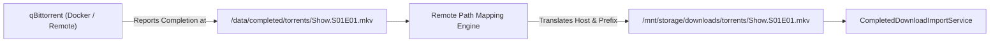
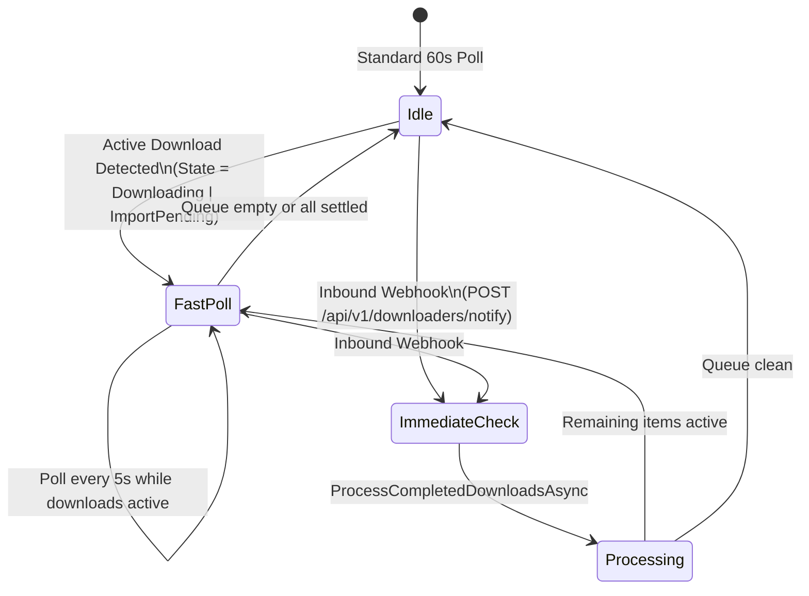
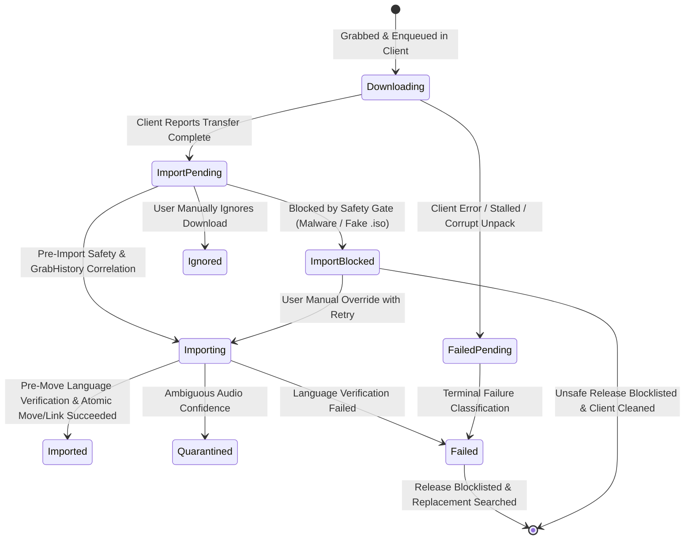

# Download Clients, Import, and Activity Orchestration

Managerr unifies download client management across BitTorrent and Usenet. It pairs active download polling with completion webhooks, atomic hardlink file organization, strict category isolation, and pre-move file safety and language verification gates.

---

## 1. Supported Download Clients & UI Settings

Managerr includes native driver implementations for 12 download clients across BitTorrent and Usenet protocols. Instead of configuring duplicate client instances across separate applications, Managerr configures each client once under **Settings -> Download Clients** (`/settings/downloaders`) with a centralized category routing table.

| Implementation Key | Display Name | Protocol | Default Port | Auth Style | Technical Capabilities |
| :--- | :--- | :--- | :--- | :--- | :--- |
| `qbittorrent` | qBittorrent | BitTorrent | `8080` | `username_password` | WebAPI v2.8+ driver. Supports multi-vertical categories, per-grab ratio and seeding time limits, sequential piece downloading, and Gluetun VPN port forwarding. |
| `deluge` | Deluge | BitTorrent | `8112` | `password` | WebUI JSON-RPC driver. Integrates directly with the Deluge `Label` plugin for automated category routing. |
| `transmission` | Transmission | BitTorrent | `9091` | `username_password` | Transmission RPC driver with per-vertical `download-dir` assignment, label tagging, and ratio limiting. |
| `rtorrent` | rTorrent / ruTorrent | BitTorrent | `8080` | `username_password` | XML-RPC over HTTP/SCGI driver. Supports ruTorrent `custom1` label category tagging and multi-mount output directories. |
| `flood` | Flood | BitTorrent | `3000` | `username_password` | Flood REST API driver communicating with rTorrent, qBittorrent, or Transmission backends. |
| `vuze` | Vuze / BiglyBT | BitTorrent | `9091` | `username_password` | Transmission-compatible RPC adapter interface for Vuze and BiglyBT daemons. |
| `aria2` | Aria2 | BitTorrent | `6800` | `secret_token` | JSON-RPC 2.0 driver (`token:<secret>`). Handles multi-source torrents and magnet URIs. |
| `sabnzbd` | SABnzbd | Usenet | `8080` | `api_key` | JSON API driver (`mode=addurl`, `queue`, `history`). Supports per-vertical category mapping, priority levels, and direct failed-unpack detection. |
| `nzbget` | NZBGet | Usenet | `6789` | `username_password` | JSON-RPC driver (`append`, `listgroups`, `history`). Supports category assignment, pause/resume, and direct post-processing status checks. |
| `pneumatic` | Pneumatic | Usenet | `0` | `filesystem` | File-drop adapter for Kodi/XBMC Pneumatic directory integrations. |
| `torrent_blackhole` | Torrent Blackhole | BitTorrent | `0` | `filesystem` | Filesystem driver. Drops `.torrent` and `.magnet` files into a watched folder and monitors a completed folder for imports. |
| `usenet_blackhole` | Usenet Blackhole | Usenet | `0` | `filesystem` | Filesystem driver. Drops `.nzb` files into a watched directory and imports completed unpack directories. |

### Advanced Download Client Settings Modal
When creating or editing a download client in the UI, the modal exposes full driver configuration fields and an inline **Test** button to verify authentication and reachability before saving:

* **`isEnabled`**: Enables or disables polling and grab dispatching for this client without deleting its configuration.
* **`urlBase`**: Optional reverse-proxy sub-path (e.g., `/qbittorrent` or `/sabnzbd`).
* **`priority`**: Integer client selection priority when multiple clients support the same protocol.
* **`removeCompleted`**: Automatically removes completed jobs from the download client after import (recommended for Usenet; leave off for seeding torrents).
* **`removeFailed`**: Automatically purges terminal failed jobs from the download client.
* **`watchFolder`**: Target drop folder path for `torrent_blackhole`, `usenet_blackhole`, or `pneumatic` filesystem drivers.
* **`categoryMappings`**: Per-vertical category/label routing dictionary.

### Multi-Vertical Category Routing & Strict Category Isolation
Every download client configuration defines a `categoryMappings` dictionary mapping each media vertical to a dedicated client-side category or label:

```yaml
categoryMappings:
  tv: "tv-managerr"
  anime: "anime-managerr"
  movies: "movies-managerr"
  music: "music-managerr"
  ebooks: "ebooks-managerr"
  audiobooks: "audiobooks-managerr"
  comics: "comics-managerr"
```

Managerr enforces **strict category isolation**: during queue polling and Completed Download Handling (CDH), Managerr only tracks and imports jobs whose client category/label matches a configured Managerr category mapping (or that were explicitly dispatched by Managerr). Unrelated personal downloads or jobs belonging to other tools in the same download client are ignored.

---

## 2. Remote Path Mappings

When download clients run in separate Docker containers, remote virtual machines, or seedboxes, their internal file paths differ from the paths visible to Managerr.

Remote Path Mappings translate paths returned by download client APIs (`OutputPath`) into local filesystem paths accessible to Managerr:



### Configuration Attributes
* **Host:** Hostname or IP matching the download client (or leave blank to match all clients).
* **Remote Path:** The prefix path reported by the client (e.g., `/downloads/complete/`).
* **Local Path:** The corresponding path mounted into Managerr (e.g., `/mnt/storage/downloads/`).

Managerr normalizes trailing slashes and handles case sensitivity based on the host operating system.

---

## 3. Active Download Fast-Poll and Completion Webhooks

Managerr combines scheduled polling with reactive webhooks to ensure downloads import immediately upon completion.



### 1. 5-Second Active Download Fast-Poll
Under standard conditions, the `RefreshMonitoredDownloads` background task checks download client queues every 60 seconds (`Managerr:DownloadMonitorIntervalSeconds`, also customizable on `/system/status`).

When tracking downloads in an active state (`Downloading` or `ImportPending`), the scheduler lowers the task interval to 5 seconds:
```csharp
if (tracked.Any(t => t.State is TrackedDownloadStates.Downloading or TrackedDownloadStates.ImportPending))
{
    // Fast-poll every 5 seconds while client is actively downloading or unpacking
    intervalSec = Math.Min(intervalSec, 5);
}
```
Once active downloads finish and import, the polling interval returns to its standard idle frequency.

### 2. Instant Completion Webhook (`/notify` and `/process-completed`)
Download clients capable of executing a script on completion (such as SABnzbd, NZBGet, qBittorrent, or Transmission) can notify Managerr via HTTP:

* **Webhook Endpoint:** `POST /api/v1/downloaders/notify` or `POST /api/v1/downloaders/process-completed`
* **Supported Methods:** `GET` or `POST`
* **Authentication:** Requires `X-Api-Key: <key>` header or `?apikey=<key>` query parameter.

**Client Completion Script Example (qBittorrent / SABnzbd):**
```bash
#!/bin/sh
curl -s -X POST "http://localhost:8989/api/v1/downloaders/notify?apikey=<YOUR_API_KEY>"
```
Receiving this request triggers an immediate run of `ProcessCompletedDownloadsAsync`, bypassing the remaining sleep interval.

### 3. Reactive Post-Grab Debounce
When Managerr grabs a new release, it fires `DownloadMonitorTriggerRequested`. This triggers a debounced 5-second queue check to confirm that the client accepted the grab and initialized the download task.

---

## 4. Completed Download Import Pipeline (CDH), `GrabHistory`, and State Machine

Managerr implements a deterministic, multi-state Completed Download Handling (CDH) lifecycle. Every download tracked across client queues transitions through the following state machine:



### `GrabHistory` Localized Title Correlation
When a release is grabbed, Managerr records a `GrabHistory` correlation entry linking the client download ID / infohash / release GUID to the target `MediaWork`, `MediaContainer`, and `MediaUnit` IDs. When the download finishes, CDH resolves localized or alternate release titles (such as German localized titles extracted from provider `Translations` or Romaji anime titles) directly from `GrabHistory` before falling back to filename parsing.

### Pre-Move Language Verification Gate
Before any file is linked or moved into the target library directory, the import pipeline runs the **Pre-Move Language Verification Gate** on the staged download path:
* **VerifiedPass:** Container metadata, subtitle text, and neural speech checks confirm the required audio/subtitle languages. Only after passing does Managerr create the hardlink or atomic move into the library root.
* **QuarantineReview:** Ambiguous audio confidence holds the file in staging and generates 10-second Opus review snippets without touching existing library files.
* **VerifiedFail:** The import aborts before touching the library folder, blocklists the release hash, and triggers a replacement search.

### Tracked Download States
| State | Description |
| :--- | :--- |
| `Downloading` | Item is downloading in the client (transfer in progress, queued, or seeding). |
| `ImportPending` | Download finished transfer or unpack; awaiting pre-import inspection and staging verification. |
| `Importing` | Currently executing pre-import file safety inspection, language verification, or atomic hardlink/move. |
| `Imported` | Successfully verified and imported into library storage. |
| `ImportBlocked` | Import halted due to security hazards (e.g. executable payload, fake ISO, or path collision). |
| `FailedPending` | Client reported an error; awaiting classification as a transient fault or terminal failure. |
| `Failed` | Terminal failure confirmed (bad unpack, missing Usenet articles, or content failure). |
| `Ignored` | Download ignored by operator; excluded from subsequent automatic import runs. |
| `Removed` | Download no longer reported by the client queue or history; purged from active tracking. |

### Tracked Download Actions
Operators can manage tracked downloads via the UI or REST API:
* **Retry Import (`POST /api/v1/downloaders/tracked/{id}/retry-import`):** Retries importing a stalled or blocked download. Supports optional `ManualOverrideImportRequest` parameters:
  * `WorkId`: Re-links the download to a specific media work.
  * `SeasonNumber` / `EpisodeNumbers`: Overrides parsed season/episode coordinates.
  * `BypassUpgradeCheck`: Forces import even if existing file quality rank is higher.
  * `ConfirmedAudioLanguages`: Manually confirms audio track languages, bypassing Stage 3 speech LID.
* **Ignore Download (`POST /api/v1/downloaders/tracked/{id}/ignore`):** Prevents Managerr from attempting to process the item again without deleting data from the client.

---

## 5. Dangerous File and Fake `.iso` Safety Blocker

Before opening or staging downloaded files, Managerr runs a pre-import file safety inspection (`InspectFilesBeforeImport`).

### Blocked Executable Extensions
Any download containing files with dangerous or scriptable extensions is rejected immediately:
```text
.exe, .scr, .lnk, .bat, .cmd, .vbs, .vbe, .js, .jse, .wsf, .wsh, 
.ps1, .msi, .msp, .hta, .com, .pif, .cpl, .reg, .jar, .arj, .ade, 
.adp, .chm, .dll, .sys
```

### Fake `.iso` Disk Image Blocker
While ISO disk images are valid in retro gaming or operating system archives, their appearance in movie, TV, anime, ebook, or audiobook downloads is commonly associated with bundled adware, malware, or password-protected archives.
* If `mediaVertical` is `movies`, `tv`, `anime`, `ebooks`, or `audiobooks`, any file with extension `.iso` is rejected immediately.
* The download is blocked, its infohash or title is added to the blocklist, and the client is instructed to purge the task to protect the host environment.

---

## 6. Atomic Hardlink-First File Organizer (`AtomicFileOrganizer`)

Managerr prioritizes atomic hardlinks over file copies or destructive moves. This allows torrent clients to continue seeding without duplicating storage space on disk.

```mermaid
flowchart TD
    Complete["Completed Staging File"] --> CheckLink{"Can Create Hardlink?\n(POSIX link / CreateHardLinkW)"}
    
    CheckLink -->|Success (Same Filesystem Device)| Hardlink["Create Hardlink\n(Zero I/O overhead, Instant)"]
    CheckLink -->|Fail / Cross-Device Move Allowed| CheckMove{"Can Move Source?"}
    
    CheckMove -->|Yes| Move["File.Move\n(Destructive to torrent seeding)"]
    CheckMove -->|No / Cross-Device Fallback| TempCopy["Atomic Temp Copy\n(.file.managerr-tmp-{guid})"]
    
    TempCopy --> Flush["Flush Streams to Disk"]
    Flush --> AtomicRename["Atomic File.Move(temp, final)"]
    
    Hardlink --> Sidecars["Import Matching Subtitle Sidecars\n(.srt, .ass, .sub, .vtt)"]
    Move --> Sidecars
    AtomicRename --> Sidecars
```

### Key Technical Properties
1. **Zero-Overhead Hardlinking:** On Linux/UNIX, Managerr invokes the native `link(2)` system call via `libc`. On Windows, it invokes `CreateHardLinkW` via `kernel32.dll`. Hardlinks require zero disk I/O and zero duplicate storage blocks.
2. **Atomic Two-Phase Temp Copy:** If files reside on different filesystem devices (`EXDEV` cross-device error) and a hardlink cannot be formed:
   * Managerr streams bytes to a hidden temporary file in the destination directory: `.{filename}.managerr-tmp-{guid}`.
   * Flushes and closes file streams.
   * Renames the temporary file to its final destination using `File.Move(tempDest, fullDest, overwrite: true)`, guaranteeing that media servers (Plex, Jellyfin) never detect half-written, corrupt video files.
3. **Existing Folder Structure Preservation:** When importing new episodes for an existing series, `NamingContextMetadata` preserves existing directory names (`ExistingWorkFolderName` and `ExistingSeasonFolderName`). This prevents creating duplicate series folders if a user customized folder naming.
4. **Companion Subtitle Sidecars:** Companion subtitle files in the staging folder (`.srt`, `.ass`, `.ssa`, `.sub`, `.idx`, `.vtt`) matching the base media filename (e.g. `Movie.de.srt`) are automatically imported and renamed alongside the video file.

---

## 7. Downloader Faults vs. Genuine Release Failures

When a download task encounters an error, Managerr evaluates the failure message to distinguish between transient infrastructure faults and genuine release failures.

### Transient Downloader Client Faults
If an error matches transient host or network issue phrases:
* `"no active"`
* `"missing server"`
* `"no server"`
* `"server connection"`
* `"disk full"` / `"no space left"`
* `"permission denied"` / `"read-only file system"`
* `"login failed"` / `"authentication failed"`
* `"connection refused"` / `"network is unreachable"`

**System Action:**
* Classified as a client or host operational fault.
* The release is not blocklisted.
* The item transitions to `FailedPending` and remains eligible for automatic retry once infrastructure connectivity or disk space is restored.

### Genuine Release Failures
Errors indicating corrupted files, missing data, or security risks:
* Usenet missing articles, incomplete article health, or out-of-par2 repair blocks
* Corrupt archive, CRC error, or password-protected RAR archive
* Malware or dangerous executable detected
* Language verification failure (audio language absent or mislabeled)

**System Action:**
* Release is classified as permanently broken.
* Release infohash, GUID, and synthetic fingerprint are added to the recurring blocklist.
* The failed download is removed from the download client.
* Managerr automatically triggers an immediate replacement search for the affected media units.

---

## 8. Queue Management and Strike Sweeper

### Queue Controls
The active download queue (`GET /api/v1/downloaders/queue`) provides per-task controls:
* **Pause / Resume:** Dispatches pause or resume RPC commands to the download client.
* **Remove Download (`POST /api/v1/downloaders/queue/{clientId}/{externalId}/control` or `DELETE /api/v1/downloaders/queue/{clientId}/{externalId}`):**
  * `removeFromClient`: Deletes the item from client tracking.
  * `deleteData`: Deletes downloaded files from disk.
  * `blocklist`: Adds the release hash to the permanent blocklist.
  * `searchReplacement`: Automatically triggers an immediate search for an alternative release.

### Queue Cleaner Strike Sweeper
The `QueueHealthCheck` background task runs periodically to detect and remediate stalled or unresponsive downloads:
1. **Metadata Stuck / Zero Peers:** Torrents stuck in metadata collection or 0-seed stall accumulate strikes.
2. **3-Strike Remediation:** When a download reaches 3 consecutive strikes, the sweeper purges the download from the client, adds the release to the blocklist, and auto-searches for a working replacement.

---

## 9. Manual Folder Import

For media downloaded outside Managerr, historical archives, or seedbox dumps, Managerr provides an interactive two-stage Manual Import pipeline:

1. **Folder Scan and Preview (`GET /api/v1/downloaders/manual-import`):**
   * Scans a target path on the host.
   * Parses titles, qualities, and detected languages.
   * Correlates candidate files against monitored catalog items (`MediaWork` and `MediaUnit`).
   * Runs pre-import safety inspections and flags potential conflicts or missing mappings.
2. **Execute Import (`POST /api/v1/downloaders/manual-import`):**
   * Accepts confirmed work IDs, season/episode coordinates, and audio language overrides.
   * Atomically links or moves files into the library folder using configured naming templates.
   * Updates catalog files, marks episodes as available, and records import events in activity history.

---

## 10. Activity History and the Recurring Blocklist

### Activity History and Mark-Failed Workflow
The Activity History ledger (`GET /api/v1/activity/history`) records an audit trail of acquisition and file events:
* `Grabbed`: Release dispatched to download client.
* `DownloadFolderImported`: Media imported into library.
* `DownloadFailed`: Download failure recorded.
* `MediaFileDeleted` / `MediaFileRenamed`: Storage maintenance events.

If an imported file turns out to be defective upon playback (e.g., bad dub, desynced audio, or poor encode), an operator can click **Mark Failed** (`POST /api/v1/activity/history/{id}/mark-failed`). Managerr will:
1. Blocklist the release hash and release title.
2. Record a `DownloadFailed` event.
3. Automatically execute a replacement search and enqueue a superior release.

### Recurring Torrent and Usenet Blocklist
The Blocklist engine prevents Managerr from re-downloading a release that has failed:

| Protocol | Blocklist Identifier | Matching Strategy |
| :--- | :--- | :--- |
| **BitTorrent** | Cryptographic InfoHash | Exact SHA-1 (20-byte / 40-char hex) or BitTorrent v2 SHA-256 hash matching. |
| **Usenet** | Release GUID and Token | Sanitized Newznab release GUID or URL token (e.g. `guid:<id>`). |
| **Usenet (Synthetic)** | Triplet Fingerprint | Synthetic triplet matching: `(IndexerId/IndexerName, PublishedAtTimestamp, SizeBytes)`. Matches identical NZBs even when GUIDs differ across indexers. |
| **All Protocols** | Normalized Clean Title | Strict title normalizer match (`_strictBlockedTitles`) applied on malware or verified content failures. |

---

## Cross-Wiki References
* Configure indexers and release search waves: [05. Indexers & Release Search](05-Indexers-and-Release-Search)
* Quality Profiles, scoring rules, and language tiers: [07. Quality Profiles, Scoring & Language Policies](07-Quality-Profiles-Scoring-and-Language-Policies)
* Language verification pipeline and quarantine: [08. Language Verification & Quarantine](08-Language-Verification-and-Quarantine)
* Migrate download clients from legacy Sonarr/Radarr: [09. Ecosystem, *arr Compatibility & Migration](09-Ecosystem-Arr-Compat-and-Migration)
* Download client REST API documentation: [11. REST API v1 Reference](11-REST-API-v1-Reference)
