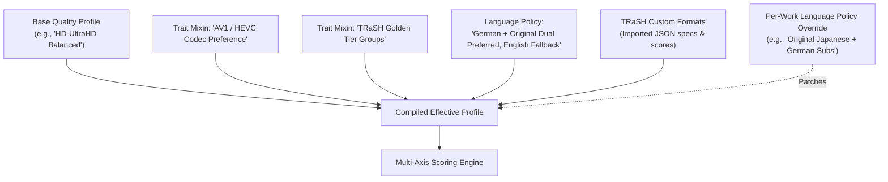
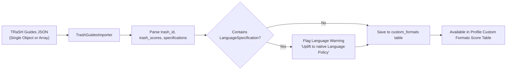
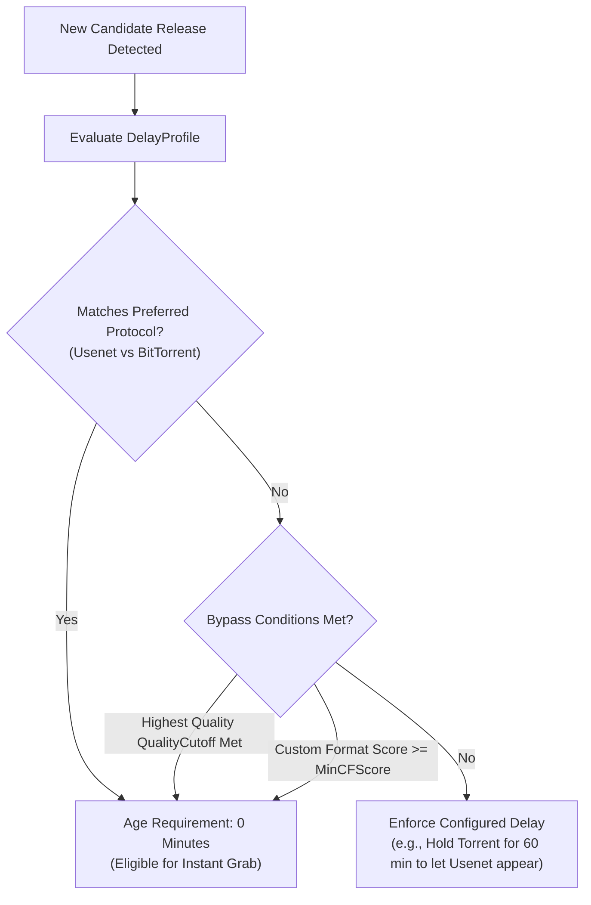
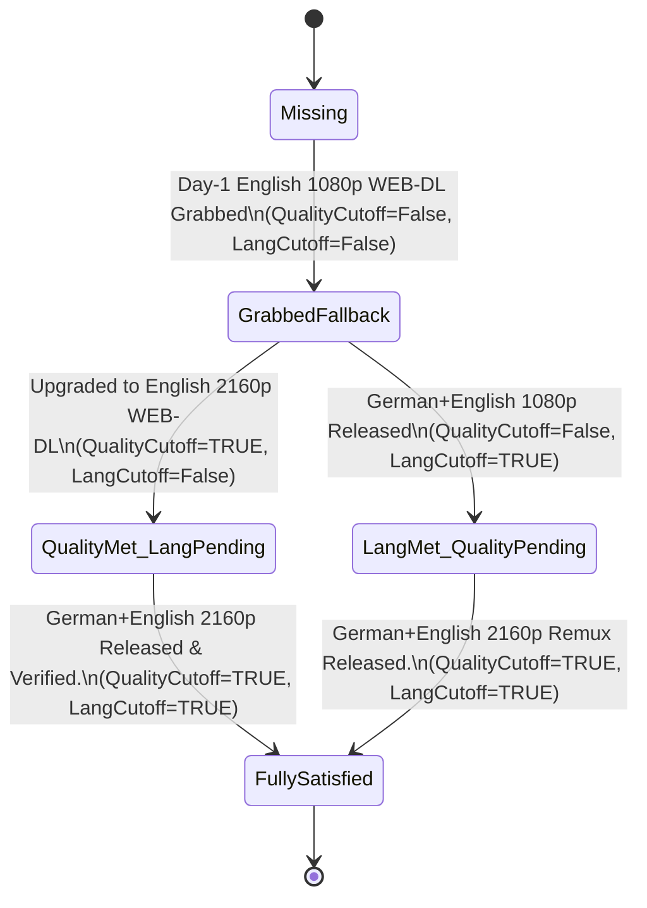

# Quality Profiles, Scoring, and Language Policies

Managerr uses composable profiles, a multi-axis scoring engine, reusable trait mixins, and tiered language policies. This structure eliminates duplicate profile maintenance, prevents unwanted quality step-downs during dub upgrades, and tracks video quality and audio/subtitle satisfaction independently.

---

## 1. Composable Quality Profile Architecture

In Sonarr and Radarr, profiles have three common limitations:
1. **Profile Duplication:** Separate profiles must be maintained for English shows, dual-audio anime, and 4K movies, duplicating quality lists and score tables across applications.
2. **Quality Trumps Language:** In legacy `*arr` systems, quality tiers dominate custom format scores. Upgrading to a dual-audio release without downgrading video resolution requires external scripts and score adjustments.
3. **Cross-Media Differences:** Video quality models do not translate directly to lossless audio (`FLAC` vs `MP3`) or books (`EPUB` vs `M4B`).

### The Composable Architecture
Managerr breaks profiles into reusable building blocks configurable under **Settings -> Profiles** (`/settings/profiles`):



### Quality Profile UI Editing
When creating or editing a Quality Profile in the UI (`POST/PUT /api/v1/profiles`), operators can configure:
* **Axis Weights (`weightEfficiency`, Quality, Language, Traits):** Tune how heavily file size/bitrate efficiency and other axes contribute to total release score.
* **Minimum Trait Score (`minTraitScore`):** Hard gate rejecting any candidate whose trait score falls below the configured minimum floor.
* **Trait Mixins (`mixinIds`):** Attach one or more reusable Trait Mixins directly from the profile editor.
* **Stream Retention Lists (`retainAudioLangs`, `retainSubLangs`):** Specify which audio and subtitle language codes (including the dynamic `original` token) are retained during post-verification stream pruning.

### Trait Mixins & Language Policy CRUD UI
**Settings -> Profiles** provides dedicated panels with full Create, Read, Update, and Delete workflows for both building blocks:
* **Language Policies:** Create, edit, and delete policies (`GET/POST /api/v1/profiles/language-policies`, `PUT/DELETE /api/v1/profiles/language-policies/{id}`).
* **Trait Mixins:** Create, edit, and delete reusable scoring mixins (`GET/POST /api/v1/profiles/mixins`, `PUT/DELETE /api/v1/profiles/mixins/{id}`).

### Global Quality Hierarchy
Managerr maintains a quality hierarchy across all verticals in `GlobalQualityHierarchy`:

| Vertical | Quality Tier | Rank / Score |
| :--- | :--- | :--- |
| **Video** | `Remux-2160p` | 100 |
| **Video** | `BluRay-2160p` / `WEBDL-2160p` / `WEBRip-2160p` | 90 / 85 / 80 |
| **Video** | `Remux-1080p` / `BluRay-1080p` / `WEBDL-1080p` | 75 / 70 / 65 |
| **Video** | `WEBRip-1080p` / `HDTV-1080p` | 60 / 55 |
| **Video** | `BluRay-720p` / `WEBDL-720p` / `HDTV-720p` | 45 / 40 / 35 |
| **Video** | `SD-480p` | 15 |
| **Music** | `FLAC 24bit` / `FLAC` | 95 / 85 |
| **Music** | `MP3-320` / `MP3-V0` | 60 / 50 |
| **Books** | `EPUB` / `AZW3` / `PDF` | 90 / 80 / 55 |
| **Audiobooks** | `M4B` / `MP3` | 90 / 60 |
| **Comics** | `CBZ` / `CBR` | 90 / 75 |

---

## 2. Unified Multi-Axis Scoring Formula

Instead of reducing candidate evaluation to a single integer, Managerr evaluates candidate releases against an effective profile using a four-dimensional score vector:

$$S_{\text{total}}(R, P, M) = w_Q \cdot S_{\text{quality}}(R) + w_L \cdot S_{\text{lang}}(R, M) + w_T \cdot S_{\text{traits}}(R) + w_B \cdot S_{\text{efficiency}}(R)$$

| Axis | Weight Default | Evaluated Attributes |
| :--- | :--- | :--- |
| **Quality ($S_{\text{quality}}$)** | $w_Q = 1.0$ | Source media (`Remux`, `BluRay`, `WEB-DL`, `HDTV`) and resolution (`2160p`, `1080p`, `720p`). |
| **Language ($S_{\text{lang}}$)** | $w_L = 1.0$ | Language tier satisfaction, multi-audio bonuses, and subtitle bridges. |
| **Traits ($S_{\text{traits}}$)** | $w_T = 1.0$ | HDR formats (`DV`, `HDR10+`, `HDR10`), audio codecs (`TrueHD Atmos`, `DTS-HD MA`, `DDP5.1`), release group reputation, streaming service tags (`AMZN`, `NF`, `ATVP`), and attached `mixinIds`. |
| **Efficiency ($S_{\text{efficiency}}$)** | $w_B = 1.0$ (`weightEfficiency`) | File size and bitrate curve relative to target runtime. |

### Hard Gates (Mandatory Pre-Conditions)
A candidate release is rejected immediately if it violates any hard gate:
1. **Allowed Qualities:** The detected quality must be enabled in `AllowedQualities`.
2. **Quality Floor:** `Q(R) >= Q_floor(P, M_current)`. Prevents a lower-tier dub from replacing high-definition content unless explicitly allowed by the tradeoff policy.
3. **Trait Hard Rejects:** `S_traits(R) >= minTraitScore` and no trait rule marked `RequiredReject = true` matches the candidate.
4. **Size Boundary Limits:** The release file size per runtime minute must fall within the configured `[MinMbPerMin, MaxMbPerMin]` range.

### Profile Decision Kinds
The scoring engine categorizes outcomes into explicit decision kinds:
* `NewGrab`: Media unit is currently missing; candidate satisfies all hard gates.
* `QualityUpgrade`: Candidate exceeds the quality rank of the existing file on disk.
* `LanguageUpgrade`: Candidate satisfies a higher language tier than the verified file on disk.
* `TraitUpgrade`: Candidate matches the same quality and language tier, but provides superior custom format traits (e.g. HDR10 -> Dolby Vision).
* `BlockedByQualityFloor`: Candidate provides an upgraded language tier, but violates the minimum quality threshold.
* `CutoffsAlreadyMet`: Both Quality Cutoff and Language Cutoff are satisfied on disk.
* `RejectedByHardGate`: Candidate violated allowed qualities, `minTraitScore`, or size limits.

---

## 3. Custom Formats and Regex Specifications

Managerr supports Custom Formats composed of multiple specification items (`CustomFormatSpecItem`):

```json
{
  "name": "Dolby Vision with HDR10 Fallback",
  "defaultScore": 500,
  "includeWhenRenaming": true,
  "specifications": [
    {
      "name": "DV Pattern",
      "implementation": "ReleaseTitleSpecification",
      "negate": false,
      "required": true,
      "pattern": "\\b(DV|Dovi|Dolby[ ._-]?Vision)\\b"
    },
    {
      "name": "HDR10 Fallback",
      "implementation": "ReleaseTitleSpecification",
      "negate": false,
      "required": false,
      "pattern": "\\b(HDR|HDR10|HDR10Plus)\\b"
    }
  ]
}
```

### Supported Specification Types
* `ReleaseTitleSpecification`: Evaluates regular expressions against raw release titles.
* `SizeSpecification`: Compares release file size against minimum and maximum thresholds.
* `LanguageSpecification`: Evaluates parsed or declared language tags. (Managerr flags these for uplift into native Language Policies).

---

## 4. Native TRaSH Guides Importer (`TrashGuidesImporter`)

Managerr embeds a native importer for TRaSH Guides and Recyclarr Custom Format JSON definitions. Operators can paste raw JSON definitions directly into the web UI or submit them via `POST /api/v1/profiles/import-trash`.



### Automatic Language Uplift Warnings
In Radarr and Sonarr, users often rely on Custom Format regexes (`[GERMAN]`, `[DE-EN]`) to manage audio preferences. When importing TRaSH definitions, Managerr scans for `LanguageSpecification` blocks and displays an advisory notice:
> *"Custom Format '{name}' contains LanguageSpecification ('{specName}'): consider uplifting to a native Managerr Language Policy."*

Moving these rules into native Language Policies enables post-download audio verification, dual-cutoff tracking, and subtitle bridges.

---

## 5. Release Delay Profiles

Delay Profiles (`DelayProfileSummary`) enforce release aging before acquisition, ensuring that fast-releasing low-quality or non-preferred protocol releases do not preempt preferred releases:



### Delay Profile Parameters
* `PreferredProtocol`: Either `usenet` or `torrent`.
* `UsenetDelayMinutes`: Number of minutes a Usenet release must age before being grabbed.
* `TorrentDelayMinutes`: Number of minutes a BitTorrent release must age before being grabbed.
* `BypassIfHighestQuality`: Immediately grabs the release if it satisfies the profile top quality tier, bypassing the delay timer.
* `BypassIfAboveCustomFormatScore`: Bypasses the delay if the candidate Custom Format score exceeds `MinCustomFormatScoreForBypass`.
* `Tags`: Scopes the delay profile to works carrying matching tags.

---

## 6. Per-Quality Size Limits (`MB/min`)

To protect storage arrays from bloated re-encodes and filter out starved micro-rips, Managerr enforces runtime-proportional size boundaries:

$$\text{ExpectedSizeRange} = [\text{MinMbPerMin} \times \text{RuntimeMinutes},\, \text{MaxMbPerMin} \times \text{RuntimeMinutes}] \times 10^6 \text{ bytes}$$

Operators configure three thresholds per quality tier:
* `MinMbPerMin`: Micro-rip floor. Releases below this bitrate are rejected for poor visual quality.
* `PreferredMbPerMin`: The target bitrate sweet spot used by the efficiency scoring curve.
* `MaxMbPerMin`: Bloat ceiling. Releases exceeding this size are rejected to conserve storage.

Size limits are maintained separately per media vertical, ensuring that a 4K movie rule does not accidentally constrain 4K anime or high-frame-rate sports.

---

## 7. Tiered Language Policies

A **Language Policy** defines an ordered list of satisfaction tiers for audio and subtitle preferences.

```yaml
languagePolicy:
  name: "German + Original Dual-Audio (English Fallback)"
  enableLanguageUpgrades: true
  languageCutoffTier: 1

  tiers:
    - tier: 1
      id: "dual-de-orig"
      label: "German + Original Dual Audio"
      audioContainsAll: ["de", "original"]
      score: 1000
      satisfiesLanguageCutoff: true

    - tier: 2
      id: "de-audio"
      label: "German Audio"
      audioContainsAny: ["de"]
      score: 750
      satisfiesLanguageCutoff: false

    - tier: 3
      id: "orig-with-de-subs"
      label: "Original Audio + German Subtitles"
      audioContainsAny: ["original", "en"]
      subtitlesContainsAny: ["de"]
      score: 400
      satisfiesLanguageCutoff: false

    - tier: 4
      id: "day1-en-orig"
      label: "Original or English Audio (Day-1 Fallback)"
      audioContainsAny: ["original", "en"]
      score: 200
      satisfiesLanguageCutoff: false
```

### The Dynamic `original` Token
Language Policy rules can reference the special token `original` (or `orig`). During candidate evaluation, Managerr dynamically resolves this token from the target work metadata:
* For *Attack on Titan*, `original` -> `ja` (Japanese).
* For *Parasite*, `original` -> `ko` (Korean).
* For *Dark*, `original` -> `de` (German).
* For *Severance*, `original` -> `en` (English).

A single Language Policy serves all international content without requiring separate profiles per country of origin.

### Per-Work Language Policy Overrides
While libraries assign a default Quality Profile and Language Policy, individual works can override the Language Policy directly via `media_works.language_policy_id`. This allows setting a dedicated original-audio policy for anime or foreign cinema while retaining the global dual-audio policy for Hollywood series.

### Plex User-Driven Language Promotion
When a user requests media through Overseerr, Jellyseerr, or the Managerr interface, `PromotePlexUserLanguageAsync` inspects the requester Plex account language settings. If the user prefers German and the item currently holds an English fallback, Managerr automatically attaches the German Dual-Audio policy to the work and triggers an immediate upgrade search.

---

## 8. Dual-Cutoff State Machine (Quality Cutoff x Language Cutoff)

Unlike legacy systems that cease monitoring as soon as a quality cutoff is met, Managerr tracks two independent cutoff flags on every `MediaUnit`:
1. `QualityCutoffMet`: True when the file on disk satisfies the quality cutoff rank.
2. `LanguageCutoffMet`: True when verified on-disk audio or subtitles satisfy the cutoff tier index.



### Tradeoff Policies and Downgrade Prevention
When evaluating whether a better language tier justifies changing video quality, the profile `TradeoffMode` governs the decision:
* `never_downgrade_quality`: Under no circumstance will the system allow a lower quality rank, even if the candidate provides Tier 1 Dual-Audio.
* `bounded_stepdown`: Allows stepping down by at most `maxQualityTierDrop` ranks (e.g., dropping from 2160p WEB-DL to 1080p BluRay), provided the candidate meets `minimumAbsoluteQuality` (e.g., `WEBDL-1080p`).
* `weighted_score`: Allows the overall multi-axis score to decide.

This guardrail prevents low-quality television recordings or camera dubs from overwriting pristine 4K video files.

---

## 9. Audio Track and Subtitle Stream Pruning

When importing releases containing excessive language streams (such as European `MULTI` releases with 12+ audio dubs), profiles can enable post-verification Stream Pruning configured via `retainAudioLangs` and `retainSubLangs` in the Profile Editor:
* **Retained Audio Languages (`retainAudioLangs`):** e.g., `["de", "original", "en"]`.
* **Retained Subtitle Languages (`retainSubLangs`):** e.g., `["de", "en"]`.
* **Container Header Normalization:** MKV headers are updated so that track dispositions (`default` and `forced`) reflect the operator primary language, ensuring that media players (Plex, Jellyfin, Kodi) immediately select the intended audio and subtitle tracks without transcoding.

---

## Cross-Wiki References
* Indexer capability discovery and search waves: [05. Indexers & Release Search](05-Indexers-and-Release-Search)
* Download client handling and atomic imports: [06. Download Clients, Import & Activity](06-Download-Clients-Import-and-Activity)
* Verification pipeline and speech language detection: [08. Language Verification & Quarantine](08-Language-Verification-and-Quarantine)
* Import existing profiles and custom formats from Sonarr/Radarr: [09. Ecosystem, *arr Compatibility & Migration](09-Ecosystem-Arr-Compat-and-Migration)
* Profiles and policies REST API reference: [11. REST API v1 Reference](11-REST-API-v1-Reference)
