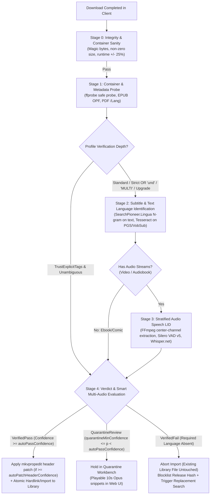
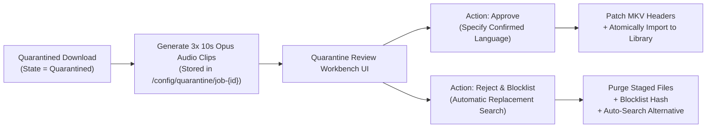

# Language Verification Pipeline and Quarantine Review

BitTorrent and Usenet release titles often omit or misrepresent language metadata. Releases tagged `MULTI` or `DUAL` may lack the expected primary language, container streams are regularly left untagged (`und`) or mislabeled, and duplicate English tracks are sometimes marked under foreign language codes.

Managerr verifies files before import:

> **No downloaded file overwrites an existing library item or marks a `LanguageCutoff` as satisfied until its audio and subtitle composition passes the Verification Pipeline in staging.**

---

## 1. End-to-End Verification Pipeline Architecture

The Verification Pipeline operates in an isolated pre-import staging environment before files are atomically linked into library storage. It can also run as an on-demand audit across existing library files.



---

## 2. Configurable Verification Thresholds (`GET/PUT /api/v1/verification/settings`)

Administrators can tune all confidence gates directly in the **Verification & Quarantine** settings UI (`/settings/profiles` or `/activity/quarantine`) via `GET /api/v1/verification/settings` and `PUT /api/v1/verification/settings`:

| Setting Key | Default | Allowed Range | Purpose |
| :--- | :--- | :--- | :--- |
| `autoPassConfidence` | `0.80` | `0.50 - 0.99` | Minimum Whisper/Lingua confidence required to pass automatically (`VerifiedPass`). |
| `quarantineMinConfidence` | `0.45` | `0.10 - (autoPassConfidence - 0.01)` | Lower confidence bound for routing ambiguous files to Quarantine instead of immediate rejection (`VerifiedFail`). |
| `autoPatchHeaderConfidence` | `0.80` | `0.50 - 0.99` | Minimum confidence required before `mkvpropedit` automatically rewrites `und` or mismatched MKV track language tags. |
| `fakeDubCorrelationThreshold` | `0.95` | `0.80 - 0.999` | Pearson waveform correlation threshold above which two differently labeled audio tracks are rejected as `IsDuplicateFakeDub`. |
| `defaultProfileSlug` | `german-first-best-quality` | Slug string | Default fallback profile (`catalog.default_profile_slug`) used when a work or library has no explicit quality profile. |

---

## 3. Pipeline Stages

### Stage 0: Integrity and Container Pre-Gate
Before running neural models, Stage 0 checks basic file integrity:
* **Non-Zero Filesize:** Files with 0 bytes or truncated headers are rejected immediately.
* **Magic-Byte Container Validation:**
  * Matroska (`.mkv`): Validates EBML magic bytes `1A 45 DF A3`.
  * MP4 (`.mp4`): Validates `ftyp` box.
  * FLAC (`.flac`): Validates `fLaC` stream marker.
  * EPUB (`.epub`): Validates ZIP header `PK\x03\x04`.
  * PDF (`.pdf`): Validates `%PDF` header.
* **Runtime Sanity Check:** Verifies that media duration matches expected work duration within +/- 25%, detecting short promotional samples or looped video files.

---

### Stage 1: Container and Embedded Metadata Inspection
Stage 1 probes container metadata across each supported media type:

| Media Vertical | Inspection Engine | Inspected Metadata Signals |
| :--- | :--- | :--- |
| **Video (`MKV`, `MP4`, `AVI`, `TS`)** | `ffprobe` (JSON stream format) | Per-stream language tags (`tags.language`), title hints (`"German TrueHD"`, `"Castellano"`, `"VOSTFR"`), and disposition flags (`default`, `forced`, `dub`, `original`). |
| **Ebooks (`EPUB`)** | Native ZIP + XML Reader | Reads `content.opf`, extracts `<dc:language>`, and aggregates XHTML chapter text layers. |
| **Documents (`PDF`)** | Native Latin1 Regex Engine | Extracts catalog `/Lang` dictionaries and text streams (enforcing a 64 MB in-memory safety limit). |
| **Audiobooks and Music (`M4B`, `FLAC`, `MP3`)** | `TagLibSharp` + `ffprobe` | ID3v2 `TLAN`, Vorbis `LANGUAGE`, Apple iTunes `©lan` tags, and AcoustID fingerprint matches. |

> [!TIP]
> **Safe Probing on Large Files (> 2 GiB):**
> `DefaultContainerProbeAdapter` streams container header structures using `ffprobe -v quiet -print_format json -show_format -show_streams`. It reads only the container header tables without decoding media packets, completing Stage 1 in under 200 ms even on 80 GB 4K Remux files.

---

### Stage 2: Subtitle and Text Language Identification
When releases contain subtitle streams or text layers, Stage 2 verifies subtitle text:

1. **Text Subtitles (`SRT`, `ASS`, `SSA`, `WebVTT`) and Ebooks:**
   * Extracts text samples across the middle 20% to 85% of the file, skipping front-matter, copyright pages, URL watermarks, and credit rolls.
   * Strips formatting tags and evaluates text using **`SearchPioneer.Lingua`**:
     * Runs an in-process 29-language N-gram statistical language detector.
     * Distinguishes closely related languages (e.g. `de` vs `nl`, `es` vs `pt`, `no` vs `da` vs `sv`).
2. **Bitmap Subtitles (`HDMV PGS`, `DVD VobSub`):**
   * Extracts representative bitmap frames from the interior of the video.
   * Runs local optical character recognition via **Tesseract 5 LSTM** to convert subtitle bitmaps to text before executing Lingua LID.
3. **Forced vs. Full Subtitle Track Distinction:**
   * **Forced Subtitles:** Characterized by low cue density (typically 15-80 cues covering foreign signs or alien dialogue).
   * **Full Subtitles:** Characterized by high cue density (600-1800+ cues covering >= 60% of dialogue runtime).
   * **Protection:** Prevents a release containing only German forced subtitles from satisfying a profile that requires full German dialogue subtitles.

---

### Stage 3: Neural Spoken Language Identification (Audio Speech LID)
To verify uncompressed audio streams without decoding multi-gigabyte files, Managerr uses stratified sampling, voice activity detection (VAD), and neural speech identification:


#### Step 3.1: Stratified Multi-Checkpoint Seek
FFmpeg seeks directly via container indices to 5 interior checkpoints:

$$t \in \{0.18,\, 0.34,\, 0.50,\, 0.66,\, 0.82\} \times \text{Duration}$$

This avoids intro songs or logos (first 15% of duration) and end-credit soundtracks (final 15% of duration).

#### Step 3.2: Center-Channel Dialogue Isolation
For 5.1 and 7.1 surround tracks (`TrueHD`, `DTS-HD MA`, `E-AC-3`), FFmpeg isolates the Front Center (`FC`) channel (`-af "pan=mono|c0=FC"`). Dialogue is mixed onto the center channel, separating spoken speech from sound effects and background musical scores on the left and right channels.

#### Step 3.3: Voice Activity Detection (`Silero VAD v5`)
The extracted 16 kHz mono PCM stream passes through Silero VAD v5.1.2 (`silero_vad.onnx`, 2.3 MB, executed via ONNX Runtime). The VAD model strips non-speech segments, collecting 3 to 5 speech windows of 8-12 seconds each.

#### Step 3.4: Neural Speech Identification (`Whisper.net`)
Speech windows are evaluated by OpenAI Whisper Tiny Q5_1 (`ggml-tiny-q5_1.bin`, 32.2 MB) running locally via `Whisper.net`:
* **Zero Cloud Dependence:** Speech classification executes offline on standard CPUs in roughly 1.5 to 3 seconds per stream.
* **Hybrid Extended Cut Dub Handling:** Extended editions in countries like Germany often contain German dubbing for 90% of the film, with original English audio and forced subtitles inserted for extended scenes that were never dubbed. If 3 or more of 5 checkpoints detect German (p > 0.85) and 1 or 2 checkpoints detect English, Managerr marks the track as `IsHybridExtendedCutDub = true` and accepts the file rather than failing the release.

#### Step 3.5: Duplicate-Dub Detection (Pearson Correlation)
Upload bots sometimes duplicate English audio into stream 1 (`eng`) and stream 2 (`ger`) to mimic foreign dubs.
* Managerr computes the Pearson acoustic waveform correlation (r) between concurrent audio streams:

$$r = \frac{\sum_{i=1}^{n} (x_i - \bar{x})(y_i - \bar{y})}{\sqrt{\sum_{i=1}^{n} (x_i - \bar{x})^2} \sqrt{\sum_{i=1}^{n} (y_i - \bar{y})^2}}$$

* If `r > fakeDubCorrelationThreshold` (default `0.95`) between streams declared as different languages, Managerr flags the release as `IsDuplicateFakeDub = true` and rejects it.

#### Step 3.6: In-Place MKV Header Patching (`mkvpropedit`)
When a stream passes neural verification with confidence `>= autoPatchHeaderConfidence` (default `0.80`) but carries an undetermined (`und`) or inaccurate header tag:
* Managerr invokes `mkvpropedit --edit track:a1 --set language=deu`.
* This updates container metadata in under 50 ms without remuxing or rewriting video packets. Plex, Jellyfin, and Kodi display the updated audio language name.

---

## 4. Smart Multi-Audio Verification

A common issue in naive verification scripts is failing releases because of secondary, unrequested audio tracks. For example, a release titled `Movie.German.DL.1080p.WEB-DL` may contain:
* **Track 1:** German audio (verified p = 0.99).
* **Track 2:** Russian commentary tagged as `und` or with low Whisper confidence (p = 0.52).

In older tools, an unidentifiable secondary stream would send the release to quarantine or trigger a false rejection.

### The Smart Multi-Audio Rule
When evaluating multi-stream releases:
1. Managerr extracts the primary wanted audio languages required by the target Language Policy (`ExtractPrimaryWantedAudioLanguages`).
2. If all required primary languages (such as German) are verified present with confidence `>= autoPassConfidence` (default `0.80`), any ambiguity on secondary, unrequested tracks is ignored.
3. Managerr sets the verdict to `VerifiedPass`, cleans up any temporary quarantine records, unblocks the infohash, and updates the library record with all detected languages.
4. The media imports, the existing file is safely upgraded, and unnecessary redownloads do not occur.

---

## 5. Quarantine Review Workbench

When neural confidence falls in the ambiguous range (`quarantineMinConfidence <= p < autoPassConfidence`, default `0.45` to `0.80`) or when unexpected language configurations arise, the download is placed in Quarantine (`/api/v1/quarantine`).



### Review Workbench Features
* **Playable Audio Snippets:** The workbench embeds 3 playable 10-second Opus audio clips sampled from speech-active checkpoints. Operators can listen to dialogue in the browser to verify the spoken language.
* **Approve (`POST /api/v1/quarantine/{id}/approve`):**
  * The operator confirms the actual language (e.g., `de`).
  * Managerr marks the job as `Approved`, patches container headers if necessary, and completes the atomic import.
* **Reject and Blocklist (`POST /api/v1/quarantine/{id}/reject`):**
  * The release is confirmed defective or fraudulent.
  * Managerr blocklists the release hash and title across BitTorrent and Usenet.
  * Staged files are deleted.
  * Managerr immediately launches an automated replacement search to grab an alternative release.
* **Orphaned Snippet Pruning:** The `RetentionAndVacuum` task periodically scans `/config/quarantine/` and prunes audio snippet folders for review jobs that have been resolved or deleted.

---

## 6. Verification Report Schema (`MediaFileVerificationReport`)

Every verification run records an audit report stored in SQLite and inspectable via `GET /api/v1/verification/reports`:

```json
{
  "jobId": 4821,
  "unitId": 1092,
  "stagedFilePath": "/mnt/downloads/torrents/Show.S02E01.German.DL.1080p.mkv",
  "mediaVertical": "tv",
  "verdict": "VerifiedPass",
  "overallConfidence": 0.985,
  "headerAutoPatched": true,
  "existingFilePreservedOnFailure": true,
  "hashBlocklisted": false,
  "quarantineId": null,
  "durationMs": 2410,
  "verifiedAudioLanguages": ["de", "en"],
  "verifiedSubtitleLanguages": ["de"],
  "streams": [
    {
      "streamIndex": 1,
      "streamType": "audio",
      "codec": "eac3",
      "channels": 6,
      "declaredLanguage": "und",
      "detectedLanguage": "de",
      "confidence": 0.991,
      "method": "silero-vad+whisper-tiny-q5_1",
      "isHybridExtendedCutDub": false,
      "isDuplicateFakeDub": false,
      "appliedTagPatch": "deu",
      "windows": [
        { "offsetSec": 540, "speechSec": 9.2, "detectedLanguage": "de", "probability": 0.994 },
        { "offsetSec": 1080, "speechSec": 10.1, "detectedLanguage": "de", "probability": 0.989 },
        { "offsetSec": 1620, "speechSec": 8.8, "detectedLanguage": "de", "probability": 0.990 }
      ]
    },
    {
      "streamIndex": 2,
      "streamType": "audio",
      "codec": "truehd",
      "channels": 8,
      "declaredLanguage": "eng",
      "detectedLanguage": "en",
      "confidence": 0.988,
      "method": "silero-vad+whisper-tiny-q5_1",
      "isHybridExtendedCutDub": false,
      "isDuplicateFakeDub": false
    },
    {
      "streamIndex": 3,
      "streamType": "subtitle",
      "codec": "subrip",
      "declaredLanguage": "deu",
      "detectedLanguage": "de",
      "confidence": 0.999,
      "method": "SearchPioneer.Lingua",
      "cueCount": 1140,
      "coverageClassification": "full"
    }
  ],
  "verifiedAt": "2026-11-15T11:45:00.000Z",
  "matchedPolicyTier": 1,
  "matchedPolicyTierLabel": "German + Original Dual Audio",
  "satisfiesLanguageCutoff": true
}
```

---

## Cross-Wiki References
* Indexer capability discovery and multi-wave search: [05. Indexers & Release Search](05-Indexers-and-Release-Search)
* Download client orchestration and atomic imports: [06. Download Clients, Import & Activity](06-Download-Clients-Import-and-Activity)
* Language policies, quality cutoffs, and scoring: [07. Quality Profiles, Scoring & Language Policies](07-Quality-Profiles-Scoring-and-Language-Policies)
* Ecosystem migration from legacy `*arr` instances: [09. Ecosystem, *arr Compatibility & Migration](09-Ecosystem-Arr-Compat-and-Migration)
* Verification and quarantine REST API reference: [11. REST API v1 Reference](11-REST-API-v1-Reference)
