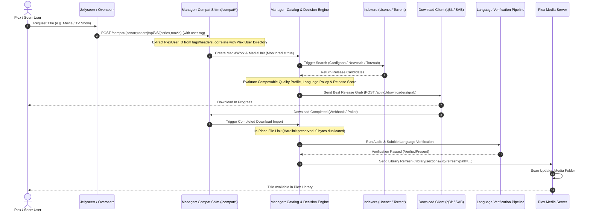
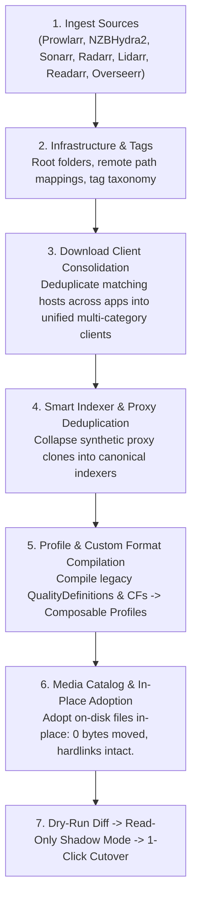

# Ecosystem, *arr Compatibility Shims, and In-Place Migration

Managerr serves as a unified replacement for the traditional multi-app media stack (`Sonarr`, `Radarr`, `Lidarr`, `Readarr`, `Prowlarr` / `NZBHydra2`, `Maintainerr`, and request managers). To ease transitions, Managerr provides two integration systems:

1. **Virtual `*arr` Compatibility Shims:** HTTP API emulation layers for Sonarr v3, Radarr v3, Lidarr v1, Readarr v1, and Prowlarr v1 / Torznab, allowing existing third-party applications (such as Jellyseerr, Overseerr, Bazarr, and mobile apps) to communicate with Managerr without modification.
2. **In-Place Migration Wizard (`Managerr.Migration`):** A migration and shadow-sync engine capable of ingesting live running instances or offline database backups (`.db` / `.zip`), deduplicating indexers and download clients, adopting existing media files in-place without breaking hardlinks, and validating operations through a read-only Shadow Mode before cutover.

---

## 1. Virtual `*arr` Compatibility Shims

Instead of requiring external tools and ecosystem managers to build native Managerr integrations, Managerr exposes compatibility shims mounted under `/compat/*`:

| Emulated Application | Mount Base URL | Emulated API Version | Primary Ecosystem Consumers |
| :--- | :--- | :--- | :--- |
| **Sonarr** | `/compat/sonarr` | `api/v3` | Overseerr, Jellyseerr, Bazarr, LunaSea, Homarr, Homepage |
| **Radarr** | `/compat/radarr` | `api/v3` | Overseerr, Jellyseerr, Bazarr, LunaSea, Homarr, Homepage |
| **Lidarr** | `/compat/lidarr` | `api/v1` | Overseerr/Jellyseerr (audio), Music metadata scrobblers |
| **Readarr** | `/compat/readarr` | `api/v1` | Book management frontends, Calibre-Web automations |
| **Prowlarr** | `/compat/prowlarr` | `api/v1` | Standalone *arr instances, Torznab/Newznab aggregators |
| **Torznab / Newznab** | `/api/v1/torznab/{indexerId}/api` | `v1` | Torznab-compatible release clients |

### 1.1 Architecture and Emulation Mechanics

Each compatibility shim translates legacy REST requests into Managerr's unified domain model on the fly:

* **System Status (`/system/status`):** Emulates instance runtime data, returning `appName`, `version`, `isDocker`, `migrationVersion`, and system health metrics expected by client libraries.
* **Root Folders (`/rootfolder`):** Maps Managerr's polymorphic libraries ([Catalog & Media Management](03-Catalog-Libraries-and-Media-Management)) to legacy root paths, reporting live free/total disk space via system `statvfs` calls.
* **Quality Profiles (`/qualityprofile`):** Translates Managerr's composable quality profiles ([Quality Profiles & Scoring](07-Quality-Profiles-Scoring-and-Language-Policies)) into legacy `QualityProfile` JSON structures with cutoff items and quality group hierarchies.
* **Tags (`/tag`):** Provides a two-way tag bridge. Tags assigned in legacy clients (such as requester identity tags in Overseerr) are mapped to Managerr internal tag IDs and tracked in application state.
* **Commands (`/command`):** Handles legacy automation commands, such as `RssSync` (triggers Managerr automated RSS sync), `DownloadedEpisodesScan`, `RefreshSeries`, `RescanMovie`, and `MissingEpisodeSearch`.
* **Release Push (`/release/push`):** Accepts release payloads pushed from indexers or webhooks, passing them into Managerr's Release Parser and Decision Engine.

### 1.2 Compatibility Settings (`GET/PUT /api/v1/compat/settings`)

Under **Settings -> Migration / Compatibility** (or via `GET /api/v1/compat/settings` and `PUT /api/v1/compat/settings`), administrators can toggle compatibility behavior:

* **`compat.sonarr.expand_single_season_anime`**: When enabled, single-season or collapsed anime works requested or queried via the Sonarr `/compat/sonarr` shim expand episode structures cleanly across cour boundaries so Overseerr/Jellyseerr season selectors align with AniList/TVDB seasons.

### 1.3 Dual-Readarr Instance Resolution (Ebooks vs. Audiobooks)

In legacy setups, users frequently ran two separate Readarr instances: one for `ebooks` and one for `audiobooks`. Managerr unifies both formats into a single canonical book work containing dual edition slots. To support legacy clients targeting a specific format, the Readarr shim determines the target format slot through three mechanisms:

1. **Explicit Query Parameter:** Passing `?slot=ebook` or `?slot=audiobook`.
2. **HTTP Header:** Sending `X-Readarr-Slot: audiobook` or `X-Readarr-Slot: ebook`.
3. **Scoped API Key Prefix:** Using an API key generated with the `mgr_readarr_audiobook_` prefix directs all inbound book operations to the audiobook edition slot automatically.

### 1.4 Torznab and Prowlarr Indexer Proxy Emulation

Managerr natively functions as a Torznab/Newznab provider:
* **Capabilities Probe (`t=caps`):** Generates RFC-compliant XML declaring supported search modes (`search`, `tvsearch`, `movie`, `music`, `book`) and category taxonomies (e.g., 2000 for Movies, 5000 for TV, 3000 for Audio, 7000 for Books).
* **Search Queries (`t=search`, `t=tvsearch`, `t=movie`):** Translates incoming query parameters (`q`, `imdbid`, `tmdbid`, `tvdbid`, `season`, `ep`, `cat`) into Managerr's unified indexer search engine, returning an XML RSS feed containing enclosure download links, infohashes, seeders, leechers, and publication timestamps.
* **Direct Mounts:** Available via `/compat/prowlarr/{indexerId}/api` or `/api/v1/torznab/{indexerId}/api`.

---

## 2. Seerr / Overseerr / Jellyseerr Setup Guide

Integrating Overseerr or Jellyseerr with Managerr requires no changes to the Seerr codebase. You configure Managerr as standard Sonarr and Radarr servers.

### 2.1 Step-by-Step Configuration

1. **Obtain Scoped Compatibility API Keys:**
   Navigate to **System -> Security -> API Keys** or run the [Cutover Tool](#53-rollout-process-dry-run---shadow-mode---cutover) to generate API keys scoped to `compat:sonarr` and `compat:radarr`.
2. **Configure Radarr (Movies) in Seerr:**
   * **Server Name:** `Managerr (Movies)`
   * **Hostname / IP:** `managerr` (or your Docker container / LAN IP)
   * **Port:** `8989` (or configured Managerr port)
   * **Use SSL:** Off (or On if behind reverse proxy TLS)
   * **URL Base:** `/compat/radarr`
   * **API Key:** `<YOUR_COMPAT_RADARR_KEY>`
   * Click **Test**. Once green, select your **Default Quality Profile** and **Default Root Folder** (populated directly from Managerr libraries).
3. **Configure Sonarr (TV / Anime) in Seerr:**
   * **Server Name:** `Managerr (TV)`
   * **Hostname / IP:** `managerr`
   * **Port:** `8989`
   * **Use SSL:** Off
   * **URL Base:** `/compat/sonarr`
   * **API Key:** `<YOUR_COMPAT_SONARR_KEY>`
   * Click **Test**, select **Default Quality Profile**, **Default Root Folder**, and **Language Profile** (set to "Any" or "Original", as Managerr handles language rules natively).

### 2.2 Automatic Plex User Correlation

Overseerr tags all requests with the requester identity. Managerr's compatibility shim intercepts these tags and attributes the media request to the canonical `PlexUser` ([Authentication & RBAC](02-Authentication-RBAC-and-Security)):

* **Tag Matching Patterns:** Managerr parses tag strings matching `<plexId> - <username>`, `plexid-<plexId>`, or bare usernames.
* **Header Support:** If Seerr passes `X-Plex-User-Id`, Managerr directly binds the request to that Plex user.
* **User Rule Application:** Request ownership, per-user preferred languages (e.g., German dual-audio upgrade policies), and library visibility permissions are applied automatically without requiring external identity management.

### 2.3 End-to-End Seerr-to-Plex Lifecycle Diagram

The following diagram illustrates how a user request flows from Jellyseerr through Managerr's acquisition engine, download client, language verifier, and into Plex:



---

## 3. Notification Connections

Managerr features a centralized notification engine implementing `IMediaLifecycleNotificationSink`. Configured under **Settings -> Connect**, notifications notify external services and media servers whenever lifecycle events occur.

### 3.1 Supported Notification Providers

| Provider | Description | Required Connection Settings |
| :--- | :--- | :--- |
| **Plex Media Server** | Triggers targeted library section refresh for newly imported media | `serverUrl`, `token` (Plex Token), `sectionId` (optional, defaults to `all`) |
| **Signed Webhook** | Dispatches standard JSON payloads signed with `HMAC-SHA256` | `url`, `method` (`POST`/`PUT`), `hmacSecret` (optional secret key) |
| **Discord** | Formatted embed messages with event color coding | `webhookUrl`, `username` (optional) |
| **Telegram** | Alerts sent through a Telegram bot | `botToken`, `chatId`, `apiBaseUrl` (optional) |
| **Gotify** | Self-hosted push notifications with adjustable priority | `serverUrl`, `appToken`, `priority` (default `5`) |
| **Ntfy** | HTTP pub/sub push notifications | `serverUrl` (default `https://ntfy.sh`), `topic`, `accessToken` (optional) |
| **Apprise** | Dispatches notifications via an external Apprise microservice | `apiUrl`, `urls` (Apprise service URLs) |
| **Jellyfin / Emby** | Triggers media library rescan | `serverUrl`, `apiKey` |

### 3.2 Notification Lifecycle Triggers

Each connection can be fine-tuned to trigger only on specific events:

* **On Grab (`onGrab`):** Fired when an indexer release candidate is approved and sent to a download client.
* **On Import (`onImport`):** Fired when a downloaded media file is adopted and linked into the library.
* **On Upgrade (`onUpgrade`):** Fired when a newly imported file replaces an existing file (quality upgrade or language policy upgrade).
* **On Rename (`onRename`):** Fired when disk reorganization or renaming executes.
* **On Delete (`onDelete`):** Fired when media works, containers, or files are removed.
* **On Health Issue (`onHealthIssue`):** Fired on indexer connectivity errors, disk full warnings, or quarantine alerts.
* **On Application Update (`onApplicationUpdate`):** Fired when a new version of Managerr is installed.
* **Tag Filtering (`tags`):** Restricts notifications to media works assigned matching tags.

### 3.3 HMAC-SHA256 Signed Webhook Security

For automated infrastructure and webhook consumers, Managerr cryptographically signs each payload to prevent spoofing and replay attacks:

* **Signature Header:** `X-Managerr-Signature: sha256=<hex_digest>` (calculated over raw UTF-8 body using configured `hmacSecret`).
* **Timestamp & Delivery Headers:** Dispatches also include `X-Managerr-Timestamp: <unix_epoch>` and `X-Managerr-Delivery-Id: <uuid>`.
* **`instanceName` Field:** Outbound webhook payloads automatically populate `instanceName` from the configured general setting `system.general.instance_name` (default: `Managerr`).
* **Payload Structure:**
  ```json
  {
    "eventType": "OnImport",
    "instanceName": "Managerr",
    "timestamp": "2026-11-15T12:00:00Z",
    "title": "Managerr: Media Imported",
    "message": "Imported 'Frieren: Beyond Journey's End' S01E01 [WEBDL-1080p] [de, ja]",
    "workId": 42,
    "workTitle": "Frieren: Beyond Journey's End",
    "mediaVertical": "anime",
    "episodeCode": "S01E01",
    "releaseTitle": "Frieren.S01E01.1080p.CR.WEB-DL.AAC2.0.H.264-VARYG",
    "quality": "WEBDL-1080p",
    "languages": ["de", "ja"],
    "isUpgrade": false,
    "destinationPath": "/media/anime/Frieren/Season 01/Frieren - S01E01 - The Journey's End.mkv"
  }
  ```

---

## 4. Automated Import Lists

Automated Import Lists sync titles from external discovery platforms and add them to Managerr's catalog on a recurring schedule.

### 4.1 Supported List Providers

| List Type Key | Provider | Media Vertical | Required Settings & Notes |
| :--- | :--- | :--- | :--- |
| `tmdb_popular` | The Movie Database | `movie` / `tv` | Fetches popular titles. Requires `apiKey` (or uses global TMDB key). |
| `tmdb_trending` | The Movie Database | `movie` / `tv` | Fetches trending titles of the week. Requires `apiKey`. |
| `trakt_popular` | Trakt.tv | `movie` / `tv` | Fetches popular Trakt shows/movies. Requires `clientId`. |
| `stevenlu` | StevenLu Movie List | `movie` | Curated popular movies (`https://popular-movies-data.stevenlu.com/movies.json`). |
| `anilist_trending` | AniList GraphQL | `anime` | Fetches trending anime series directly from AniList's public GraphQL API. |
| `openlibrary_subject` | Open Library | `books` | Syncs books by subject taxonomy (e.g. `science_fiction`, `history`). |
| `custom_json` | Custom JSON URL / Inline | Any | Ingests custom JSON arrays from a remote HTTP URL or inline raw JSON. |

### 4.2 List Configuration and Automatic Search

* **Library Assignment:** Each list targets a specific destination Library.
* **Quality Profile & Monitor Mode:** Items added by the list inherit the selected Composable Quality Profile and Monitor Mode (`all`, `future`, `latest`, `none`).
* **Minimum Availability:** Enforces release status thresholds (`announced`, `inCinemas`, `released`).
* **Search On Add (`searchOnAdd`):** When enabled, Managerr immediately executes a wanted search for newly discovered items upon import list synchronization.
* **Per-List Sync Interval (`syncIntervalHours`):** Configurable between 1 and 168 hours (default: 12 hours). The `ImportListSync` background scheduler honors each list's individual `syncIntervalHours` and skips lists whose interval has not elapsed since their last sync.
* **Result Limit (`limit`):** Configurable fetch limit up to **500 items** per sync run.
* **Import List Exclusions:** Titles added to the Exclusions list (`/api/v1/import-lists/exclusions`, or added by Cleanerr's `action.add_import_exclusion`) are permanently ignored during sync runs, preventing unwanted items from re-appearing after deletion.

### 4.3 RFC 5545 iCalendar (.ics) Subscription Feed

External calendar clients (Google Calendar, Apple Calendar, Outlook, Nextcloud) can subscribe to scheduled media releases via live iCalendar feeds:

* **Endpoints:** `/feed/v1/calendar/managerr.ics` and `/api/v1/calendar/managerr.ics`.
* **Query Parameters:**
  * `pastDays` (default `7`): Days of historical releases to include.
  * `futureDays` (default `60`): Window of upcoming releases.
  * `vertical`: Filter by vertical (`tv`, `movie`, `anime`, `music`, `books`).
  * `unmonitored`: Include unmonitored catalog items (`true`/`false`).
  * `tags`: Comma-separated tags to filter releases.
* **Authentication:** Secured via API key parameter `?apikey=<YOUR_API_KEY>` or standard bearer token.

---

## 5. In-Place Migration Wizard

Migrating existing root folders, hardlinked torrents, TRaSH custom formats, and seeding torrents from an existing `*arr` stack to Managerr is handled by the **Migration Engine (`Managerr.Migration`)**.

### 5.1 Ingestion Modes

Managerr supports two ingestion modes, which can be used individually or combined:

1. **Live REST API Connector (No File Copying):**
   * Connects directly to running instances of Sonarr, Radarr, Lidarr, Readarr, and Prowlarr via HTTP/HTTPS and API key (`/api/v3`, `/api/v1`).
   * Supports **Live Token Probing** (`POST /api/v1/migration/arr-api/probe`) to test connectivity, detect instance schema version, inspect root folders, and count catalog items before importing.
   * Enables continuous delta syncing during the testing phase.
2. **Offline Database & Backup Reader (`.db` / `.zip`):**
   * Reads raw SQLite databases directly: `sonarr.db`, `radarr.db`, `lidarr.db`, `readarr.db`, `prowlarr.db`, `nzbhydra.yml` / `nzbhydra.mv.db`, `cleanerr.db`, and `overseerr.db`.
   * Directly queries schema tables (`Series`, `Movies`, `EpisodeFiles`, `QualityProfiles`, `CustomFormats`, `History`, `Blocklist`), automatically adapting to schema versions across Sonarr v3, v4, v5, and Radarr v4/v5.

---

### 5.2 Deterministic 7-Phase Migration Pipeline



#### Phase 1: Infrastructure and Tags
Imports root folders and maps them to Managerr libraries. Remote path mappings are translated, and legacy tags are imported into Managerr's global tag store.

#### Phase 2: Download Client Consolidation
Legacy setups typically configure the same download client (e.g. qBittorrent or SABnzbd) multiple times across Sonarr, Radarr, Lidarr, and Readarr using different category names (`tv-sonarr`, `radarr`, `music`, `books`).
* **Normalization:** Clients matching on `(Implementation, Host, Port, Username)` are consolidated into **one unified Managerr Download Client**.
* **Category Preservation:** Legacy category names are preserved in `categoryMappings`. Active seeding torrents in qBittorrent continue tracking without category resets, path breaks, or re-checks.

#### Phase 3: Indexer and Proxy Deduplication
A user running Prowlarr or NZBHydra2 typically has dozens of synthetic Torznab/Newznab proxy copies synced into Sonarr, Radarr, Lidarr, and Readarr.
* **Canonical Import:** Canonical indexers, proxies (e.g., FlareSolverr, SOCKS5), and cookie states are imported directly from Prowlarr or NZBHydra2.
* **Proxy Clone Elimination:** Managerr identifies and discards synthetic aggregate proxy entries (`(Prowlarr)`, `(NZBHydra2)`) from individual *arr databases, keeping only genuinely unique standalone indexers.

#### Phase 4: Quality Profile and Custom Format Compiler
* **Profile Compilation:** Allowed qualities, quality grouping, and cutoff specifications are compiled into Managerr's composable profile architecture ([Quality Profiles & Scoring](07-Quality-Profiles-Scoring-and-Language-Policies)).
* **Automatic Language Rule Uplift:** When Custom Formats containing language rules (such as TRaSH Guides `"German"`, `"Multi"`, `"Dual Audio"`) are detected, the wizard offers an automatic uplift:
  * *Option A (Compat Mode):* Keep as raw trait score modifiers.
  * *Option B (Recommended Uplift):* Promote rules into a native **Language Policy** with quality-floor protection and language upgrade capabilities.

#### Phase 5: Media Catalog and In-Place File Adoption
* **Zero-Touch File Guarantee:** Adopting media files **never moves, renames, remuxes, or touches bytes on disk**. Managerr executes filesystem `stat` checks to verify file existence, records inode and size, and marks items as `LanguageVerificationStatus = ImportedUnverified`.
* **Hardlink Preservation:** Existing hardlinks between seeding torrent storage and library root folders remain fully intact.
* **Overseerr User Correlation:** Plex user IDs and Overseerr media requests are correlated with the canonical `PlexUser` directory ([Authentication & RBAC](02-Authentication-RBAC-and-Security)), preserving request ownership and quotas.

---

### 5.3 Rollout Process: Dry-Run -> Shadow Mode -> Cutover

To ensure operator confidence before decommissioning legacy services, Managerr provides a three-stage rollout process:

#### Stage 1: Interactive Dry-Run Report
Executing a dry run (`POST /api/v1/migration/plan`) analyzes all sources and produces a summary:
* Discovered media counts: series, movies, artists, books, episode files, movie files, track files.
* Deduplicated indexer count vs. skipped proxy clones.
* Consolidated download clients and preserved category maps.
* **Path Remapper:** Flags any discrepancies between Docker container paths (e.g., `/data/tv` vs. `/media/tv`) and allows inline path translation before execution.

#### Stage 2: Read-Only Shadow Mode
Managerr can operate alongside existing `*arr` instances in **Shadow Mode**:
* Managerr's RSS sync poller processes live indexer feeds and evaluates incoming releases against migrated profiles.
* Shadow decisions are logged in a comparison dashboard (`GET /api/v1/migration/shadow-decisions`), contrasting Managerr's decision against the legacy app (e.g., *"Managerr would have grabbed X (LanguageUpgrade) whereas Sonarr rejected (Cutoff Met)"*).
* **No Disk/Client Interaction:** In Shadow Mode, no releases are sent to download clients and no disk modifications occur.

#### Stage 3: Cutover
When ready to switch (`POST /api/v1/migration/cutover`):
1. **Final Incremental Delta Sync:** Ingests any media items or grabs that occurred during the shadow evaluation period.
2. **Legacy Automation Shutdown:** Optionally calls the legacy `*arr` REST APIs to disable `EnableRss` and `EnableAutomaticSearch`, preventing duplicate grabs while keeping containers available for cold rollback.
3. **Scoped Compatibility Keys:** Generates scoped `/compat/*` API keys with ready-to-copy mount URLs for immediate insertion into Jellyseerr, Bazarr, and monitoring dashboards.

### 5.4 Rollback Safeguards

If an operator decides to revert during evaluation, the Rollback API (`POST /api/v1/migration/rollback`) safely removes migrated catalog entries, indexers, download clients, and profile compilation artifacts from Managerr's database, while strictly honoring the zero-touch file guarantee (`BytesMovedOrModified = 0`). On-disk media files are never deleted or modified.

---

## 6. Next Steps and Related Documentation

* [REST API v1 Reference](11-REST-API-v1-Reference): Detailed reference for all `/api/v1/migration/*` and `/compat/*` endpoints.
* [Authentication, RBAC & Security](02-Authentication-RBAC-and-Security): Configuring scoped API keys and Plex user directory mappings.
* [Quality Profiles & Language Policies](07-Quality-Profiles-Scoring-and-Language-Policies): Fine-tuning composable profiles and language upgrades after migration.
* [Download Clients & Activity](06-Download-Clients-Import-and-Activity): Managing consolidated download clients and import post-processing.
