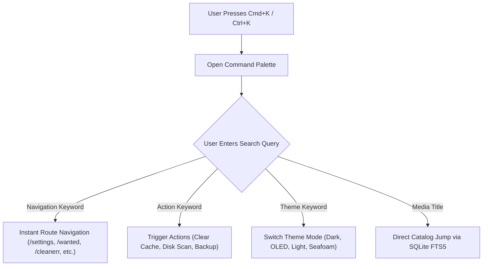
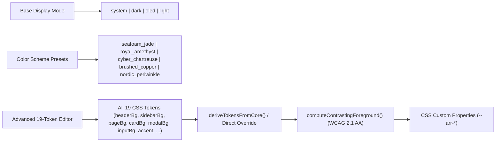
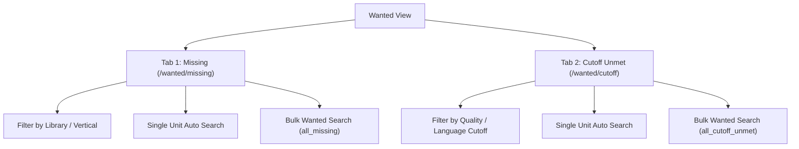
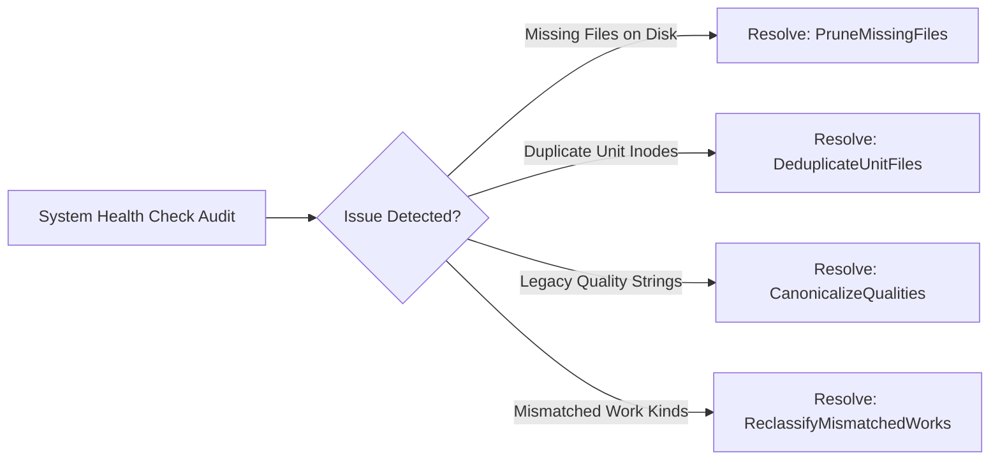
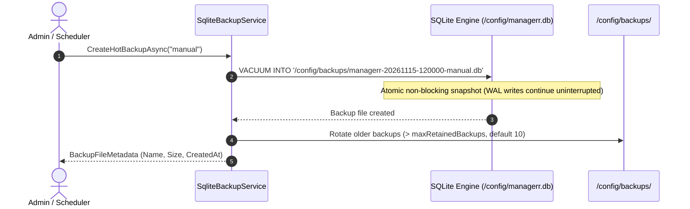

# UI Tour, Theme Studio & System Operations

Managerr includes a React single-page frontend served alongside the backend service. Built for administration across desktop, tablet, and mobile displays, the interface combines real-time SignalR notifications, keyboard navigation through a global Command Palette, a 19-token Theme Studio with WCAG AA contrast validation, Cleanerr lifecycle management, and background system health checks.

---

## Full Web UI Navigation Tour

The Managerr interface (`App.tsx`) is organized into dedicated functional domains. Navigation is dynamically filtered according to the authenticated user's Role-Based Access Control (RBAC) permissions.

```mermaid
graph TD
    Root["Managerr Web Application"]
    Root --> Lib["Library (/library)"]
    Root --> Cal["Calendar (/calendar)"]
    Root --> Wan["Wanted (/wanted)"]
    Root --> Act["Activity (/activity)"]
    Root --> Cln["Cleanerr (/cleanerr)"]
    Root --> Set["Settings (/settings)"]
    Root --> Sys["System (/system)"]

    Lib --> L1["Catalog Grid (/library)"]
    Lib --> L2["Add New Media (/library/add)"]
    Lib --> L3["Media Requests (/library/requests)"]
    Lib --> L4["Work Detail (/works/:id)"]

    Wan --> W1["Missing Units (/wanted/missing)"]
    Wan --> W2["Cutoff Unmet (/wanted/cutoff)"]

    Act --> A1["Queue (/activity/queue)"]
    Act --> A2["History (/activity/history)"]
    Act --> A3["Blocklist (/activity/blocklist)"]
    Act --> A4["Manual Import (/activity/manual-import)"]
    Act --> A5["Release Parser (/activity/parser)"]
    Act --> A6["Quarantine (/activity/quarantine)"]

    Cln --> C1["Overview (/cleanerr)"]
    Cln --> C2["Lifecycle Studio (/cleanerr/studio)"]
    Cln --> C3["Leaving Soon Queue (/cleanerr/queue)"]
    Cln --> C4["Media Catalog (/cleanerr/media)"]
    Cln --> C5["Exclusions (/cleanerr/exclusions)"]
    Cln --> C6["Discord & Settings (/cleanerr/discord)"]

    Set --> S1["General (/settings/general)"]
    Set --> S2["Media Management (/settings/media)"]
    Set --> S3["Profiles (/settings/profiles)"]
    Set --> S4["Indexers (/settings/indexers)"]
    Set --> S5["Download Clients (/settings/downloaders)"]
    Set --> S6["Connect (/settings/connect)"]
    Set --> S7["Import Lists (/settings/import-lists)"]
    Set --> S8["Metadata (/settings/metadata)"]
    Set --> S9["Migration (/settings/migration)"]
    Set --> S10["Users & Roles (/settings/users, /settings/roles)"]

    Sys --> Y1["System Status & Tasks (/system/status)"]
    Sys --> Y2["SQLite Backups (/system/backup)"]
    Sys --> Y3["Security & Tokens (/system/security)"]
    Sys --> Y4["System Events (/system/events)"]
```



### Route Index & Descriptions

| View / Route | Display Title | Description & Capabilities | Required RBAC Scope |
| :--- | :--- | :--- | :--- |
| **`/library`** | Media Library | Virtualized card and table grid of all cataloged works. Houses filter bubbles, sorting controls (`title`, `year`, `added` / `dateAdded` / `addedAt`, `missing`, `rating`), and multi-select bulk editing. | `catalog:read` |
| **`/library/add`** | Add New Media | Unified search bar across all 20 metadata providers. Allows configuring library target, monitor presets, and initial availability. | `catalog:write` |
| **`/library/requests`**| Media Requests | Queue of requested movies, series, books, and music submitted by non-admin users. Allows one-click approval, modification, or rejection. | `catalog:read` |
| **`/works/:id`** | Work Detail View | Hierarchical view of a single intellectual property: season/container breakdown, media files, audio/subtitle tracks, and manual search. | `catalog:read` |
| **`/calendar`** | Calendar | Interactive monthly/weekly release calendar with air date tracking, calendar popovers, and links to authenticated iCal subscription feeds. | `catalog:read` |
| **`/wanted/missing`** | Wanted: Missing | Surfaces all monitored media units that have aired or released but lack a physical media file on disk. Supports targeted and bulk searches. | `catalog:read` |
| **`/wanted/cutoff`** | Wanted: Cutoff Unmet | Tracks media units that possess a physical file on disk, but the file fails to meet the target quality profile or audio language policy. | `catalog:read` |
| **`/activity/queue`** | Activity Queue | Real-time download client progress bar, ETA telemetry, active client states (queued, downloading, paused), and strike status. | `queue:read` |
| **`/activity/history`**| History | Audit trail of grabbed releases, completed imports, upgrades, and automated cleanup actions. | `queue:read` |
| **`/activity/blocklist`**| Blocklist | Releases flagged for corruption, language mismatches, password protection, or repeated download failures. | `queue:read` |
| **`/activity/manual-import`**| Manual Import | Interactive folder scanner allowing administrators to match un-imported files to catalog works and override quality/edition tags. | `queue:manage` |
| **`/activity/parser`** | Release Parser | Live test sandbox to paste raw torrent/NZB release titles and verify regex extraction (title, year, resolution, source, audio, release group).| `system:admin` |
| **`/activity/quarantine`**| Quarantine | Review dashboard for media files that failed deep FFprobe or Whisper AI language verification. Listen to audio snippets and override verdicts. | `quarantine:review` |
| **`/cleanerr`** | Cleanerr Overview | Storage telemetry across libraries, reclaim forecast buckets, staged Leaving Soon summary, and Discord Gateway connection state. | `cleanerr:read` |
| **`/cleanerr/studio`** | Cleanerr Studio | Visual Lifecycle DAG Studio (`@xyflow/react`) and Maintainerr-compatible Rule Builder with YAML import/export, dry-run simulator, and Test Media inspector. | `cleanerr:read` |
| **`/cleanerr/queue`** | Leaving Soon Queue | Manage staged cleanup items, postpone grace timers, rescue titles, exclude whole series, or execute immediate deletions. | `cleanerr:read` |
| **`/cleanerr/media`** | Cleanerr Media Catalog | Inspect synced Plex and Managerr media metadata (watch counts, view dates, hardlinks, Seerr requester status) used by Cleanerr rules. | `cleanerr:read` |
| **`/cleanerr/exclusions`** | Cleanerr Exclusions | Create and manage global or workflow-scoped exclusions by media item, tag, Plex label, Plex user, or Seerr user. | `cleanerr:read` |
| **`/cleanerr/discord`** | Cleanerr Discord & Settings | Configure Discord Gateway bot, Ed25519 Interactions, webhook notifications, auth modes, grace/postpone defaults, `TorrentDownloadsPath`, and Seerr reset integration. | `cleanerr:read` |
| **`/settings/general`**| General Settings | Instance name, rolling quota window, MCP Server enabled toggle (`system.mcp.enabled`), auth/reverse-proxy settings, and Theme Studio. | `system:admin` |
| **`/settings/media`** | Media Management | Library root folder CRUD (`defaultProfileId`, `metadataWaterfall`), file renaming templates, hardlink toggles, and unmapped file management. | `catalog:read` |
| **`/settings/profiles`**| Profiles | Composable Quality Profiles, Trait Mixins CRUD, Custom Formats scoring, Wanted Language Policies CRUD, and verification confidence thresholds. | `profiles:read` |
| **`/settings/indexers`**| Indexers | Cardigann YAML selector, Torznab/Newznab indexer configurations, `requestDelayMs`, `tags`, and Indexer Proxies (`flaresolverr`, `byparr`, `http`, `socks4`, `socks5`). | `indexers:read` |
| **`/settings/downloaders`**| Download Clients | qBittorrent, Transmission, Deluge, SABnzbd, NZBGet, and Aria2 client connections, `urlBase`, `priority`, `watchFolder`, and `categoryMappings`. | `downloaders:read` |
| **`/settings/connect`** | Connect / Notifications | Webhook notifications, Discord, Telegram, Ntfy, Gotify, Apprise, Jellyfin/Emby, and Plex library refresh triggers. | `catalog:read` |
| **`/settings/import-lists`**| Import Lists | Automated sync lists (TMDb, StevenLu, Trakt, AniList, Open Library, Custom JSON) with per-list `syncIntervalHours` and limits up to 500. | `catalog:read` |
| **`/settings/metadata`**| Metadata Providers | Provider API keys, custom base URLs, and custom HTTP metadata webhook definitions. | `catalog:read` |
| **`/settings/migration`**| Import / Migration | Shadow migration, SQLite/API ingestion from legacy Radarr/Sonarr/Lidarr/Readarr/Prowlarr, and `/compat/*` settings. | `migration:read` |
| **`/settings/users`** | Users | Multi-tenant user management, Plex synchronization, user editing modal (`PATCH /api/v1/users/{id}`), and Passkey bindings. | `users:read` |
| **`/settings/roles`** | Roles & Permissions | RBAC role definitions, assigning any of the 36 permission scopes, `allowedLibraryIds` picker, and request quotas. | `users:read` / `roles:manage` |
| **`/system/status`** | System Status & Tasks | Health ping, OS/runtime telemetry, database sizes, self-healing resolution actions, and all 10 customizable scheduled tasks (interval, enable toggle, Run Now). | `system:admin` / `queue:read` |
| **`/system/backup`** | SQLite Backup | Manage atomic `VACUUM INTO` database backups, configure max retained backup count, trigger manual hot backups, and inspect archive files. | `system:admin` |
| **`/system/security`**| Security | Manage active API keys, scoped machine tokens with expiration and library scoping, and WebAuthn/Passkey authenticators. | `system:admin` |
| **`/system/events`** | System Events | Centralized audit log capturing logins, configuration changes, Cleanerr live executions, API access, and operational errors. | `audit:read` |

---

## Global Command Palette (`Cmd+K` / `Ctrl+K`)

Managerr incorporates a command palette (`CommandPaletteModal.tsx`) accessible from any view via standard keyboard shortcuts:
* macOS: <kbd>Cmd</kbd> + <kbd>K</kbd>
* Linux / Windows: <kbd>Ctrl</kbd> + <kbd>K</kbd>



### Command Categories

1. **Navigation**: Quick-jump to any application view (e.g., typing `"indexers"` jumps directly to `/settings/indexers`; typing `"cleanerr"` navigates to `/cleanerr`; typing `"quarantine"` navigates to `/activity/quarantine`).
2. **Actions**: Instant execution of high-frequency tasks:
   * `"Trigger Backup Now"`: Initiates an immediate SQLite hot backup.
   * `"Scan Libraries"`: Launches a disk scan for new and unmapped media.
   * `"Sync RSS"`: Polls all enabled indexers for newly released torrents and NZBs.
3. **Themes**: Instant toggle between `Light`, `Dark`, `OLED Black`, and preset color schemes without opening Settings.
4. **FTS5 Catalog Jump**: Typing any media title queries the SQLite FTS5 index, displaying matching work cards directly within the palette dropdown for instant navigation.

---

## General Settings & MCP Toggle

Under **Settings -> General** (`/settings/general`), administrators configure core instance options:
* **Instance Name (`system.general.instance_name`):** Sets the instance name displayed in the browser header and attached to outbound webhook `instanceName` payloads.
* **MCP Server Enabled (`system.mcp.enabled`):** Enables or disables the `/api/v1/mcp` and `/mcp` AI agent endpoints at runtime (default `true`; can also be overridden at startup via `Managerr__Mcp__Enabled`).
* **Rolling Request Quota Window (`system.quotas.rolling_window_days`):** Sets the rolling day window (default `30` days) used to evaluate per-role movie, TV season, and music/book request quotas.

---

## Real-Time Push Engine (SignalR Hub)

Managerr pushes backend state updates to the browser over persistent connections instead of polling.

### Hub Architecture (`/api/v1/realtime`)

The frontend establishes a persistent WebSocket connection to the SignalR hub (`RealtimeHub` in `Program.cs`). If WebSockets are blocked by corporate proxies or strict firewall rules, the client automatically falls back to Server-Sent Events (SSE) via `/api/v1/realtime/stream`.

### Authentication & Token Handshake

SignalR connections use the same security model as REST endpoints:
* **HttpOnly Cookies**: Standard browser sessions authenticate using the session cookie.
* **Token Query Handshake**: For headless dashboards or cross-origin embedding, the connection handler accepts an `access_token` query parameter during the initial WebSocket HTTP upgrade request (`/api/v1/realtime?access_token=<token>`), as defined in `ManagerrAuthenticationHandler.cs`.

### Broadcast Scopes & UI Reactivity

Events are grouped into broadcast scopes:
* `download_progress`: Pushes real-time download speeds, ETA seconds, and byte counts to the Activity Queue.
* `import_completed`: Notifies the catalog that a release has finished importing, updating unit badges from missing to completed instantly.
* `task_progress`: Streams background task execution states and progress percentages.
* `cleanerr.updated`: Pushes Cleanerr workflow execution, Leaving Soon queue, exclusion, and Discord interaction updates across open Cleanerr views.
* `health_alert`: Dispatches warning notifications when a library storage mount drops or an indexer fails.

---

## Theme Studio & WCAG AA Contrast Validation

Managerr includes a **Theme Studio** (`theme.ts` and `ThemeCustomizerSection.tsx`) under **Settings -> General** that allows administrators to configure interface colors with automated contrast validation and an **Advanced 19-Token Editor**.



### Built-In Color Schemes

Managerr includes five built-in color schemes:

1. **`seafoam_jade`** *(Default)*: Servarr-familiar jade and seafoam accents (`#2dd4bf`) paired with deep slate backgrounds.
2. **`royal_amethyst`**: Deep violet and amethyst purple tones (`#c084fc`) designed for dark viewing environments.
3. **`cyber_chartreuse`**: High-contrast neon chartreuse (`#a3e635`) on dark slate.
4. **`brushed_copper`**: Warm metallic amber and copper accents (`#f59e0b`) on dark earth tones.
5. **`nordic_periwinkle`**: Arctic blue and soft lavender periwinkle (`#818cf8`) for a balanced, modern workspace.
6. **`custom`**: Custom mode unlocking the full 19-token editor for manual configuration of every UI token.

### Base Display Modes

* **`system`**: Synchronizes automatically with the operating system's light/dark preference.
* **`dark`**: Standard dark gray interface optimized for desktop environments.
* **`oled`**: True `#000000` pitch-black backgrounds, maximizing energy efficiency on OLED monitors and mobile devices.
* **`light`**: High-contrast, clean daylight canvas.

### Full 19-Token Theme Catalog & Advanced Editor

The Advanced Token Editor exposes all **19 distinct theme tokens** mapped directly to CSS custom properties, allowing individual color customization for headers, borders, sidebars, toolbars, cards, modals, inputs, primary buttons, and accent foregrounds:

```css
:root {
  --arr-header-bg: #09211e;
  --arr-header-bg-end: #0e2a26;
  --arr-header-border: #134e4a;
  --arr-sidebar-bg: #071917;
  --arr-sidebar-border: #040d0c;
  --arr-sidebar-active-bg: #0d3834;
  --arr-heading-bg: #09211e;
  --arr-toolbar-bg: #09211e;
  --arr-filter-bar-bg: #09211e;
  --arr-page-bg: #051412;
  --arr-card-bg: #081e1b;
  --arr-card-border: #113833;
  --arr-modal-bg: #081e1b;
  --arr-input-bg: #051412;
  --arr-accent: #2dd4bf;
  --arr-accent-fg: #061816;
  --arr-logo-secondary: #99f6e4;
  --arr-primary: #14b8a6;
  --arr-primary-hover: #0d9488;
  --arr-primary-border: #0f766e;
}
```

### WCAG AA Mathematical Contrast Validation

To prevent unreadable text when administrators select custom accent colors, Managerr enforces WCAG 2.1 relative luminance calculations (`computeContrastingForeground` in `theme.ts`):

1. **sRGB Linearization**: The hex color is decomposed into normalized red, green, and blue components, linearized via gamma expansion:
   $$V_{\text{linear}} = \begin{cases} \frac{V}{12.92} & \text{if } V \le 0.03928 \\ \left(\frac{V + 0.055}{1.055}\right)^{2.4} & \text{if } V > 0.03928 \end{cases}$$
2. **Relative Luminance Calculation**:
   $$L = 0.2126 \times R_{\text{linear}} + 0.7152 \times G_{\text{linear}} + 0.0722 \times B_{\text{linear}}$$
3. **Threshold Enforcement**:
   $$\text{Foreground} = \begin{cases} \text{\#061816 (Dark)} & \text{if } L > 0.42 \\ \text{\#ffffff (White)} & \text{if } L \le 0.42 \end{cases}$$

This mathematical threshold guarantees a minimum contrast ratio of **4.5:1** (WCAG AA standard for normal text) for any dynamic text rendered over the accent color (such as action buttons and badges).

### JSON Theme Import & Export

Themes can be backed up, shared, or imported using standard JSON payloads conforming to `managerr-theme/v1`:

```json
{
  "schema": "managerr-theme/v1",
  "name": "Nordic Slate Custom",
  "baseMode": "dark",
  "tokens": {
    "headerBg": "#0f172a",
    "accent": "#38bdf8",
    "logoSecondary": "#7dd3fc",
    "primary": "#0284c7",
    "sidebarBg": "#0b1120",
    "pageBg": "#030712",
    "cardBg": "#0f172a",
    "cardBorder": "#1e293b",
    "modalBg": "#0f172a",
    "inputBg": "#030712",
    "headerBgEnd": "#1e293b",
    "headerBorder": "#334155",
    "sidebarBorder": "#020617",
    "sidebarActiveBg": "#1e293b",
    "headingBg": "#0f172a",
    "toolbarBg": "#0f172a",
    "filterBarBg": "#0f172a",
    "primaryHover": "#0369a1",
    "primaryBorder": "#075985"
  }
}
```

---

## Wanted View: Missing & Cutoff Unmet

The Wanted View (`WantedView.tsx`) serves as the central hub for identifying and acquiring content needed to complete libraries.



### Missing Tab (`/wanted/missing`)
* Lists all media units that are flagged as monitored and have an air date in the past, but have no associated media file on disk.
* Displays work title, container (season/volume), unit number, air date, and assigned quality profile.

### Cutoff Unmet Tab (`/wanted/cutoff`)
* Surfaces media units that already possess a physical file on disk, but the file fails to satisfy the minimum thresholds defined in the work's Composable Quality Profile or Wanted Language Policy (e.g., currently stored in 720p HDTV when 1080p WEB-DL is allowed, or missing a mandatory German audio track).

### Targeted & Bulk Wanted Searches
* **Per-Unit Auto Search**: Clicking the magnifying glass next to any missing or cutoff-unmet unit triggers an on-demand indexer query (`/api/v1/catalog/works/{workId}/units/{unitId}/auto-search`), automatically evaluating candidates and grabbing the highest-scoring release.
* **Bulk Wanted Search (`POST /api/v1/wanted/search`)**:
  * Modes: `selected` (only checked units), `all_missing` (entire missing backlog), or `all_cutoff_unmet`.
  * Returns a structured `WantedBulkSearchReport`:
    * `targetedUnitsCount`: Number of items submitted for searching.
    * `searchedGroupsCount`: Number of aggregated search queries dispatched to indexers.
    * `candidatesEvaluated`: Total torrent and NZB candidates scored by profiles.
    * `grabbedCount`: Number of approved releases pushed to download clients.

---

## System Status & Health Diagnostics

The **System Status** dashboard (`/system/status`) provides low-level telemetry into the host environment, database engines, storage mounts, and all 10 scheduled background tasks.

### Host & Runtime Telemetry
* **OS & Environment**: Operating system name, kernel version, machine architecture (`x86_64`, `arm64`), and host container environment.
* **Runtime**: .NET Runtime version, garbage collection mode, thread pool telemetry, and application uptime.
* **Database Telemetry**: File sizes, WAL (Write-Ahead Log) sizes, and page counts across all three managed databases:
  * `/config/managerr.db` (Core relational datastore)
  * `/config/cache.db` (Hybrid SQLite metadata and image cache)
  * `/config/telemetry.db` (Rolling metrics and activity logs)

---

## Self-Healing Health Checks & Resolution Actions

Managerr actively audits system state every 10 minutes (`ScheduledTaskKeys.HealthCheck`). When anomalies or collection hygiene issues are identified, they are reported as actionable health issues (`SystemHealthCheckItem`):



### Automated Resolution Actions

Administrators can resolve detected issues with a single click in the UI or via `POST /api/v1/system/health/resolve/{actionKey}`:

| Action Key | Problem Solved | Self-Healing Mechanism |
| :--- | :--- | :--- |
| **`CanonicalizeQualities`** | Media files imported from legacy Arr setups containing non-canonical quality names (e.g., `"WEBDL-1080p"` instead of standard `"WEB-DL-1080p"`). | Parses raw strings through the canonical quality resolver and updates database records without re-scanning files. |
| **`PruneMissingFiles`** | Database entries pointing to files that were manually deleted or moved outside Managerr. | Verifies file existence on the host filesystem and prunes orphaned database records, resetting the corresponding units to missing. |
| **`DeduplicateUnitFiles`** | Accidental duplicate files attached to the same media unit (e.g., after repeated manual imports). | Evaluates quality scores across duplicate files, retains the highest-scoring file, and unlinks or archives the inferior duplicate. |
| **`ReclassifyMismatchedWorks`**| Media works assigned to a library whose media type contradicts the work kind (e.g., a movie stored in a TV library). | Evaluates metadata and reclassifies the work, adjusting unit structures and container kinds to match the parent library. |

---

## Scheduled Background Tasks (10 Tasks)

Managerr manages **10 background tasks** (`BackgroundTaskSchedulerService.cs`). Directly on **`/system/status`**, administrators can inspect last run timestamps, execution durations, trigger manual on-demand execution (`Run Now` via `POST /api/v1/system/tasks/{taskKey}/run`), and **customize each task's execution interval (`intervalSeconds`) and enabled state (`isEnabled`)** via `PATCH /api/v1/system/tasks/{taskKey}`:

| Task Key | Name | Default Interval | Description & Responsibilities |
| :--- | :--- | :--- | :--- |
| **`RefreshMonitoredDownloads`** | Refresh Monitored Downloads | **60 seconds** | Polls active download clients, updates Tracked Download CDH state, imports completed downloads, and auto-repulls failed releases. |
| **`RssSync`** | RSS Sync & Auto-Grab | **15 minutes** (900s) | Dispatches search queries across enabled indexer RSS feeds, evaluates Composable Profiles, and grabs approved releases. |
| **`QueueHealthCheck`** | Queue Health & Strike Sweep | **5 minutes** (300s) | Evaluates stalled or unsafe downloads, applies strikes to failing releases, blocklists repeat offenders, and triggers automatic replacements. |
| **`HealthCheck`** | System Health Check | **10 minutes** (600s) | Audits indexers, download client reachability, library root accessibility, free disk space, and quarantine backlog. |
| **`DiskScanLibraries`** | Disk Scan & Unmapped Files | **6 hours** (21,600s) | Scans library root folders to detect external file additions, prune deleted files, and index unmapped media. |
| **`ImportListSync`** | Import List Sync | **6 hours** (21,600s) | Polls enabled Import Lists (TMDb, Trakt, AniList, StevenLu, OpenLibrary, Custom JSON) honoring each list's `syncIntervalHours`, and queues non-excluded items. |
| **`RefreshCatalogMetadata`** | Nightly Metadata Refresh | **24 hours** (86,400s) | Refreshes upstream metadata for continuing monitored works, updates localized titles, and prunes expired cache entries. |
| **`SqliteBackup`** | SQLite WAL Hot Backup | **24 hours** (86,400s) | Generates an atomic hot backup of `managerr.db` using SQLite's online `VACUUM INTO` command. |
| **`RetentionAndVacuum`** | Database Retention & VACUUM | **24 hours** (86,400s) | Prunes aged verification logs, media history, and reviewed quarantine snippets, running `VACUUM` and WAL truncation if thresholds are met. |
| **`CleanerrEvaluation`** | Cleanerr Lifecycle Evaluation | **15 minutes** (900s) | Syncs catalog media into Cleanerr, evaluates scheduled lifecycle workflows, processes grace expirations, runs auto-rescues, and sends final warnings. |

---

## SQLite Hot Backups & Restore

Managerr uses SQLite's online backup capability (`SqliteBackupService.cs`) to create snapshots while write operations continue.



### Hot Backup Principles

* **Atomic `VACUUM INTO`**: Backups are created by issuing SQLite's `VACUUM INTO '<destination>'` command. This creates a fully defragmented, consistent snapshot of `managerr.db` without locking read or write operations in the main application.
* **Compact Archive Scope**: Ephemeral caches (`cache.db`) and rolling metrics (`telemetry.db`) are intentionally excluded from backup archives. This keeps backup files small (typically 10-50 MB) and ensures fast generation times.
* **Configurable Retention (`GET/PUT /api/v1/system/backups/settings`)**: Administrators can configure the **Max Retained Backups** count (`maxRetainedBackups`, range `1` to `100`, default `10`) directly under `/system/backup`. Older backup files beyond the configured limit are automatically rotated out.
* **Restoration**: To restore a backup, stop the Managerr container, copy the desired backup `.db` file over `/config/managerr.db`, remove any existing `managerr.db-wal` and `managerr.db-shm` files, and restart the daemon.

---

## Data Retention & Automatic `VACUUM` Policies

Over time, frequent indexer searches, language verifications, and download history create database fragmentation and accumulate obsolete audit logs. Managerr enforces automated retention cleanup (`SystemRetentionAndHealthService.cs`).

### Retention Policy Configuration (`SystemRetentionPolicyDto`)

Administrators can configure retention windows via `/system/backup` or `PUT /api/v1/system/retention`. Every day-based retention setting supports **`0` days** (which purges all eligible historical entries on the next `RetentionAndVacuum` run while preserving active pending/quarantined items):

| Policy Setting | Default Retention | Data Scope Purged (`0` = Purge All Eligible Now) |
| :--- | :--- | :--- |
| **`VerificationReportsRetentionDays`** | **90 days** | Deep FFprobe audio stream logs and Whisper speech-to-text transcript segments. |
| **`MediaHistoryRetentionDays`** | **365 days** | Historical release grab records, download client completion logs, and import events. |
| **`AuditAndJobLogsRetentionDays`** | **90 days** | User authentication logs, permission changes, and background task execution histories. |
| **`ReviewedQuarantineSnippetsRetentionDays`** | **30 days** | Extracted audio snippet `.wav`/`.opus` files on disk for releases whose quarantine verdicts have already been reviewed (pending items are preserved even at `0` days). |
| **`VacuumThresholdDeletedRows`** | **100 rows** | Minimum cumulative deleted rows required to trigger a full SQLite `VACUUM` cycle (`0` forces vacuum on threshold check). |

### Automatic Compaction & WAL Truncation

When the `RetentionAndVacuum` task executes:
1. It deletes records older than the configured day thresholds across all tables.
2. If the total number of purged rows exceeds `VacuumThresholdDeletedRows`, the engine executes an online `VACUUM` to rebuild the database file and reclaim unused disk space.
3. It issues `PRAGMA wal_checkpoint(TRUNCATE)` to checkpoint and truncate the Write-Ahead Log (`managerr.db-wal`) to zero bytes, minimizing filesystem footprint.

---

## Related Documentation

* [01. Getting Started & Self-Hosting](01-Getting-Started-and-Self-Hosting): Docker Compose configurations, persistent storage mounts, and reverse proxy setup.
* [02. Authentication, RBAC & Security](02-Authentication-RBAC-and-Security): Role-Based Access Control, 36 scopes, API keys, Passkeys, and session cookies.
* [03. Catalog, Libraries & Media Management](03-Catalog-Libraries-and-Media-Management): Catalog navigation, filter state persistence, and media organization.
* [06. Download Clients, Import & Activity](06-Download-Clients-Import-and-Activity): Activity Queue, strike handling, and Completed Download Handling (CDH).
* [08. Language Verification & Quarantine](08-Language-Verification-and-Quarantine): Reviewing quarantined audio snippets and managing verification reports.
* [13. Cleanerr Lifecycle Studio & Discord Bot](13-Cleanerr-Lifecycle-Studio-and-Discord-Bot): Visual DAG workflows, Leaving Soon queue, and interactive Discord bot.
* [11. REST API v1 Reference](11-REST-API-v1-Reference): Complete REST API reference for system status, scheduled tasks, backups, and retention.
