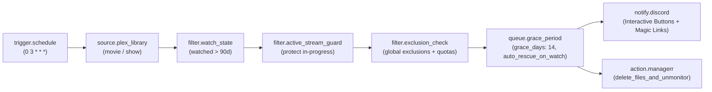

# Cleanerr Lifecycle Studio & Discord Bot

**Cleanerr** is Managerr's built-in media lifecycle automation and cleanup engine, replacing standalone tools like Maintainerr directly inside the Managerr service. It pairs a **Visual Lifecycle DAG Studio** (`@xyflow/react`), a **Maintainerr-Compatible Rule Builder** with YAML import/export, a native **Leaving Soon** deletion queue, and an **interactive Discord Bot** (Gateway + Ed25519 HTTP Interactions + HMAC Magic Links).

---

## 1. Cleanerr Architecture & Safety Guarantees

Cleanerr is engineered around four strict safety and operational principles:

### 1.1 Whole-Series Evaluation (No Per-Episode or Per-Season Drilldown)
Cleanerr evaluates **Movies** and **whole TV Series** as atomic units (`movie` and `show`). Individual episodes and seasons are never split out for partial deletion. When evaluating a TV series, Cleanerr aggregates playback across all child episodes (such as `tv.seriesActiveWatchDays`, total play count, and most recent view timestamp) so an actively watched show is never truncated mid-binge. Creating an exclusion for any child item automatically escalates to protect the whole series.

### 1.2 Native Leaving Soon Deletion Queue (Zero Plex Collection Modification)
Unlike legacy cleanup tools that create, populate, and prune Plex Collections ("Leaving Soon" collections), **Cleanerr never creates, reads, or modifies Plex Collections**. Plex is treated strictly as a read-only source of watch history, active sessions, labels, and watchlists (plus optional post-deletion library refresh/trash empty if explicitly configured on `action.plex`).

All staged cleanup candidates reside in Managerr's native **Leaving Soon Deletion Queue** (`/cleanerr/queue`), where they remain protected during their grace window (`grace_days`) and can be rescued, postponed, or excluded via the Web UI, REST API, MCP tools, or Discord.

### 1.3 Strict Library-Root File Deletion Safety Boundary
Whenever Cleanerr executes physical file deletion (`delete_files_and_unmonitor`, `delete_files_only`, `unmonitor_and_delete_existing`, `delete_work_and_files`, or `action.delete_files`), every candidate file path is canonicalized with `Path.GetFullPath(...)` and verified against configured Managerr library root folders (`libraries.root_folder_path`):
* Files outside configured library roots are **never deleted**.
* If no library roots are configured, physical `File.Delete` is skipped and logged.
* When `clean_empty_folders` is enabled, matching subtitle/NFO sidecars (`.srt`, `.ass`, `.ssa`, `.sub`, `.idx`, `.vtt`, `.nfo`) and empty parent directories strictly underneath the configured library root are pruned without touching the library root itself.

### 1.4 Hardlink-Aware Seeding Protection (`cleanerr.torrent_downloads_path`)
Cleanerr inspects `cleanerr.torrent_downloads_path` (default `/data/downloads`, configurable under **Cleanerr -> Discord & Settings**) and compares filesystem inodes (`st_ino` / link counts) to identify library media files that are hardlinked to active seeding torrents:
* Synced items carry `isHardlinked = true` (`file.isHardlinked`).
* Filter nodes (`filter.arr_seerr`, `filter.size_codec`, `filter.codec_density`) support `skip_hardlinked_seeding = true` to protect active seeding torrents from premature deletion.
* When `prune_torrent_client = true` is configured on an action, Cleanerr can remove the matching torrent and data via Managerr's download client orchestrator when executing cleanup.

---

## 2. Visual Lifecycle DAG Studio (`@xyflow/react`)

Available at **`/cleanerr/studio`**, the Visual Lifecycle DAG Studio provides a node-based workflow canvas powered by `@xyflow/react`. Workflows are serialized as JSON DAGs (`graphJson`) and evaluated topologically from triggers through sources, filters, combinators, limits, grace stages, notifications, and actions.

### 2.1 Trigger Nodes
| Node Type | Label | Key Configuration & Behavior |
| :--- | :--- | :--- |
| `trigger.schedule` | Cron Schedule Trigger | Runs automatically during the `CleanerrEvaluation` background task (every 15 minutes) according to a 5-field UTC cron expression (`cron`, e.g. `0 3 * * *`). |
| `trigger.storage_pressure` | Storage Pressure Trigger | Evaluates `min_free_gb_trigger` and `target_free_gb`; halts downstream cleanup unless drive free space falls below the trigger threshold. |
| `trigger.webhook` | Webhook Trigger | Fires when an inbound webhook arrives at `POST /api/v1/cleanerr/webhooks/{source}` matching `source` (e.g., `plex`, `radarr`, `sonarr`, `seerr`) and `event`. |
| `trigger.manual` | Manual / API Trigger | Executes only when invoked manually from the Studio UI, REST API, MCP (`cleanerr_run_workflow`), or Discord `/cleanerr run`. Includes the `allow_api` boolean gate (when `false`, rejects API/Discord triggers). |

### 2.2 Source Nodes
| Node Type | Label | Description |
| :--- | :--- | :--- |
| `source.plex_watch` / `source.plex_library` | Plex Watch / Library Source | Loads synced Plex media items filtered by `media_type` (`movie` or `show`) and `library_ids`. |
| `source.managerr_library` / `source.managerr_catalog` | Managerr Library / Catalog | Loads movies and whole TV series directly from the Managerr catalog by `media_type` and `library_ids`. |
| `source.tautulli` | Tautulli History | Loads library media enriched with playback history and viewer metrics. |
| `source.arr_library` | Arr Library | Loads movies or series tracked by Managerr/Radarr/Sonarr. |
| `source.overseerr` | Overseerr / Requests | Loads media items that originated from a user request (optionally filtered by `requested_by`). |

### 2.3 Filter & Guard Nodes
| Node Type | Label | Key Parameters |
| :--- | :--- | :--- |
| `filter.watch_state` | Watch State Filter | `last_watched_older_than_days`, `unwatched_added_older_than_days`, `view_count_gte`, `watched_by_user`, `protect_in_progress`, `protect_until_requester_watched`. |
| `filter.metadata` | Size & Metadata Filter | `size_gt_gb`, `resolution`, `rating_lt`, `year_lt`, `genre`. |
| `filter.age` | Added / Release Age | `added_older_than_days`, release year thresholds. |
| `filter.size_codec` | Size & Video Codec | `size_gt_gb`, `resolution`, `video_codec`, `skip_hardlinked_seeding`. |
| `filter.tags_labels` | Tags, Labels & Genres | `has_tags`, `exclude_tags`, Plex labels, genres, and `classification` taxonomy filters. |
| `filter.arr_seerr` | Arr / Seerr Filter | `include_tags`, `exclude_tags`, `monitored_only`, `seerr_requested_by`, `seerr_requested_older_than_days`, `skip_hardlinked_seeding`. |
| `filter.active_stream_guard` | Active Stream Guard | `protect_in_progress` (blocks items with active playback or `viewOffsetMs > 0`), `protect_active_series` (blocks series with active episode streams). |
| `filter.disk_space` | Disk Space Guard | `min_free_gb`, `target_free_gb`; halts downstream nodes unless free disk space is below `min_free_gb`. |
| `filter.limit` | Limit / Reclaim Budget | `max_items`, `max_reclaim_gb`, `sort_by` (`oldest_watched`, `largest_first`, etc.) to cap items or reclaimed bytes per run. |
| `filter.exclusion_check` | Exclusion Rules Guard | Filters out items protected by Cleanerr exclusion rules. Supports `respect_global_exclusions` (boolean), `respect_user_quotas` (boolean), `excluded_tags`, and `excluded_users`. |

### 2.4 Logic & Combinator Nodes
| Node Type | Label | Behavior |
| :--- | :--- | :--- |
| `logic.and` | Logical AND | Outputs only media items present in every connected upstream branch. |
| `logic.or` | Logical OR | Outputs the union of media items from all connected upstream branches. |
| `logic.not` | Logical NOT (Subtract) | Subtracts items in subsequent upstream branches from the first upstream branch. |
| `logic.rule_group` | Maintainerr Rule Group | Embeds a full Maintainerr-compatible multi-section boolean rule group directly inside a DAG workflow. |

### 2.5 Grace Queue & Notification Nodes
| Node Type | Label | Key Parameters |
| :--- | :--- | :--- |
| `queue.grace_period` | Grace Period Stage | Stages matched items in Managerr's Leaving Soon queue for `grace_days` days before executing downstream actions. Setting **`grace_days: 0`** bypasses waiting and executes immediately. Supports **`auto_rescue_on_watch`** (automatically rescues staged items if playback starts during grace). |
| `notify.discord` | Discord Notification | Sends a formatted Discord summary or interactive staged alert embed (with buttons and magic links). |
| `notify.webhook` | Outbound Webhook | POSTs a JSON summary payload for matched items to a configured webhook URL. |

### 2.6 Action Nodes
| Node Type | Action Modes / Options | Description |
| :--- | :--- | :--- |
| `action.managerr` | `unmonitor_only` `delete_files_and_unmonitor` `delete_files_only` `unmonitor_and_delete_existing` `downgrade_profile` `delete_work_and_files` `delete_show_if_empty` `unmonitor_show_if_empty` `add_import_exclusion` `prune_torrent_client` (boolean) | Executes lifecycle cleanup on Managerr catalog works/files. `downgrade_profile` switches the work to `target_profile_id`; `add_import_exclusion` adds the title to `import_list_exclusions`; `prune_torrent_client` removes linked torrents from the download client. |
| `action.plex` | `refresh_library_and_empty_trash` `refresh_library` `empty_trash` `unmatch` `delete_item` | Runs targeted Plex maintenance after cleanup (refreshing library sections, emptying trash, unmatching, or removing item metadata). |
| `action.seerr` | `reset_media_status` `delete_request` | Updates native Managerr requests (`cleaned_reset`) and optionally resets media status or removes the request in Overseerr/Jellyseerr so users can re-request later. |
| `action.webhook` | `url`, `include_items` (boolean) | Dispatches an outbound JSON webhook notification upon cleanup execution, optionally embedding the list of affected media items (`include_items`). |

---

## 3. Maintainerr-Compatible Rule Builder & YAML Import/Export

For operators migrating from Maintainerr or preferring structured rule tables over node graphs, **`/cleanerr/studio`** provides a **Rule Builder** editor mode (`editorMode: "rules"`):

* **`useRules` Toggle:** Enables or disables rule-section evaluation (when `useRules: false`, the rule group matches all items in the selected libraries without filtering).
* **Multi-Library Selection (`libraryIds`):** Target one or more Managerr libraries (`movie` or `show`).
* **Boolean OR/AND Sections:** Organize rules into numbered sections joined by `AND` / `OR` section connectors (`SectionOperator`) and per-rule `AND` / `OR` operators (`Operator`).
* **21 Comparators & Property-vs-Property Comparisons:** Supports `EQUALS`, `NOT_EQUALS`, `BIGGER`, `SMALLER`, `CONTAINS`, `NOT_CONTAINS`, `CONTAINS_PARTIAL`, `NOT_CONTAINS_PARTIAL`, `CONTAINS_ALL`, `NOT_CONTAINS_ALL`, `BEFORE`, `AFTER`, `IN_LAST`, `NOT_IN_LAST`, `IN_NEXT`, `COUNT_EQUALS`, `COUNT_NOT_EQUALS`, `COUNT_BIGGER`, `COUNT_SMALLER`, `EXISTS`, and `NOT_EXISTS`, across 38 catalog, file, Plex, TV rollup, Seerr request, and disk fields (`catalog.*`, `file.*`, `plex.*`, `tv.*`, `request.*`, `system.*`). Rules can also compare one field against `SecondField`.
* **`pruneTorrentClient` Toggle:** Instructs the compiled action to remove linked torrent jobs from the download client during deletion.
* **YAML Import & Export:** Export any workflow (`GET /api/v1/cleanerr/workflows/{id}/yaml`) or paste Maintainerr-style YAML definitions into the Import Modal (`POST /api/v1/cleanerr/workflows/import-yaml`).
* **Built-In Templates:** Includes ready-to-use templates (`GET /api/v1/cleanerr/templates`), including *Stale Watched Movies (90d + 14d Leaving Soon Grace)*, *Stale Watched TV Series (180d + 14d Leaving Soon Grace)*, *4K Profile Downgrade after 120d*, and *Seerr Requested Unwatched Cleanup*.

---

## 4. Simulation, Test Media Diagnostics & Live-Impact Safeguards

Cleanerr enforces multiple verification layers so workflows never delete unintended media:

### 4.1 Dry-Run Simulation (`simulatedFreeSpaceGb` & `simulatedFreeSpacePercent`)
Every workflow defaults to `dryRun: true`. Clicking **Simulate** in the Studio (`POST /api/v1/cleanerr/workflows/simulate` or `POST /api/v1/cleanerr/workflows/{id}/simulate`) executes the full DAG or Rule Group without staging or deleting any files:
* Returns per-node `inputCount`, `outputCount`, `sizeBytes`, matched item previews, and execution logs.
* Accepts optional **`simulatedFreeSpaceGb`** and **`simulatedFreeSpacePercent`** overrides so operators can test `trigger.storage_pressure` and `filter.disk_space` thresholds without filling real disks.

### 4.2 Single-Item Test Media Diagnostics
The **Test Media** modal (`POST /api/v1/cleanerr/rules/test-media` or `POST /api/v1/cleanerr/workflows/{id}/test-media`) evaluates a single movie or TV series against a workflow and prints:
* Whether the item `wouldMatch`, `isExcluded` (and `exclusionReason`), or `isCurrentlyStaged`.
* Per-section and per-condition pass/fail traces showing actual field values vs. expected targets.
* Guard notes (such as hardlink seeding protection, active stream guard, or global exclusions).

### 4.3 Live-Impact Confirmation Safeguards
Switching a workflow from `dryRun: true` to `dryRun: false` (or creating/importing an enabled live workflow) triggers a **Live-Impact Preview** (`POST /api/v1/cleanerr/workflows/preview-live-impact`):
* Displays exact counts of affected items, total GiB, movies vs. series, unwatched count, and items requested by other users.
* The backend rejects live activation with `400 Bad Request` (`ERR_CLEANERR_LIVE_CONFIRMATION_REQUIRED`) unless **`confirmWorkflowName`** (in the request body, query string, or `X-Confirm-Workflow-Name` header) matches the workflow's exact name.
* Live activation and immediate queue deletions (`delete-now`) are permanently recorded in `/system/events` audit logs.

---

## 5. Interactive Discord Bot & Cleanerr Settings

Configured under **`/cleanerr/discord`**, Cleanerr supports three complementary Discord channels:

### 5.1 Transport Modes
1. **Discord Gateway Bot (`BotToken`):** Maintains an outbound WebSocket connection to the Discord Gateway, automatically discovering guilds and text channels (`GET /api/v1/cleanerr/discord/discover`), syncing `/cleanerr` slash commands (`POST /api/v1/cleanerr/discord/sync-commands`), and handling slash commands, autocomplete, buttons, and select menus without requiring an inbound public HTTPS port. Includes a **Reconnect** button (`POST /api/v1/cleanerr/discord/reconnect`) and optional `GatewayPassiveShadowMode`.
2. **Ed25519 HTTP Interactions (`/api/v1/cleanerr/webhooks/discord-interactions`):** Verifies `X-Signature-Ed25519` and `X-Signature-Timestamp` headers using `PublicKeyHex` for reverse-proxied public Discord Interaction endpoints.
3. **Fallback Outbound Webhook (`WebhookUrl`):** Posts Leaving Soon notifications and final warnings via Discord Webhook using customizable **`WebhookBotUsername`** (default `"Cleanerr"`).

### 5.2 `/cleanerr` Slash Commands & Interactive Controls
| Command | Required Cleanerr Scope | Behavior |
| :--- | :--- | :--- |
| `/cleanerr status` | `cleanerr:read` | Shows Cleanerr storage overview, staged Leaving Soon count, and active exclusions. |
| `/cleanerr leaving-soon [page]` | `cleanerr:read` | Paginates staged Leaving Soon items with interactive **Exclude** and **+Nd Postpone** buttons and select menus. |
| `/cleanerr why <title>` | `cleanerr:read` | Runs the Test Media diagnostics explainer (with title autocomplete) to show why a movie or series matched or is protected. |
| `/cleanerr exclude <title>` | `cleanerr:exclude` | Excludes a movie or whole TV series from Cleanerr deletion. |
| `/cleanerr postpone <title> [days]` | `cleanerr:rescue` | Postpones a staged item's deletion date by `days` (defaults to `DefaultPostponeDays`). |
| `/cleanerr exclusions` | `cleanerr:read` | Lists active Cleanerr exclusion rules. |
| `/cleanerr run <workflow>` | `cleanerr:execute` | Triggers a Cleanerr workflow run directly from Discord. |

### 5.3 HMAC-Signed 1-Click Magic Links
Notifications and embeds can include single-use, expiring HMAC-SHA256 signed links rooted at `PublicBaseUrl` so household users can act directly from a notification without logging into the Web UI:
* `GET /api/v1/cleanerr/webhooks/magic/exclude?media_id=...&sig=...`
* `GET /api/v1/cleanerr/webhooks/magic/postpone?media_id=...&days=...&sig=...`
* `GET /api/v1/cleanerr/webhooks/magic/rescue?media_id=...&sig=...`
* `GET /api/v1/cleanerr/webhooks/magic/exclude-all?workflow_id=...&sig=...`

### 5.4 Discord Authorization Modes (`AuthMode`)
* **`channel_members`:** Any member in the configured notification channel can use read/rescue/exclude commands.
* **`discord_roles`:** Restricts interactive Discord actions to users holding specific Discord role IDs (`AllowedRoleIds`).
* **`linked_plex_rbac`:** Maps the Discord user to a linked Managerr/Plex user account and enforces Managerr's RBAC scopes (`cleanerr:read`, `cleanerr:rescue`, `cleanerr:exclude`, `cleanerr:execute`) and role exclusion quotas.

### 5.5 General Cleanerr & Discord Settings
Under `/cleanerr/discord`, operators can customize:
* **`DefaultGraceDays`** (default `7`): Default grace period days for manual staging and templates.
* **`DefaultPostponeDays`** (default `7`, range `1-365`): Default number of days added when clicking Postpone or running `/cleanerr postpone`.
* **`FinalWarningHours`** (default `24`): Hours before `DeleteAt` when Cleanerr sends a final warning notification (`NotifyOnFinalWarning`).
* **`TorrentDownloadsPath`** (`cleanerr.torrent_downloads_path`, default `/data/downloads`): Path scanned for inode-based hardlink seeding detection.
* **`WebhookBotUsername`** (default `"Cleanerr"`): Display username for outbound Discord webhook messages.
* **Notification Toggles:** `NotifyOnStaged`, `NotifyOnRescued`, `NotifyOnDeleted`, `NotifyOnFinalWarning`.
* **Seerr Integration (`SeerrUrl`, `SeerrApiKey`):** Connects Cleanerr to Overseerr/Jellyseerr to reset media status or remove requests when `action.seerr` executes.

---

## 6. Cleanerr REST API & 10 MCP Tools

### 6.1 Cleanerr REST API (`/api/v1/cleanerr/*`)
Cleanerr exposes full REST endpoints under `/api/v1/cleanerr/*` governed by the 5 Cleanerr RBAC scopes (`cleanerr:read`, `cleanerr:rescue`, `cleanerr:exclude`, `cleanerr:write`, `cleanerr:execute`). See [11. REST API v1 Reference](11-REST-API-v1-Reference#510-cleanerr-lifecycle-studio--discord-bot-cleanerrendpointscs) for the complete route, parameter, and scope table.

### 6.2 Cleanerr MCP Tools (10 Tools)
AI agents connected to `/api/v1/mcp` have access to 10 Cleanerr tools filtered by the caller's RBAC scopes:
1. `cleanerr_get_overview` (`cleanerr:read`)
2. `cleanerr_list_workflows` (`cleanerr:read`)
3. `cleanerr_simulate_workflow` (`cleanerr:read`): supports `workflowId` or inline `graphJson` / `ruleGroup` plus simulated disk space overrides.
4. `cleanerr_list_queue` (`cleanerr:read`)
5. `cleanerr_exclude_media` (`cleanerr:exclude`)
6. `cleanerr_test_media` (`cleanerr:read`)
7. `cleanerr_run_workflow` (`cleanerr:execute`)
8. `cleanerr_rescue_queue_item` (`cleanerr:rescue`)
9. `cleanerr_postpone_queue_item` (`cleanerr:rescue`)
10. `cleanerr_delete_exclusion` (`cleanerr:write`)

See [12. MCP Server & AI Agent Guide](12-MCP-Server-and-AI-Agent-Guide) for parameter schemas and least-privilege agent recipes.

---

## Related Documentation

* [02. Authentication, RBAC & Security](02-Authentication-RBAC-and-Security): Cleanerr RBAC scopes (`cleanerr:*`) and role exclusion quotas.
* [10. UI Tour, Theme Studio & System Operations](10-UI-Tour-Theme-Studio-and-System-Operations): `/cleanerr/*` views and the `CleanerrEvaluation` scheduled task.
* [11. REST API v1 Reference](11-REST-API-v1-Reference): Complete `/api/v1/cleanerr/*` REST endpoint table.
* [12. MCP Server & AI Agent Guide](12-MCP-Server-and-AI-Agent-Guide): All 40 MCP tools including the 10 Cleanerr tools.
