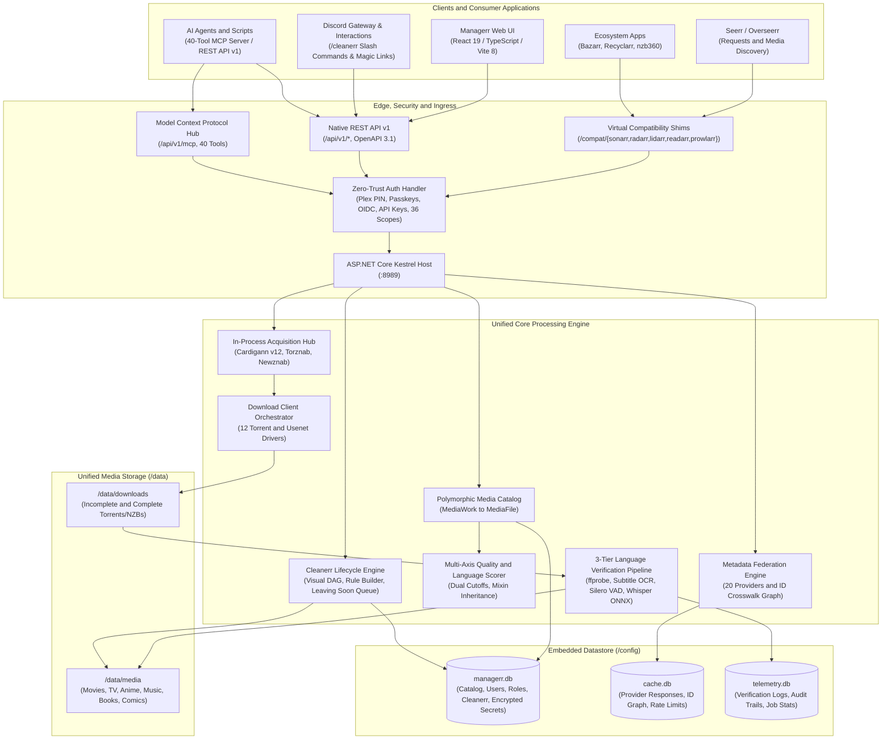

# Managerr Documentation Wiki

Welcome to the documentation wiki for **Managerr** (`v0.2.0`).

**Managerr** is a self-hosted media automation and lifecycle platform that replaces **Sonarr**, **Radarr**, **Lidarr**, **Readarr**, **Prowlarr / NZBHydra2**, and **Maintainerr** in a single `.NET 10` and `React 19 / TypeScript` service.

> [!NOTE]
> **Built-In Subsystems:** Core Acquisition, 3-Tier Language Verification, Polymorphic Catalog, Migration, Seerr Compatibility, and the **Cleanerr Lifecycle Studio & Discord Bot** are all built directly into Managerr on `main`. Only optional hardware AV1 compression remains separate.

---

## 1. System Architecture

Managerr uses a single-container architecture with embedded storage and no external database dependencies:

- **Embedded SQLite (`WAL` + `FTS5`) Storage:** Runs self-contained within `/config` (`managerr.db`, `cache.db`, `telemetry.db`). Requires no external PostgreSQL, MariaDB, Redis, or Elasticsearch containers.
- **In-Process Cardigann v12 & Indexer Hub:** Runs Newznab, Torznab, and user-supplied Cardigann YAML indexer definitions in-process with per-host rate limiting and proxy routing (FlareSolverr, Byparr, HTTP, SOCKS4/SOCKS5).
- **12 Supported Download Clients:** Direct native drivers for `qBittorrent`, `Deluge`, `Transmission`, `rTorrent`, `Flood`, `Vuze`, `aria2`, `SABnzbd`, `NZBGet`, `Pneumatic`, `torrent_blackhole`, and `usenet_blackhole`.
- **Pluggable Metadata Federation (20 Built-In Providers):** Queries and crosswalks IDs across TVDB, TMDB, MusicBrainz, AcoustID, Open Library, AniList, AniDB, TVMaze, Trakt, Discogs, Deezer, Hardcover, Audnexus, BookBrainz, Google Books, DNB, MangaDex, ComicVine, local sidecars (`NFO`/`OPF`), and indie folder tags.
- **3-Tier Language Verification Pipeline:** Inspects container metadata, analyzes interior subtitle/text OCR via Tesseract and Lingua, and runs local AI voice detection (`Silero VAD v5` + `Whisper.net` ONNX) to verify audio language before import.
- **Cleanerr Lifecycle Studio & Discord Bot:** Built-in visual DAG studio (`@xyflow/react`), Maintainerr-compatible rule builder with YAML import/export, native Leaving Soon deletion queue, hardlink-aware seeding protection, and interactive Discord Gateway + Ed25519 bot.
- **Plex-First Identity & Multi-Provider RBAC:** Native Plex PIN OAuth, PMS shared-library access gates, Passkeys (WebAuthn/FIDO2), Generic OIDC + PKCE SSO, break-glass admin login, 36 RBAC scopes, and custom roles.
- **Ecosystem & Automation APIs:** Virtual `/compat/{sonarr,radarr,lidarr,readarr,prowlarr}` API shims for Seerr, Overseerr, Bazarr, and nzb360, plus a 40-tool MCP server and 10 scheduled background tasks.

### High-Level Architecture



---

## 2. Multi-Vertical Capability Matrix

Managerr models seven media verticals using a polymorphic 5-tier entity graph (`MediaWork` -> `MediaContainer` -> `MediaUnit` -> `MediaEdition` -> `MediaFile`):

| Media Vertical | Canonical Hierarchy | Default Formats | Primary Metadata Providers | Key Capabilities & Differentiators |
| :--- | :--- | :--- | :--- | :--- |
| **Movies** | Work: Movie<br>Container: Single Feature<br>Unit: Feature Cut<br>Edition: IMAX / Director's / Theatrical<br>File: Video Stream | `.mkv`, `.mp4` | TMDB, TheTVDB, Trakt, local `NFO` | Replaces Radarr. Edition-aware releases, Custom Format multi-axis scoring, dual-audio preservation, and pre-import language verification. |
| **TV Series** | Work: Series<br>Container: Season / Specials<br>Unit: Episode (`SxxExx` / Absolute)<br>Edition: Broadcast / Uncut / Web<br>File: Video Stream | `.mkv`, `.mp4` | TheTVDB, TMDB, TVMaze, Trakt | Replaces Sonarr. Multi-season monitoring, season packs vs episode releases, anime absolute cross-mapping, and Plex library refresh integration. |
| **Anime** | Work: Series / Movie / OVA<br>Container: Season / Cour / Arc<br>Unit: Episode / Absolute Number<br>Edition: TV / Blu-ray / Web Uncensored<br>File: Video Stream | `.mkv`, `.mp4` | AniList, AniDB, TheTVDB, TMDB | Dual-numbering support (Absolute <-> Season/Episode), Japanese Romanized title parsing, Fansub release group tracking, and forced vs full subtitle verification. |
| **Music** | Work: Artist<br>Container: Release Group / Album<br>Unit: Track (`Disc-Track`)<br>Edition: Specific Album Release (e.g. 24-bit Hi-Res)<br>File: Audio Track | `.flac`, `.mp3`, `.opus`, `.alac` | MusicBrainz, AcoustID, Discogs, Deezer | Replaces Lidarr. Ingestion for unlisted and indie releases, Chromaprint acoustic fingerprinting, and TagLibSharp audio tag extraction. |
| **Ebooks** | Work: Literary Work<br>Container: Book Title<br>Unit: Ebook Format Slot<br>Edition: Publisher ISBN Edition<br>File: Digital Publication | `.epub`, `.azw3`, `.mobi`, `.pdf` | Open Library, Hardcover, Google Books, DNB, BookBrainz | Replaces Readarr. Native EPUB OPF and PDF structure parsing, interior chapter text language identification via Lingua, and independent monitoring slots. |
| **Audiobooks** | Work: Literary Work<br>Container: Book Title<br>Unit: Audiobook Format Slot<br>Edition: Narrator / ASIN Edition<br>File: Spoken Audio Track | `.m4b`, `.mp3` | Audnexus, Hardcover, Open Library, Google Books | Monitors both Ebook and Audiobook editions under the same book record without requiring separate containers. |
| **Comics / Manga** | Work: Comic Series / Manga<br>Container: Volume / Story Arc<br>Unit: Issue / Chapter<br>Edition: Digital Single / Omnibus / Scanlation<br>File: Comic Archive | `.cbz`, `.cbr`, `.pdf` | ComicVine, MangaDex, AniList | Volume vs Issue tracking, digital metadata extraction (`ComicInfo.xml`), scanlation team matching, and automated chapter packing. |

---

## 3. Quick-Start Guide

Quick-start setup using the interactive installation script:

```bash
# 1. Clone the repository
git clone https://github.com/m0ritz2k19/managerr.git
cd managerr

# 2. Run the interactive self-hosting setup script
scripts/selfhost-setup.sh --data-dir /srv/data
```

The script detects your host user ID (`PUID`) and group ID (`PGID`), creates the directory structure under `/srv/data`, writes `.env`, pulls or builds the container image (prebuilt images are published at `ghcr.io/m0ritz2k19/managerr:latest`), and launches Managerr on port `8989`.

Once started, open `http://<host-ip>:8989` in your browser. Complete the initial setup wizard by claiming the instance via **Sign in with Plex** or by creating an initial local administrative user.

For manual Docker Compose configuration, reverse proxy forwarded-header settings, and headless bootstrap setups, see [01. Getting Started & Self-Hosting](01-Getting-Started-and-Self-Hosting).

---

## 4. Documentation Index

Documentation index:

1. **[01. Getting Started & Self-Hosting](01-Getting-Started-and-Self-Hosting)**: Hardware and software prerequisites, `/data` single-mount layout for atomic hardlinks, `compose.yaml` deployment with `ghcr.io/m0ritz2k19/managerr:latest`, reverse-proxy CIDR configuration (including Tailscale `100.64.0.0/10`), the 4-service test stack (`Managerr` + `Seerr` + `SABnzbd` + `Plex`), embedded SQLite engine details, secret injection, and backup/restore workflows.
2. **[02. Authentication, RBAC & Security](02-Authentication-RBAC-and-Security)**: Sign in with Plex PIN OAuth and server binding, PMS server membership gating, Plex Home user switching, Generic OIDC + PKCE SSO with UI claim/group mappings, WebAuthn/FIDO2 passkeys, reverse-proxy header trust, break-glass local accounts, 36 RBAC scopes, custom roles with library scoping and rolling quotas, scoped `mgr_live_*` API keys, and instance master API key.
3. **[03. Catalog, Libraries & Media Management](03-Catalog-Libraries-and-Media-Management)**: The 5-tier polymorphic media model (`MediaWork` to `MediaFile`), library creation and editing, Plex library section binding, monitoring modes, file organization tokens across all verticals, and configurable fallback default profiles.
4. **[04. Metadata Federation & Crosswalk](04-Metadata-Federation-and-Crosswalk)**: The 20 built-in metadata providers, provider API key and custom base URL settings, custom HTTP metadata webhooks, waterfall fallback ordering, cross-provider ID translation graph, localized translations extraction, and field-level merge strategies.
5. **[05. Indexers & Release Search](05-Indexers-and-Release-Search)**: In-process Cardigann v12 YAML engine, Torznab and Newznab feed configuration, request pacing and tags, proxy routing (`flaresolverr`, `byparr`, `http`, `socks4`, `socks5`), rate limiters, and multi-wave release search.
6. **[06. Download Clients, Import & Activity](06-Download-Clients-Import-and-Activity)**: Configuring the 12 supported Usenet and BitTorrent clients, strict category isolation, `GrabHistory` localized title correlation, remote path mappings, queue state machine, pre-move language verification gate, and import automation.
7. **[07. Quality Profiles, Scoring & Language Policies](07-Quality-Profiles-Scoring-and-Language-Policies)**: Profile composition, multi-axis scoring (Quality, Language, Traits, Efficiency), trait mixins, dual cutoffs, dynamic original language matching, stream pruning retention lists, and quality-floor guardrails.
8. **[08. Language Verification & Quarantine](08-Language-Verification-and-Quarantine)**: Pre-import 3-tier inspection pipeline: container probing, subtitle/text OCR, center-channel speech identification with Silero VAD and Whisper ONNX, configurable confidence thresholds, quarantine management, and audio preview.
9. **[09. Ecosystem, *arr Compatibility & Migration](09-Ecosystem-Arr-Compat-and-Migration)**: Migration wizard from existing Sonarr/Radarr/Lidarr/Readarr/Prowlarr setups, live API and offline backup importers, shadow mode, virtual `/compat/*` API shims, anime season-expansion toggle, notifications, and import lists.
10. **[10. UI Tour, Theme Studio & System Operations](10-UI-Tour-Theme-Studio-and-System-Operations)**: React 19 SPA navigation (including `/cleanerr/*` views), table views, keyboard shortcuts, 19-token Theme Studio custom styling, system health diagnostics, 10 customizable scheduled tasks on `/system/status`, backup retention settings, and logging.
11. **[11. REST API v1 Reference](11-REST-API-v1-Reference)**: OpenAPI 3.1 specification, authentication headers, filtering, pagination, idempotency keys, RFC 9457 error details, and complete endpoint tables including `/api/v1/cleanerr/*`.
12. **[12. MCP Server & AI Agent Guide](12-MCP-Server-and-AI-Agent-Guide)**: Integrating Managerr with Claude Code, Cursor, Gemini CLI, and custom LLM agents via Model Context Protocol (MCP) endpoints across all 40 tools (12 Catalog + 18 Operations + 10 Cleanerr).
13. **[13. Cleanerr Lifecycle Studio & Discord Bot](13-Cleanerr-Lifecycle-Studio-and-Discord-Bot)**: Visual Lifecycle DAG Studio (`@xyflow/react`), Maintainerr-compatible rule builder with YAML import/export, whole-series evaluation, native Leaving Soon deletion queue, strict library-root deletion safety, hardlink seeding protection, interactive Discord Gateway/Ed25519 bot, HMAC magic links, and Cleanerr REST/MCP APIs.
